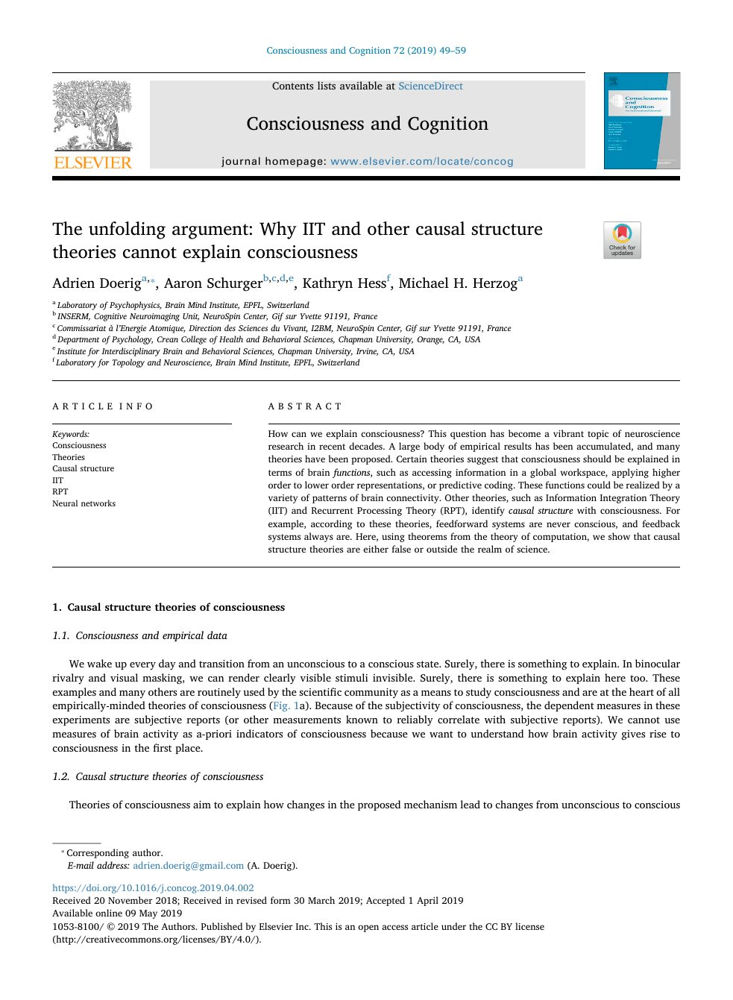
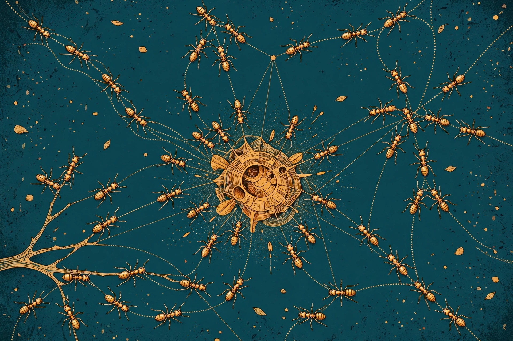

## ۱ چرا از «حضور» شروع می‌کنیم؟

ایدهٔ محوری این است: آگاهی به جنسِ اشیا وابسته نیست. مهم نیست اجزا نورون باشند یا مورچه یا زنبور؛ آگاهی از رابطهٔ میان آن‌ها و درهم‌تنیدگی‌شان شکل می‌گیرد. صورتِ فعلیِ این ایده چنین است: مجموعه‌ای از اشیا هنگامی آگاه می‌شوند که **در هم حضور داشته باشند** و یک **«منِ یکپارچه»** بسازند.

مشکل در همین دو تعبیر است. «حضور داشتن در هم» و «منِ یکپارچه» در شکل فعلی استعاره‌اند، نه تعریف. تا روشن نشود حضور یعنی چه، هیچ‌یک از پرسش‌های بعدی پاسخ‌پذیر نیست: چرا یک مجموعه «من» می‌سازد و مجموعه‌ای دیگر نمی‌سازد؟ مرز میان تعاملِ صرف و حضور کجاست؟ و آیا کلونی مورچه‌ها، که بی‌تردید هوش جمعی از خود نشان می‌دهد، آگاه هم هست یا نه؟

پس ترتیب کار برعکسِ وسوسهٔ معمول است: به جای آن‌که از تعریف آگاهی آغاز کنیم، از واژه‌ای آغاز می‌کنیم که تعریف آگاهی قرار است بر آن بنا شود.

## ۲ دام اصلی: حضورِ صرفاً رابطه‌ای

هشدار روش‌شناختی. اگر «حضور» فقط به معنای برهم‌کنش علّی یا تبادل اطلاعات باشد، بحث بی‌آن‌که متوجه شود به همان کارکردگرایی و تقلیل‌گرایی برمی‌گردد که از ابتدا محل نقد بود؛ زیرا هر سیستمِ به‌هم‌پیوسته‌ای، از ترموستات تا شبکهٔ برق، برهم‌کنش علّی و تبادل اطلاعات دارد. 

این دام واقعی است، نه فرضی. اگر معیار آگاهی «رابطه» باشد و رابطه هم چیزی جز اثرگذاری متقابل و جریان اطلاعات نباشد، آنگاه تمایز میان یک سیستم آگاه و یک سیستم صرفاً پیچیده از میان می‌رود و بحث دقیقاً به موضعی می‌رسد که محل نقد بود. نتیجهٔ عملیِ این یادداشت از همین‌جا می‌آید: حضور باید معنایی **بیش از رابطه** داشته باشد، و آن معنا باید آن‌قدر دقیق باشد که بتوان گفت در کجا هست و در کجا نیست.

## ۳ پنج معنای حضور

واژهٔ «حضور» در گفت‌وگوی روزمره و در متون فلسفی دست‌کم پنج معنای متفاوت دارد که معمولاً بی‌آن‌که از هم جدا شوند، با هم به کار می‌روند. کار این بخش فقط جداسازی است: برای هر معنا، تعریف، نمونه و آزمونی می‌آوریم که نشان دهد آن معنا به‌تنهایی برای آگاهی کافی هست یا نه.

نقشهٔ پنج معنا: از هم‌جواری تا هم‌وجودی

هرچه از راست به چپ می‌رویم، معنا عمیق‌تر و ادعایش سنگین‌تر می‌شود. دو معنای سمت چپ نامزدِ هستهٔ تعریف‌اند؛ دو معنای میانی شرط لازم‌اند؛ معنای سمت راست کنار گذاشته می‌شود.
<svg viewbox="0 0 920 210" xmlns="http://www.w3.org/2000/svg" aria-hidden="true"><line x1="40" y1="105" x2="880" y2="105" stroke="var(--line)" stroke-width="3"></line><g><circle cx="830" cy="105" r="34" fill="var(--paper)" stroke="var(--muted)" stroke-width="2"></circle><text x="830" y="113" text-anchor="middle" font-size="22" font-weight="800" fill="var(--muted)" class="svg-label">۵</text><text x="830" y="168" text-anchor="middle" font-size="16" font-weight="700" fill="var(--ink)" class="svg-label">هم‌جواری</text><text x="830" y="192" text-anchor="middle" font-size="13" fill="var(--muted)" class="svg-label">کنار گذاشته می‌شود</text></g><g><circle cx="635" cy="105" r="34" fill="var(--amber-wash)" stroke="var(--amber)" stroke-width="2"></circle><text x="635" y="113" text-anchor="middle" font-size="22" font-weight="800" fill="var(--amber)" class="svg-label">۱</text><text x="635" y="168" text-anchor="middle" font-size="16" font-weight="700" fill="var(--ink)" class="svg-label">حضور علّی</text><text x="635" y="192" text-anchor="middle" font-size="13" fill="var(--muted)" class="svg-label">شرط لازم، ناکافی</text></g><g><circle cx="460" cy="105" r="34" fill="var(--amber-wash)" stroke="var(--amber)" stroke-width="2"></circle><text x="460" y="113" text-anchor="middle" font-size="22" font-weight="800" fill="var(--amber)" class="svg-label">۲</text><text x="460" y="168" text-anchor="middle" font-size="16" font-weight="700" fill="var(--ink)" class="svg-label">حضور اطلاعاتی</text><text x="460" y="192" text-anchor="middle" font-size="13" fill="var(--muted)" class="svg-label">شرط لازم، ناکافی</text></g><g><circle cx="285" cy="105" r="38" fill="var(--teal)"></circle><text x="285" y="114" text-anchor="middle" font-size="24" font-weight="800" fill="#ffffff" class="svg-label">۳</text><text x="285" y="168" text-anchor="middle" font-size="16" font-weight="700" fill="var(--ink)" class="svg-label">علم حضوری</text><text x="285" y="192" text-anchor="middle" font-size="13" fill="var(--muted)" class="svg-label">هستهٔ تعریف</text></g><g><circle cx="95" cy="105" r="38" fill="var(--teal)"></circle><text x="95" y="114" text-anchor="middle" font-size="24" font-weight="800" fill="#ffffff" class="svg-label">۴</text><text x="95" y="168" text-anchor="middle" font-size="16" font-weight="700" fill="var(--ink)" class="svg-label">حضور وجودی</text><text x="95" y="192" text-anchor="middle" font-size="13" fill="var(--muted)" class="svg-label">هستهٔ تعریف</text></g></svg>

<article class="meaning">
۱<h3>حضور علّی</h3>شرط لازم، اما ناکافی

ساده‌ترین معنا: A در B حاضر است، یعنی بر آن اثر می‌گذارد و از آن اثر می‌پذیرد. در این معنا، حضور همان برهم‌کنش علّیِ متقابل است و درجه‌اش را می‌توان با قدرت و تراکمِ پیوندهای علّی سنجید.

<b>آزمون:</b> چرخ‌دنده‌های یک ساعت و اجزای یک مدار الکترونیکی دقیقاً به همین معنا در هم حاضرند، اما هیچ‌کس آن‌ها را آگاه نمی‌داند. پس حضور علّی، اگر هم لازم باشد، به‌تنهایی آگاهی نمی‌سازد.
</article>

<article class="meaning">
۲<h3>حضور اطلاعاتی و یکپارچه</h3>شرط لازم، اما ناکافی

در این معنا، اجزا هنگامی در هم حاضرند که حالتِ هر جزء برای کل «در دسترس» باشد و کل، بیش از مجموعِ جدا‌جدای اجزا اطلاعات داشته باشد. نزدیک‌ترین صورت‌بندیِ موجودِ این معنا در نظریهٔ IIT (Integrated Information Theory) است که یکپارچگی اطلاعات را با کمّیت Φ می‌سنجد: هرچه بریدنِ سیستم به دو نیمه، اطلاعات بیشتری را از بین ببرد، حضورِ متقابل اجزا بیشتر است.

<b>آزمون:</b> این معنا از معنای اول دقیق‌تر است، اما هنوز رفتاری و ساختاری است: از بیرون سنجیده می‌شود و دربارهٔ این‌که «از درون چه حسی دارد» چیزی نمی‌گوید. جعبهٔ آزمونِ بخش ۵ نشان می‌دهد تکیهٔ کامل بر این معنا چه بهایی دارد.
</article>

<article class="meaning">
۳<h3>علم حضوری</h3>نامزد هستهٔ تعریف

در سنت فلسفهٔ اسلامی، علم دو گونه است: علم حصولی، که در آن صورت و مفهومِ شیء نزد عالِم حاصل می‌شود و میان عالِم و معلوم واسطه هست؛ و <strong>علم حضوری</strong>، که در آن خودِ معلوم، بی‌واسطهٔ هیچ صورت و مفهومی، نزد عالِم حاضر است. روشن‌ترین نمونه‌اش حضورِ خود نزد خود است: انسان خودش را با واسطهٔ یک تصویر ذهنی نمی‌شناسد؛ خودش نزد خودش حاضر است.
<blockquote> «فالعلم الحضوري هو أتمّ صنفي العلم، بل العلم في الحقيقة ليس إلّا هو» ملاصدرا (Mulla Sadra)، <i>الحکمة المتعالیة فی الأسفار العقلیة الأربعة</i>، ج ۶، ص ۱۳۵؛ یعنی: علم حضوری کامل‌ترینِ هر دو صنف علم است، بلکه علم در حقیقت چیزی جز همان نیست.</blockquote>
در شرح همین مبنا گفته‌اند که ملاصدرا در <i>المشاعر</i> علم را «حضور وجود بدون پرده» می‌داند: علم چیزی جز حضورِ وجود، بدون حجاب، نیست. اگر این معنا را به رابطهٔ اجزا تعمیم دهیم، «حضور اجزا در هم» یعنی هر جزء برای جزء دیگر ـ و برای کل ـ صرفاً علت یا پیام‌رسان نیست، بلکه <strong>نزد او حاضر است</strong>؛ و این دقیقاً همان چیزی است که می‌تواند از یک مجموعه، یک «من» بسازد: من یعنی آن‌که اجزایش نزد خودش حاضرند.

<b>دشواری:</b> علم حضوری در اصل دربارهٔ رابطهٔ عالِم با معلوم است، نه رابطهٔ دو جزءِ بی‌جان با یکدیگر. تعمیم آن به اجزای یک سیستم، گام نظریِ اصلی است و باید جداگانه توجیه شود، نه این‌که بدیهی فرض شود.
</article>

<article class="meaning">
۴<h3>حضور وجودی</h3>نامزد هستهٔ تعریف

عمیق‌ترین معنا: اجزا هنگامی در هم حاضرند که در <strong>یک وجودِ واحد و درجه‌بندی‌شده</strong> شریک باشند، نه این‌که فقط بر هم اثر بگذارند. پشتوانهٔ این معنا در فلسفهٔ ملاصدرا، تشکیک وجود است: وجود حقیقتی واحد است که مراتب دارد و اختلاف مراتبش به شدت و ضعف است، مانند مراتب نور که نورِ قوی و نورِ ضعیف هر دو نورند و تفاوتشان در شدت است، نه در جنس.

در این معنا، «منِ یکپارچه» یک استعارهٔ ادبی نیست: یعنی مجموعه به مرتبه‌ای از وحدت وجودی رسیده است که اجزایش دیگر فقط کنار هم نیستند، بلکه شئون و مراتبِ یک وجودند. و چون وجود درجه‌بندی‌شده است، آگاهی هم می‌تواند درجه‌بندی‌شده باشد؛ نکته‌ای که در بخش ۶ به آن برمی‌گردیم.

<b>دشواری:</b> این معنا سنگین‌ترین بار متافیزیکی را دارد. اگر پذیرفته شود، باید روشن شود «شریک بودن در یک وجود» برای یک سیستم مشخص ـ مثلاً یک کلونی یا یک مغز ـ با چه نشانه‌ای شناخته می‌شود و چه سیستمی فاقد آن است.
</article>

<article class="meaning dropped">
۵<h3>هم‌حضوری زمانی ـ مکانی</h3>کنار گذاشته می‌شود

سطحی‌ترین معنا: دو چیز در یک زمان و یک مکان کنار هم باشند. سنگ‌های یک توده‌سنگ و مسافران یک واگن دقیقاً به همین معنا «با هم حاضرند»، بی‌آن‌که هیچ وحدتی بسازند.

<b>حکم:</b> این معنا هیچ کار توضیحی نمی‌کند و از تعریف کنار گذاشته می‌شود. ذکرش فقط برای این است که در کاربردهای بعدیِ واژه، دوباره از راه نرسد.
</article>

## ۴ پیشنهاد کاری: هسته و شرط لازم

با این تفکیک، پیشنهاد این یادداشت چنین است: در تعریف حضور، معنای سوم و چهارم **هسته** باشند و معنای اول و دوم **شرط لازم، اما ناکافی**.

حضور =

۳ ـ علم حضوری+۴ ـ حضور وجودی؛۱ ـ علّی و ۲ ـ اطلاعاتی: لازم، نه کافی

یعنی هیچ مجموعه‌ای بدون برهم‌کنش علّی و یکپارچگی اطلاعاتی آگاه نمی‌شود، اما هیچ‌کدام از این دو، و حتی هر دو با هم، برای آگاهی کافی نیستند. آنچه مجموعه را آگاه می‌کند حضورِ بی‌واسطه و وحدتِ وجودی است.

این پیشنهاد دو پیامد فوری دارد. نخست، راه بازگشت به کارکردگرایی بسته می‌شود؛ زیرا دو معنای رفتاری و ساختاری صریحاً «ناکافی» اعلام شده‌اند. دوم، بار اثبات جابه‌جا می‌شود: از این پس پرسش اصلی این نیست که «کدام سیستم‌ها اطلاعات را یکپارچه می‌کنند»، بلکه این است که «حضور بی‌واسطه و وحدت وجودی در یک سیستم، دقیقاً چیست و چگونه شناخته می‌شود». این جابه‌جایی عمدی است و باید آگاهانه پذیرفته یا رد شود.

## ۵ جعبهٔ آزمون: استدلال گشودن (Unfolding)

چرا اصرار داریم معنای دوم به‌تنهایی کافی نیست؟ یک دلیل فنی و مشخص وجود دارد که باید در این بحث حاضر باشد: استدلال گشودن. دوریگ (Doerig) و همکاران (۲۰۱۹) و هرتسوگ (Herzog) و همکاران (۲۰۲۲) نشان داده‌اند که هر شبکهٔ بازگشتی (Recurrent) را می‌توان برای یک افق زمانیِ محدود «گشود» و به یک شبکهٔ پیش‌خور (Feedforward) تبدیل کرد؛ شبکه‌ای که دقیقاً همان ورودی ـ خروجی و همان رفتار را دارد، اما ساختار علّی‌اش متفاوت است و بنابر IIT، مقدار Φ آن صفر است.

<blockquote class="en-q"> “using theorems from the theory of computation, we show that causal structure theories are either false or outside the realm of science.” Doerig, Schurger, Hess &amp; Herzog, “The Unfolding Argument”, <i>Consciousness and Cognition</i> 72 (2019), چکیدهٔ مقاله. <a href="https://doi.org/10.1016/j.concog.2019.04.002">پیوند مقاله (DOI)</a></blockquote>

<figure class="papershot"><figcaption>صفحهٔ نخست مقالهٔ دوریگ و همکاران ـ Consciousness and Cognition، ۲۰۱۹، صص. ۴۹–۵۹. چکیده با این پرسش آغاز می‌شود: «آگاهی را چگونه می‌توان توضیح داد؟» و با این داوری پایان می‌یابد که نظریه‌های ساختار علّی یا نادرست‌اند یا بیرون از قلمرو علم. برای گشودن متن کامل، روی تصویر کلیک کنید.</figcaption></figure>

یک رفتار، دو ساختار، دو حکم متضاد

اگر حضور فقط معنای دوم باشد، این دو سیستم از نظر رفتار هیچ تفاوتی ندارند، اما یکی آگاه و دیگری ناآگاه شمرده می‌شود؛ تفاوتی که هیچ مشاهده‌ای نمی‌تواند نشانش دهد.
<svg viewbox="0 0 920 300" xmlns="http://www.w3.org/2000/svg" aria-hidden="true"><rect x="500" y="30" width="390" height="180" rx="14" fill="var(--teal-wash)" stroke="var(--teal)" stroke-width="1.5"></rect><text x="695" y="62" text-anchor="middle" font-size="17" font-weight="800" fill="var(--ink)" class="svg-label">شبکهٔ بازگشتی</text><circle cx="610" cy="130" r="17" fill="var(--teal)"></circle><circle cx="695" cy="105" r="17" fill="var(--teal)"></circle><circle cx="780" cy="130" r="17" fill="var(--teal)"></circle><path d="M627 122 Q652 92 678 100" fill="none" stroke="var(--teal)" stroke-width="2.5" marker-end="url(#ar)"></path><path d="M763 122 Q738 92 712 100" fill="none" stroke="var(--teal)" stroke-width="2.5" marker-end="url(#ar)"></path><path d="M772 142 Q695 178 618 142" fill="none" stroke="var(--teal)" stroke-width="2.5" marker-end="url(#ar)"></path><text x="695" y="192" text-anchor="middle" font-size="15" fill="var(--ink)" class="svg-label">حلقهٔ بازخورد دارد ← Φ > 0 ← «آگاه»</text><rect x="30" y="30" width="390" height="180" rx="14" fill="var(--paper)" stroke="var(--muted)" stroke-width="1.5"></rect><text x="225" y="62" text-anchor="middle" font-size="17" font-weight="800" fill="var(--ink)" class="svg-label">شبکهٔ پیش‌خورِ «گشوده‌شده»</text><circle cx="110" cy="125" r="15" fill="var(--muted)"></circle><circle cx="225" cy="125" r="15" fill="var(--muted)"></circle><circle cx="340" cy="125" r="15" fill="var(--muted)"></circle><path d="M125 125 L210 125 M240 125 L325 125" stroke="var(--muted)" stroke-width="2.5" marker-end="url(#ar2)"></path><text x="225" y="192" text-anchor="middle" font-size="15" fill="var(--ink)" class="svg-label">بدون حلقه ← Φ = 0 ← «ناآگاه»</text><rect x="310" y="238" width="300" height="44" rx="22" fill="var(--amber-wash)" stroke="var(--amber)"></rect><text x="460" y="266" text-anchor="middle" font-size="16" font-weight="800" fill="var(--ink)" class="svg-label">ورودی ـ خروجیِ هر دو دقیقاً یکی است</text><defs><marker id="ar" markerwidth="8" markerheight="8" refx="6" refy="3" orient="auto"><path d="M0 0 L7 3 L0 6 Z" fill="var(--teal)"></path></marker><marker id="ar2" markerwidth="8" markerheight="8" refx="6" refy="3" orient="auto"><path d="M0 0 L7 3 L0 6 Z" fill="var(--muted)"></path></marker></defs></svg>

نتیجهٔ این استدلال دو لبه دارد. از یک سو، این استدلال از پیشنهاد بخش ۴ پشتیبانی می‌کند: اگر حضور فقط ساختار علّی و یکپارچگی اطلاعات بود، آگاهی به ویژگی‌ای گره می‌خورد که از هیچ مشاهده‌ای قابل تشخیص نیست. از سوی دیگر، باید حدّ استدلال را هم دقیق نگه داشت: هم‌ارزیِ دو شبکه برای **پارامترهای ثابت و افق زمانیِ محدود** ثابت شده است. یک پیش‌چاپ در سال ۲۰۲۵، که هنوز داوری نشده است، استدلال می‌کند که شکل‌پذیری (Plasticity) این هم‌ارزی را می‌شکند. این پیش‌چاپ در این یادداشت فقط به‌عنوان حدّ استدلال ذکر می‌شود و مبنای هیچ نتیجه‌ای نیست.

## ۶ ردّ آگاهی در جزءِ تنها: سه نامزد

یک اصل، تکلیف این بخش را روشن می‌کند: بر خلاف تصور رایج از پیدایش (Emergence)، هیچ خاصیتی نمی‌تواند کاملاً نو و بی‌سابقه از اجزا برخیزد؛ اجزا نمی‌توانند به کل، خاصیتی کاملاً بیگانه با خودشان ببخشند و حتماً باید ردّ آن خاصیت از پیش در خود اجزا بوده باشد. اگر این اصل درست باشد، آگاهی هم نمی‌تواند ناگهان از صفر روشن شود. پس باید در جزءِ تنها ـ یک نورون، یک مورچه ـ ردّی از آگاهی باشد که در پیوند اجزا تشدید شود. آن رد چیست؟ سه نامزد داریم و هیچ‌کدام بی‌اشکال نیست.

اگر رد از پیش هست، آگاهی درجه دارد، نه کلید روشن ـ خاموش

بر مبنای تشکیک وجود: همان‌طور که مراتب نور در شدت فرق می‌کنند نه در جنس، مراتب حضور هم می‌توانند از ردّی ضعیف در جزء تا «منِ» کامل در کل بالا بروند.

<i style="height:12px"></i>
<b>جزءِ تنها</b>ردّ ضعیف حضور؛ نامزدهای این بخش

<i style="height:12px"></i><i style="height:22px"></i>
<b>خوشهٔ پیوسته</b>حضور متقابل پررنگ‌تر می‌شود

<i style="height:12px"></i><i style="height:22px"></i><i style="height:32px"></i>
<b>کلِ یکپارچه</b>حضور اجزا در کل و کل در اجزا

<i style="height:12px"></i><i style="height:22px"></i><i style="height:32px"></i><i style="height:44px"></i>
<b>«من»</b>شدتِ حضور به وحدت می‌رسد

<article class="cand"><h3>نامزد الف ـ حضورِ جزء به خود</h3>
ردّ آگاهی در جزء، همان حضورِ خودِ جزء نزد خویش است: هر موجودی، هرقدر هم ساده، به اندازهٔ مرتبهٔ وجودش نزد خود حاضر است و همین حضورِ ضعیف، بذر آگاهی است. وقتی اجزا در یک وجودِ واحد شریک می‌شوند، این خودحضوری‌ها در هم تشدید می‌شوند و «منِ» کل را می‌سازند.

<b>نقطهٔ قوت:</b> با ملاصدرا سازگارتر از دو نامزد دیگر است؛ چون وجود درجه‌بندی‌شده است، آگاهی هم تشدید می‌شود و نیازی به جهش از صفر نیست. آن اصل هم حفظ می‌شود: خاصیت کل، همان خاصیت اجزاست در مرتبه‌ای شدیدتر.

<b>اشکال:</b> به همه‌روان‌انگاری (Panpsychism) نزدیک می‌شود: اگر هر موجودی ردّی از آگاهی دارد، باید دقیقاً گفت این رد در یک سنگ چیست و چرا با آگاهیِ ما از یک جنس دانسته می‌شود، نه فقط هم‌نام.

</article>

<article class="cand"><h3>نامزد ب ـ استعداد و بالقوه بودن</h3>
ردّ آگاهی در جزء، خودِ آگاهی نیست؛ فقط استعدادِ آن است. جزء به‌تنهایی هیچ حضوری ندارد، اما چنان ساخته شده است که در ترکیب درست، آگاهی از آن برخیزد؛ مانند استعدادِ سوختن در چوب که آتش نیست، اما در چوب هست.

<b>نقطهٔ قوت:</b> از همه‌روان‌انگاری پرهیز می‌کند و مرز جزءِ ناآگاه و کلِ آگاه را نگه می‌دارد.

<b>اشکال:</b> با آن اصل ناسازگار به نظر می‌رسد. اگر رد فقط «استعداد» باشد، آگاهی در کل خاصیتی است که در اجزا به هیچ نحو بالفعل نبوده است؛ یعنی همان پیدایشِ کاملاً نو که آن اصل ناممکنش می‌داند، این بار با نام استعداد برگشته است. باید نشان داده شود استعداد، چیزی بیش از نامِ مؤدبانهٔ همان جهش است.

</article>

<article class="cand"><h3>نامزد ج ـ حضور فقط در رابطه با کل</h3>
جزء به‌تنهایی هیچ ردّی ندارد؛ رد، در رابطهٔ جزء با کل است. جزء فقط هنگامی و فقط از آن جهت که عضو این کل است، سهمی از حضور دارد و بیرون از کل، آن سهم صفر است.

<b>نقطهٔ قوت:</b> نقش رابطه و درهم‌تنیدگی را ـ که محور ایدهٔ اصلی این بحث است ـ جدی‌تر از همه می‌گیرد و توضیح می‌دهد چرا جداکردن جزء، آگاهیِ کل را می‌شکند.

<b>اشکال:</b> دور یا بازگشت به نقطهٔ شروع است: حضورِ جزء را با ارجاع به کل تعریف می‌کند و حضورِ کل همان چیزی بود که می‌خواستیم با حضور اجزا توضیحش دهیم. همچنین با آن اصل تنش دارد، چون رد را از خودِ جزء به رابطه منتقل می‌کند.

</article>

داوری این یادداشت: نامزد الف از نظر سازگاری با دو ستون این بحث ـ تشکیک وجود و اصلِ نبودِ پیدایشِ کاملاً نو ـ جلوتر است، اما بهای آن، یعنی نزدیکی به همه‌روان‌انگاری، باید آگاهانه پرداخته شود. این داوری پیشنهاد است، نه نتیجهٔ نهایی.

## ۷ مورد آزمون: کلونی مورچه‌ها

<figure class="inline"><figcaption>کلونی مورچه‌ها: هوش جمعی‌اش را در حل مسئله و یافتن مسیر می‌بینیم. پرسش این است که آیا افزون بر هوش، «حضور» هم در کار است یا نه.</figcaption></figure>

هیچ‌کس از ابتدا نگفته است کلونی مورچه‌ها آگاه نیست؛ کلونی یک **مورد آزمون** است، نه یک نتیجهٔ آماده. مورچه‌ها در کنار هم نوعی هوش جمعی می‌سازند: کوتاه‌ترین مسیر را می‌یابند، کار را تقسیم می‌کنند و به تغییر محیط پاسخ هماهنگ می‌دهند. اما بر اساس تمایزی که این بحث می‌گذارد، هوش جمعی یک رفتار و کارکرد است و آگاهی یعنی حضور و ساختن یک «من». پس هوشمندیِ کلونی به‌تنهایی دلیل آگاهی‌اش نیست؛ وگرنه دوباره کارکردگرایی برگشته است.

با پیشنهاد بخش ۴، تکلیف کلونی به یک پرسش تجربی ـ فلسفیِ دقیق تبدیل می‌شود:

- اگر کلونی فقط معنای اول و دوم حضور را دارد ـ برهم‌کنش علّی و تبادل و یکپارچگی اطلاعات ـ آنگاه طبق این تعریف **هوشمند است، اما آگاه نیست**.
- اگر معنای سوم و چهارم هم در کار است ـ مورچه‌ها برای کل و کل برای مورچه‌ها «حاضر» است و همه در یک وجودِ درجه‌بندی‌شده شریک‌اند ـ آنگاه باید نتیجه را پذیرفت: **کلونی آگاه است**، و باید گفت «منِ» کلونی کجاست و چه چیزی آن را از مجموع مورچه‌ها جدا می‌کند.

راه میانه‌ای وجود ندارد که هم تعریف را نگه دارد و هم از نتیجه فرار کند. همین اجبار به انتخاب، نشانهٔ آن است که تعریف دارد کار می‌کند.

## ۸ سه تصمیمی که باید گرفته شود

ادامهٔ کار به این سه پاسخ وابسته است. هر سه را می‌توان رد کرد یا تغییر داد؛ اما بدون تعیین تکلیفشان، تعریف دقیق حضور نوشته نمی‌شود.

<h3>کدام معناهای حضور پذیرفته می‌شود؟</h3>
آیا تقسیم‌بندیِ «معنای سوم و چهارم هسته، معنای اول و دوم شرط لازم اما ناکافی، معنای پنجم کنار گذاشته‌شده» پذیرفته است؟ اگر معنایی باید اضافه یا حذف شود، کدام و چرا؟

<h3>ردّ آگاهی در جزءِ تنها چیست؟</h3>
نامزد الف (حضور جزء به خود)، نامزد ب (استعداد)، نامزد ج (حضور فقط در رابطه با کل) ـ یا نامزد چهارمی که در این یادداشت نیامده است؟ این انتخاب، موضع این تعریف را در برابر همه‌روان‌انگاری و آن اصل تعیین می‌کند.

<h3>حکم کلونی مورچه‌ها، با همین تعریف، چیست؟</h3>
آگاه است یا فقط هوشمند؟ و اگر آگاه است، «منِ» کلونی کجاست: در چه چیزی حضورِ کلونی نزد خودش تحقق پیدا می‌کند؟

قدم بعدی، پس از این سه پاسخ: تعریف دقیق «حضور» در یک پاراگراف نوشته می‌شود؛ پاراگرافی که هر واژه‌اش از دل همین تصمیم‌ها آمده باشد و بتوان از آن دفاع کرد. 

<footer><h2>منابع و ارجاع‌ها</h2><ol><li>ملاصدرا، <i>الحکمة المتعالیة فی الأسفار العقلیة الأربعة</i>، ج ۶، ص ۱۳۵ (تعریف علم حضوری) و <i>المشاعر</i> (علم به‌مثابهٔ حضور وجود بدون پرده). شرح و نقل این عبارات در: نجم‌آبادی و دهباشی، «آگاهی و خودآگاهی از منظر کانت (Immanuel Kant) و ملاصدرا»، <i>فصلنامهٔ اندیشهٔ دینی دانشگاه شیراز</i> (Shiraz University)، دورهٔ ۱۹، شمارهٔ ۲، تابستان ۱۳۹۸. <a href="https://jrt.shirazu.ac.ir/article_5283_42034925c71f0b9e730f6916a19d54d1.pdf">متن مقاله (PDF)</a></li><li>«وجود و علم در فلسفهٔ صدرالمتألهین»، <i>معرفت</i>، دربارهٔ ارجاع علم به حضور بی‌واسطهٔ وجود نزد مدرِک. <a href="http://marifat.nashriyat.ir/node/87">متن مقاله</a></li><li>Doerig, A., Schurger, A., Hess, K., &amp; Herzog, M. H. (2019). “The Unfolding Argument: Why IIT and Other Causal Structure Theories Cannot Explain Consciousness.” <i>Consciousness and Cognition</i>, 72, 49–59. <a href="https://doi.org/10.1016/j.concog.2019.04.002">پیوند مقاله (DOI)</a></li><li>Herzog, M. H., Schurger, A., &amp; Doerig, A. (2022). “First-person experience cannot rescue causal structure theories from the unfolding argument.” <i>Consciousness and Cognition</i>, 98, 103261.</li></ol>
تصویرهای این یادداشت تصویرسازی اختصاصی‌اند و جنبهٔ تزیینی و توضیحی دارند، نه سند تجربی.
</footer>
