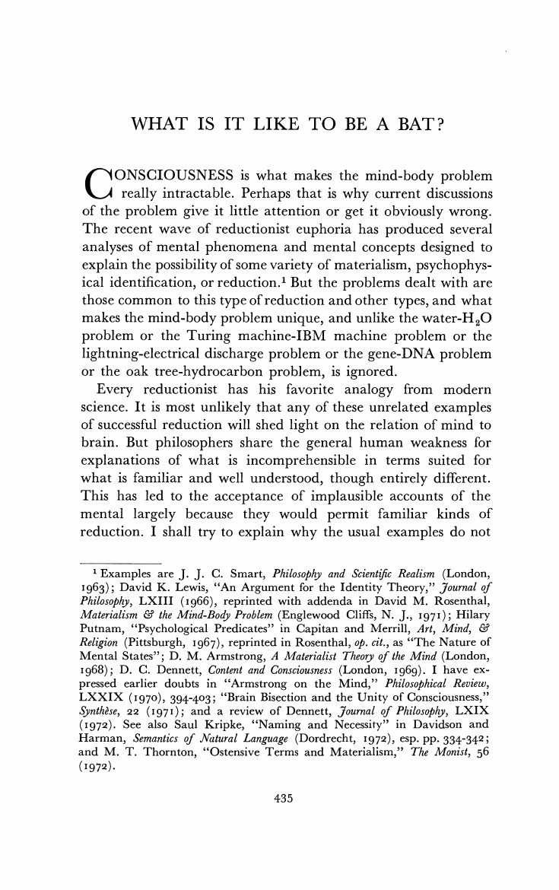
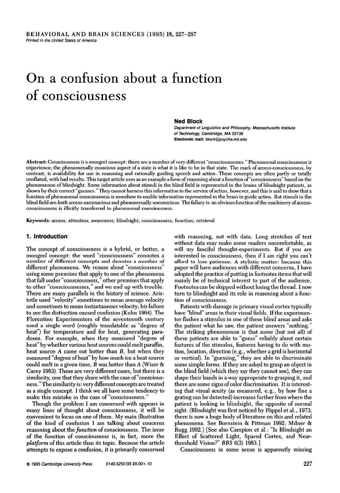
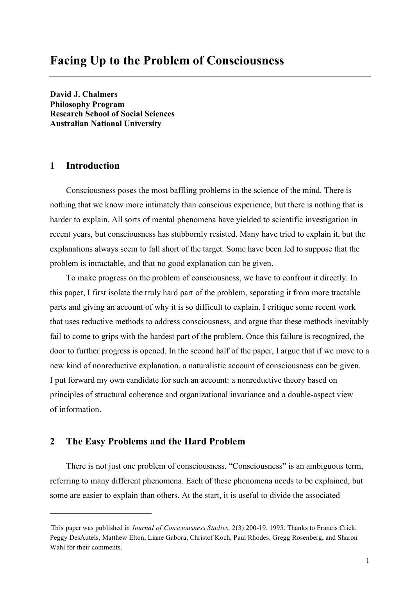
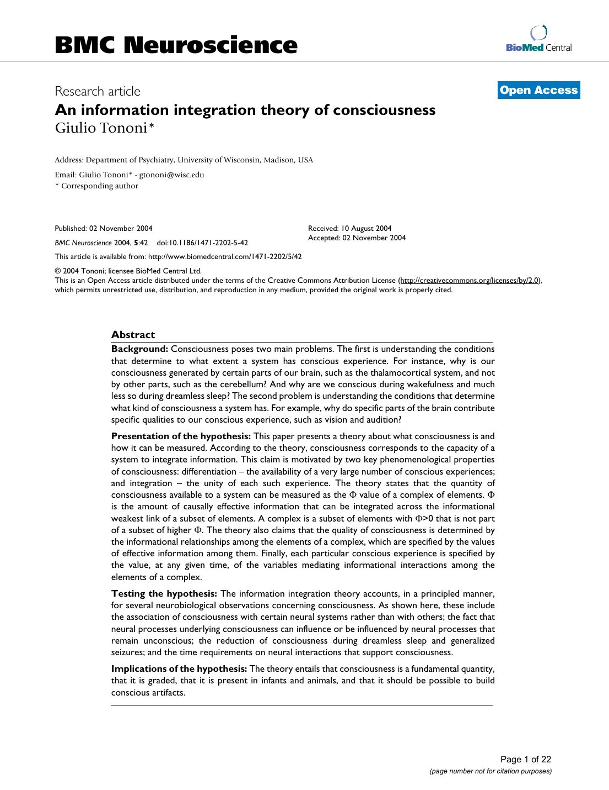
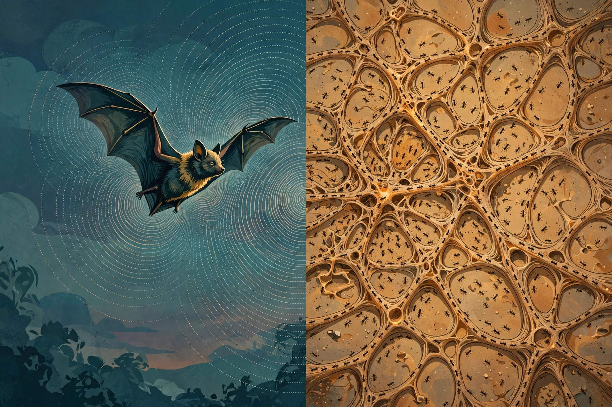

وقتی کسی آگاهی را تعریف می‌کند، معمولاً تصور می‌کنیم که او فقط دارد معنای یک واژه را روشن می‌کند؛ کاری شبیه باز کردن فرهنگ لغت. اما در فلسفهٔ ذهن چنین نیست. هر تعریفی از آگاهی، در واقع، گزارشی است از یک مشاهدهٔ درونی: تعریف‌کننده به تجربهٔ خودش نگاه کرده، یک وجه از آن را از بقیه پررنگ‌تر دیده و سپس گفته است: «اصلِ ماجرا همین وجه است و بقیه فرع‌اند.» به همین دلیل است که اختلاف بر سر تعریف آگاهی، اختلاف بر سر واژه‌ها نیست؛ اختلاف بر سر این است که کدام وجهِ تجربه، وجهِ اصلی است.

در این یادداشت پنج خانوادهٔ اصلیِ تعریف را بررسی می‌کنیم. برای هر خانواده، چهار کار انجام می‌دهیم: نخست، تعریف را با دقیق‌ترین صورت‌بندیِ خودِ صاحبش می‌آوریم. دوم، صحنه‌ای را بازسازی می‌کنیم که در ذهن او بوده است؛ یعنی همان مثال یا آزمایش فکری‌ای که او را به آن تعریف رسانده است. سوم، توضیح می‌دهیم که چرا آن تعریف برای او و پیروانش چنین قانع‌کننده به نظر رسیده است. و چهارم، نقطهٔ کور آن را نشان می‌دهیم؛ یعنی همان چیزی را که تعریف نمی‌بیند یا نمی‌تواند توضیح دهد.

یک نکتهٔ روشی را همین‌جا روشن کنیم: وقتی از فیلسوفی نقل می‌کنیم، متنِ خودِ او را می‌آوریم و ترجمه را زیر آن می‌گذاریم، تا خواننده بتواند داوری کند که آیا برداشت ما از او درست است یا نه. در سنت اسلامی نیز عبارت عربیِ اصل را می‌آوریم، زیرا در این سنت، گاهی یک واژهٔ عربی بار معنایی‌ای دارد که هیچ معادل فارسی‌ای آن را کامل منتقل نمی‌کند.

@@TOC@@

## <span class="no">۰ ـ</span> چرا تعریف، خودِ مسئله است؟ {#why}

دو داوریِ کاملاً مخالف دربارهٔ یک سامانهٔ واحد: «این سامانه آگاه است، چون اطلاعات را یکپارچه می‌کند» و «این سامانه آگاه نیست، چون هیچ تجربه‌ای از درون ندارد؛ فقط اطلاعات را یکپارچه می‌کند.» علت اختلاف، دادهٔ تازه‌ای نیست که یکی از دو طرف دیده و دیگری ندیده باشد؛ علت این است که آن دو، از واژهٔ «آگاهی» دو چیز متفاوت می‌فهمند. یکی آگاهی را یک *ساختار* می‌داند و دیگری آن را یک *تجربه*.

پس پیش از هر نظریه‌ای، باید معلوم شود که نظریه قرار است چه چیزی را توضیح دهد. اگر این گام برداشته نشود، دو نفر ممکن است سال‌ها با یکدیگر بحث کنند، در حالی که هر یک دربارهٔ چیز دیگری سخن می‌گوید. بخش بزرگی از سردرگمیِ ادبیات آگاهی دقیقاً از همین‌جا می‌آید.

<div class="infographic" role="img" aria-label="اینفوگرافی نقشهٔ پنج خانوادهٔ تعریف آگاهی به‌همراه سنت حضوری"><p class="ig-title">نقشهٔ کلی: پنج خانوادهٔ تعریف، یک پرسش</p><p class="ig-sub">همه از یک مشاهده آغاز می‌کنند، اما هر یک وجه دیگری از آن را اصل می‌گیرند.</p><div class="ig-center">وقتی می‌گوییم «این موجود آگاه است»، دقیقاً چه چیزی را در او دیده‌ایم؟</div><div class="ig-branches"><div class="ig-branch"><div class="n">۱</div><b>تجربه</b><span>نیگل ـ بلاک ـ چالمرز (Nagel · Block · Chalmers)<br />«بودنش برای خودش چگونه است؟»</span></div><div class="ig-branch"><div class="n">۲</div><b>دسترسی</b><span>بلاک (Block) ـ GWT<br />«آیا در دسترس کل سامانه است؟»</span></div><div class="ig-branch"><div class="n">۳</div><b>ساختار</b><span>تونونی (Tononi) و IIT<br />«اطلاعاتش چقدر یکپارچه است؟»</span></div><div class="ig-branch"><div class="n">۴</div><b>پخش</b><span>بارس ـ دهین (Baars · Dehaene) ـ GWT<br />«آیا به همهٔ بخش‌ها اعلام می‌شود؟»</span></div><div class="ig-branch"><div class="n">۵</div><b>حضور</b><span>ابن‌سینا ـ سهروردی ـ ملاصدرا (Avicenna · Suhrawardi · Mulla Sadra)<br />«آیا نزدِ خود حاضر است؟»</span></div></div><p style="text-align:center;color:var(--muted);font-size:.85rem;line-height:1.9;padding:8px 0 6px">پنج پاسخ بالا رقیب یکدیگرند، اما الزاماً ناسازگار نیستند؛ ممکن است هر یک شرطی از یک تعریف کامل باشد. داوری دربارهٔ این امکان، به بررسی جداگانه نیاز دارد.</p></div>

## <span class="no">۱ ـ</span> تعریف اول: نیگل <span class="ltr">(Thomas Nagel)</span> و «چیزی بودن» {#nagel}

توماس نیگل <span class="ltr">(Thomas Nagel)</span>، فیلسوف آمریکایی، در سال ۱۹۷۴ مقاله‌ای نوشت با عنوان «خفاش بودن چگونه است؟» که در مجلهٔ <span class="ltr">The Philosophical Review</span> (جلد ۸۳، شمارهٔ ۴، صص. ۴۳۵–۴۵۰) منتشر شد و هنوز مشهورترین متنِ فلسفهٔ آگاهی است. تعریف او کوتاه‌ترین و در عین حال عمیق‌ترین تعریف این حوزه است.

<Bio name="توماس نیگل (Thomas Nagel)" role="فیلسوف ذهن آمریکایی · زادهٔ ۱۹۳۷، بلگراد (Belgrade)" img="../bio/nagel.jpg" alt="پرترهٔ سیاه‌وسفید توماس نیگل در جوانی">

**کیست و کجا کار کرده است؟** نیگل در خانواده‌ای یهودی و آلمانی‌زبان در بلگراد به دنیا آمد و در آستانهٔ جنگ جهانی دوم با خانواده‌اش به آمریکا مهاجرت کرد. در دانشگاه کرنل <span class="ltr">(Cornell University)</span> فلسفه خواند (۱۹۵۸)، در آکسفورد <span class="ltr">(University of Oxford)</span> ادامه داد و دکترایش را در هاروارد <span class="ltr">(Harvard University)</span>، زیر نظر جان رالز <span class="ltr">(John Rawls)</span>، گرفت (۱۹۶۳). پس از برکلی <span class="ltr">(University of California, Berkeley)</span> و پرینستون <span class="ltr">(Princeton University)</span>، از سال ۱۹۸۰ در دانشگاه نیویورک <span class="ltr">(New York University)</span> استاد فلسفه و حقوق است.

**فضای ذهنی و باورهایش.** محور همهٔ کار نیگل کشمکش میان «دیدگاه اول‌شخص» و «دیدگاه عینیِ علم» است؛ کتاب *The View from Nowhere* (۱۹۸۶) همین کشمکش را صورت‌بندی می‌کند. او واقع‌گرایی اخلاقی است، با تقلیل‌گرایی در همهٔ حوزه‌ها مخالف است و از زندگی شخصی‌اش تقریباً چیزی منتشر نکرده است؛ در نوشته‌هایش استدلال سخن می‌گوید، نه خاطره.

**این ادعا دقیقاً از کدام متن است؟** مقالهٔ <span class="ltr">“What Is It Like to Be a Bat?”</span> در مجلهٔ *The Philosophical Review*، سال ۱۹۷۴، جلد ۸۳، شمارهٔ ۴، صص. ۴۳۵–۴۵۰ ([متن مقاله در JSTOR](http://www.jstor.org/stable/2183914))؛ مقاله‌ای شانزده‌صفحه‌ای که بعد در کتاب *Mortal Questions* (۱۹۷۹) بازنشر شد.

**پیش و پس از این مقاله.** پیش از آن، فیزیکالیسم و کارکردگرایی در فلسفهٔ ذهن دست بالا را داشتند و «تجربهٔ ذهنی» موضوعی حاشیه‌ای شمرده می‌شد. مقالهٔ نیگل آگاهی را به مرکز بحث برگرداند؛ تمایز چالمرز میان مسئله‌های آسان و مسئلهٔ سخت، دو دهه بعد، مستقیماً بر شانهٔ همین مقاله ایستاده است.

**نقدها و پاسخش.** دنیل دنت <span class="ltr">(Daniel Dennett)</span>، بزرگ‌ترین مخالف او، گفت هر ویژگیِ مهم تجربه سرانجام سوم‌شخص و علمی مطالعه‌پذیر است و دست‌نیافتنی بودنِ خفاش بودن، شکست تخیل ماست، نه حدّ علم. کاتلین ایکینز <span class="ltr">(Kathleen Akins)</span> نیز گفت داوری دربارهٔ تجربهٔ خفاش به جزئیات عصب‌شناختی‌ای وابسته است که هنوز نمی‌دانیم، پس نیگل در بستن راه علم شتاب کرده است. پاسخ نیگل در آثار بعدی، به‌ویژه *The View from Nowhere* و مقالهٔ *The Psychophysical Nexus*، این بود که شاید مفاهیم علمیِ آینده لازم باشد، اما انکار وجه ذهنی، حل مسئله نیست؛ حذف خودِ مسئله است.

**سرانجام و اکنون.** کتاب *Mind and Cosmos* (۲۰۱۲) او، که در آن تبیین نئوداروینیِ تقلیل‌گرا از ذهن را ناکافی دانست، جنجال بزرگی ساخت و زیست‌شناسانی مانند الیوت سوبر <span class="ltr">(Elliott Sober)</span> او را به بدفهمی نظریهٔ تکامل متهم کردند؛ نیگل از موضعش عقب ننشست. در سال ۲۰۲۴، به مناسبت پنجاهمین سالگرد، مقالهٔ خفاش با پیش‌گفتاری تازه از خود او بازنشر شد.

<p class="credit">عکس: پرترهٔ نیگل در جوانی، از ویکی‌مدیا کامنز.</p>

</Bio>

<div class="defbox"><div class="deflabel">صورت‌بندی دقیق تعریف</div><p>یک موجود آن‌گاه و فقط آن‌گاه حالت‌های ذهنیِ آگاهانه دارد که «چیزی» باشد که بودنِ آن موجود، برای خودِ آن موجود، به‌گونه‌ای باشد؛ یعنی از درون، بودنِ او کیفیتی داشته باشد.</p></div>

<blockquote class="exact"><p dir="ltr">“But fundamentally an organism has conscious mental states if and only if there is something that it is like to be that organism — something it is like <em>for</em> the organism.”</p><footer>توماس نیگل، «خفاش بودن چگونه است؟»، مجلهٔ فلسفی <span class="ltr">(The Philosophical Review)</span>، ۱۹۷۴، جلد ۸۳، شمارهٔ ۴، صص. ۴۳۵–۴۵۰. ترجمهٔ تحت‌اللفظی: «اما در بنیاد، یک ارگانیسم آن‌گاه و فقط آن‌گاه حالت‌های ذهنیِ آگاهانه دارد که چیزی باشد که بودنِ آن ارگانیسم بودن [برای خودش] باشد ـ چیزی که برای خودِ ارگانیسم [بودن] باشد.»</footer></blockquote>

<figure class="papershot"><a href="http://www.jstor.org/stable/2183914"></a><figcaption>صفحهٔ نخست مقالهٔ نیگل ـ <span class="ltr">The Philosophical Review</span>، ۱۹۷۴، ص. ۴۳۵. آغاز مقاله با این جمله است: «آگاهی همان چیزی است که مسئلهٔ ذهن ـ بدن را واقعاً لاینحل می‌کند.» متن کامل در JSTOR است؛ برای گشودن آن، روی تصویر کلیک کنید.</figcaption></figure>

<div class="mind"><h4>در ذهن نیگل چه می‌گذشت؟</h4><p>نیگل خفاش را تصور کرد. خفاش جهان را نه با چشم، بلکه با پژواک می‌شناسد: صدایی می‌فرستد و از بازگشت آن، شکل و فاصلهٔ اشیا را درمی‌یابد. ما می‌توانیم فیزیک این سامانه را کامل بشناسیم؛ می‌توانیم بدانیم کدام نورون چه زمانی شلیک می‌کند و خفاش در برابر هر مانعی چه واکنشی نشان می‌دهد. اما نیگل پرسید: آیا با همهٔ این دانستن‌ها، فهمیده‌ایم که جهان <em>برای خودِ خفاش</em> چگونه تجربه می‌شود؟ پاسخ او منفی بود. ما می‌توانیم تصور کنیم که اگر خفاش بودیم چه می‌کردیم، اما نمی‌توانیم بدانیم خفاش بودن، از درون، <em>چگونه است</em>.</p><p>از همین‌جا نتیجه گرفت که در هر موجود آگاه، یک «نقطه‌نظر اول‌شخص» وجود دارد که از هیچ توصیف سوم‌شخصی به دست نمی‌آید. فیزیک و عصب‌شناسی ساختار را توصیف می‌کنند؛ اما تجربه، همیشه تجربهٔ <em>کسی</em> است و آن «کسی بودن» در توصیف ساختاری گم می‌شود.</p></div>

### چرا این تعریف چنین قانع‌کننده به نظر رسید؟

زیرا دقیقاً به همان چیزی انگشت می‌گذارد که هر کس بی‌واسطه می‌شناسد. درد دندان فقط یک پیام عصبی نیست؛ درد، از درون، *حسی دارد*. سرخیِ رنگ قرمز نیز فقط طول موج ۷۰۰ نانومتر نیست؛ سرخی، از درون، *ظاهری* دارد. نیگل گفت: هر تعریفی از آگاهی که این وجه را از دست بدهد، هر چیزی را توضیح داده است جز خودِ آگاهی را. این تعریف همچنین معیاری روشن برای تشخیص مسئله به دست می‌دهد: هر جا که پرسش «بودنش برای خودش چگونه است؟» معنا داشته باشد، با آگاهی روبه‌رو هستیم؛ و هر جا که این پرسش کاملاً بی‌معنا باشد، آگاهی‌ای در کار نیست.

<div class="blind"><h4><span>نقطهٔ کور ـ</span> تعریف نیگل اشاره می‌کند، اما سازوکار نمی‌دهد</h4><p>تعریف نیگل بیشتر یک <em>نشانه</em> است تا یک <em>تبیین</em>. او می‌گوید آگاهی همان وجه اول‌شخص تجربه است، اما نمی‌گوید این وجه از کجا می‌آید، در چه سامانه‌هایی پدید می‌آید و مرز آن کجاست. آیا بودنِ مورچه برای خودش «چگونه» است؟ بودنِ یک نورون چطور؟ تعریف نیگل به‌تنهایی پاسخی ندارد. همچنین این تعریف، به‌عمد، راه را بر هر تبیین تقلیل‌گرایانه می‌بندد، اما جای آن تبیین دیگری نمی‌گذارد. به همین دلیل، نیگل نقطهٔ آغاز خوبی است، اما نقطهٔ پایان نیست.</p></div>

## <span class="no">۲ ـ</span> تعریف دوم: بلاک <span class="ltr">(Ned Block)</span> و دو معنای آگاهی {#block}

نِد بلاک <span class="ltr">(Ned Block)</span> در سال ۱۹۹۵ متوجه شد که بخش بزرگی از نزاع‌ها از این‌جا ناشی می‌شود که پژوهشگران دو پدیدهٔ متفاوت را با یک نام می‌خوانند. او آن دو را از هم جدا کرد و برای هر یک نام جداگانه‌ای گذاشت.

<Bio name="نِد بلاک (Ned Block)" role="فیلسوف ذهن آمریکایی · زادهٔ ۱۹۴۲، شیکاگو (Chicago)" img="../bio/block.jpg" alt="پرترهٔ ند بلاک با مو و ریش سفید و عینک">

**کیست و کجا کار کرده است؟** بلاک دورهٔ کارشناسی را در MIT <span class="ltr">(Massachusetts Institute of Technology)</span> گذراند و دکترایش را در هاروارد <span class="ltr">(Harvard University)</span>، زیر نظر هیلاری پاتنم <span class="ltr">(Hilary Putnam)</span>، گرفت (۱۹۷۱). از ۱۹۷۱ تا ۱۹۹۶ در MIT درس داد و مدتی رئیس بخش فلسفهٔ آن‌جا بود؛ از ۱۹۹۶ در دانشگاه نیویورک <span class="ltr">(New York University)</span> است و کرسی «سیلور» فلسفه، روان‌شناسی و علوم اعصاب را دارد.

**پیشینهٔ فکری‌اش.** بلاک از سازندگان و هم‌زمان از تیزترین منتقدان کارکردگرایی است. در مقالهٔ *Troubles with Functionalism* (۱۹۷۸) نشان داد که یکسان گرفتن حالت ذهنی با نقش کارکردی‌اش دشواری دارد، و با استدلال مشهور «بلاک‌هد» در مقالهٔ *Psychologism and Behaviorism* (۱۹۸۱) گفت ماشینی که فقط از روی یک جدول عظیمِ پاسخ‌های آماده رفتار هوشمند نشان دهد، آزمون تورینگ را می‌گذراند بی‌آن‌که چیزی بفهمد. ذهن او ذهنی تفکیک‌کننده است: کارش از هم باز کردن مفاهیمی است که میدان، قاطی به کار می‌برد.

**این ادعا دقیقاً از کدام متن است؟** مقالهٔ <span class="ltr">“On a Confusion about a Function of Consciousness”</span> در مجلهٔ *Behavioral and Brain Sciences*، سال ۱۹۹۵، جلد ۱۸، شمارهٔ ۲، صص. ۲۲۷–۲۴۷ ([پیوند مقاله](https://doi.org/10.1017/S0140525X00038188))؛ مقاله‌ای «هدف» که در همان شماره ده‌ها نقد و پاسخ هم‌زمان درباره‌اش منتشر شد.

**نقدها و پاسخش.** منتقدان کارکردگرا گفتند جدا کردن تجربه از دسترسی، یا تجربه را از دسترس علم بیرون می‌برد یا تمایزی لفظی است. صورت تجربیِ نزاع بعداً بر سر «سرریز» درگرفت: کوهن <span class="ltr">(Michael A. Cohen)</span> و دنت <span class="ltr">(Daniel Dennett)</span> در مقالهٔ <span class="ltr">*Consciousness Cannot Be Separated from Function*</span> در مجلهٔ *Trends in Cognitive Sciences* (۲۰۱۱، جلد ۱۵، شمارهٔ ۸، صص. ۳۵۸–۳۶۴؛ [پیوند مقاله](https://doi.org/10.1016/j.tics.2011.06.008)) گفتند شواهد آزمایش اسپرلینگ را دسترسی هم توضیح می‌دهد. پاسخ بلاک در مقالهٔ <span class="ltr">*Perceptual Consciousness Overflows Cognitive Access*</span> در همان مجله (۲۰۱۱، جلد ۱۵، شمارهٔ ۱۲، صص. ۵۶۷–۵۷۵) این بود که ظرفیت تجربهٔ ادراکی از ظرفیت گزارش و دسترسی شناختی بیشتر است؛ ما بیش از آن‌که بتوانیم گزارش کنیم، می‌بینیم.

**اکنون چه می‌کند؟** همچنان در دانشگاه نیویورک پژوهش و تدریس می‌کند. کار سال‌های اخیرش بر جداکردن مبنای عصبیِ خودِ تجربه از مبنای عصبیِ گزارش تجربه، و بر همین پرسش دربارهٔ سامانه‌های مصنوعی متمرکز است: آیا آگاهی به زیست‌شناسی نیاز دارد یا نه؟

<p class="credit">عکس: پرترهٔ بلاک، برگرفته از صفحهٔ رویداد Digital Humanism.</p>

</Bio>

<div class="defbox"><div class="deflabel">صورت‌بندی دقیق تعریف</div><p><strong>آگاهی پدیداری</strong><span class="ltr">(Phenomenal Consciousness)</span> همان تجربه است؛ وجه پدیداریِ یک حالت ذهنی همان است که در آن حالت بودن، چگونه است. اما <strong>آگاهی دسترسی</strong><span class="ltr">(Access Consciousness)</span> آن است که محتوای یک حالت ذهنی برای استفاده در استدلال، تصمیم‌گیری و کنترل گفتار و عمل آماده و در دسترس باشد.</p></div>

<blockquote class="exact"><p dir="ltr">“Phenomenal consciousness is experience; the phenomenally conscious aspect of a state is what it is like to be in that state.”</p><footer>نِد بلاک، «دربارهٔ سردرگمی‌ای دربارهٔ کارکرد آگاهی»، مجلهٔ علوم رفتاری و مغز <span class="ltr">(Behavioral and Brain Sciences)</span>، ۱۹۹۵، جلد ۱۸، شمارهٔ ۲، صص. ۲۲۷–۲۴۷. ترجمه: «آگاهی پدیداری همان تجربه است؛ وجه پدیداریِ یک حالت، همان است که در آن حالت بودن چگونه است.»</footer></blockquote>

<figure class="papershot"><a href="https://doi.org/10.1017/S0140525X00038188"></a><figcaption>صفحهٔ نخست مقالهٔ بلاک ـ <span class="ltr">Behavioral and Brain Sciences</span>، ۱۹۹۵، ص. ۲۲۷. چکیده با این جمله آغاز می‌شود: «آگاهی مفهومی دورگه است.» برای گشودن صفحهٔ مقاله در ناشر، روی تصویر کلیک کنید.</figcaption></figure>

<div class="mind"><h4>در ذهن بلاک چه می‌گذشت؟</h4><p>بلاک به مواردی از عصب‌روان‌شناسی نگاه می‌کرد که در آن‌ها تجربه و دسترسی از یکدیگر جدا می‌شوند. مشهورترین نمونه، «بینایی کور» <span class="ltr">(Blindsight)</span> است: بیماری که بخشی از قشر بینایی‌اش آسیب دیده است، با اصرار می‌گوید که در بخشی از میدان دیدش هیچ چیزی نمی‌بیند؛ اما وقتی مجبورش می‌کنند حدس بزند، با دقتی بسیار بالاتر از شانس می‌گوید شیء در کدام سمت است. اطلاعات بینایی در سامانهٔ او <em>هست</em> و رفتارش را هدایت می‌کند، اما تجربه‌ای از دیدن در کار نیست. در جهت عکس نیز می‌توان تصور کرد که تجربه‌ای غنی داشته باشیم که فرصت گزارش و استفاده پیدا نکند؛ مانند لحظه‌ای که در کنسرت، صدایی ظریف را می‌شنویم اما پیش از آن‌که بتوانیم درباره‌اش سخن بگوییم، محو می‌شود.</p><p>بلاک نتیجه گرفت: «دسترسی» یک مفهوم <em>کارکردی</em> است؛ یعنی با نقشِ محتوا در کل سامانه تعریف می‌شود. اما «تجربه» چنین نیست. هر نظریه‌ای که فقط دسترسی را توضیح دهد، ممکن است نظریهٔ خوبی دربارهٔ توجه و گزارش باشد، اما هنوز دربارهٔ تجربه هیچ نگفته است.</p></div>

### چرا این تمایز مهم است؟

زیرا نقشهٔ میدان نبرد را روشن می‌کند. از این پس، هر نظریه‌ای باید بگوید که ادعایش دربارهٔ کدام‌یک از این دو است. خواهیم دید که نظریهٔ GWT عمدتاً نظریه‌ای دربارهٔ *دسترسی* است و نظریهٔ اطلاعات یکپارچه ادعا می‌کند که نظریه‌ای دربارهٔ *تجربه* است. بدون تمایز بلاک، این دو نظریه چنان به نظر می‌رسند که گویی مستقیماً با هم رقابت می‌کنند؛ در حالی که ممکن است هر یک نیمه‌ای از مسئله را گرفته باشد.

<div class="blind"><h4><span>نقطهٔ کور ـ</span> تمایز روشن است، اما پل میان آن دو نامعلوم</h4><p>بلاک نشان داد که تجربه و دسترسی دو چیزند، اما نگفت که رابطه‌شان چیست. آیا تجربه همیشه با دسترسی همراه است و جداییِ آن دو فقط در موارد بیمارگونه رخ می‌دهد؟ یا تجربه می‌تواند به‌کلی مستقل از دسترسی وجود داشته باشد؟ این پرسش هنوز باز است و ـ چنان‌که در پایان این یادداشت خواهیم دید ـ برای داوری دربارهٔ کلونی مورچه‌ها و سامانه‌های مصنوعی سرنوشت‌ساز است: زیرا در آن موارد، ما فقط به دسترسی و رفتار دسترسی داریم، نه به تجربه.</p></div>

## <span class="no">۳ ـ</span> تعریف سوم: چالمرز <span class="ltr">(David Chalmers)</span> و مسئلهٔ سخت {#chalmers}

دیوید چالمرز <span class="ltr">(David Chalmers)</span>، فیلسوف استرالیایی، در سال ۱۹۹۵ تمایز بلاک را یک گام جلوتر برد و آن را به صورت دو «مسئله» صورت‌بندی کرد: مسئله‌های آسان و مسئلهٔ سخت.

<Bio name="دیوید چالمرز (David Chalmers)" role="فیلسوف ذهن استرالیایی · زادهٔ ۱۹۶۶، سیدنی (Sydney)" img="../bio/chalmers.jpg" alt="پرترهٔ دیوید چالمرز در برابر قفسهٔ کتاب">

**کیست و کجا کار کرده است؟** چالمرز در سیدنی <span class="ltr">(Sydney)</span> به دنیا آمد و در آدلاید <span class="ltr">(Adelaide)</span> بزرگ شد. نخست ریاضیات خواند، سپس با بورسیهٔ رودز <span class="ltr">(Rhodes Scholarship)</span> به آکسفورد <span class="ltr">(University of Oxford)</span> رفت و در ۱۹۹۳ دکترای فلسفه گرفت؛ رساله‌اش *Toward a Theory of Consciousness* بود. او فقط ۲۹ سال داشت که اصطلاح «مسئلهٔ سخت» را در کنفرانس توسان <span class="ltr">(Tucson)</span> (۱۹۹۴) و مقالهٔ سال بعدش جا انداخت. بعدها مدیر مرکز آگاهی دانشگاه ملی استرالیا <span class="ltr">(Australian National University)</span> شد و اکنون استاد دانشگاه نیویورک <span class="ltr">(New York University)</span> و، همراه با نِد بلاک <span class="ltr">(Ned Block)</span>، هم‌مدیر مرکز ذهن، مغز و آگاهی همان دانشگاه است.

**فضای ذهنی و باورهایش.** چالمرز «دوگانه‌انگار طبیعت‌گرا»ست: تجربه را واقعیتی بنیادین می‌داند، مانند جرم و بار در فیزیک، که باید برای پیوندش با فرایندهای فیزیکی قانون‌های بنیادین روان‌فیزیکی یافت؛ و نسبت به همه‌روان‌انگاری (Panpsychism) موضعی گشوده دارد. بیرون از فلسفهٔ ذهن، با اندی کلارک <span class="ltr">(Andy Clark)</span> مقالهٔ *The Extended Mind* (۱۹۹۸) را نوشت، از بنیان‌گذاران پایگاه PhilPapers است و خوانندهٔ گروهی به نام Zombie Blues است؛ ترکیب ریاضی، منطق موجهات و فرهنگ عامه در سبک او پیداست.

**این ادعا دقیقاً از کدام متن است؟** مقالهٔ <span class="ltr">“Facing Up to the Problem of Consciousness”</span> در *Journal of Consciousness Studies*، سال ۱۹۹۵، جلد ۲، شمارهٔ ۳، صص. ۲۰۰–۲۱۹ ([متن کامل مقاله، PDF](https://consc.net/papers/facing.pdf))؛ و بسط کاملش در کتاب *The Conscious Mind*، سال ۱۹۹۶.

**پیش و پس از این مقاله.** پیش از آن، حسِ «توضیح‌های کارکردی چیزی را جا می‌اندازند» پراکنده و بی‌زبان بود. پس از مقاله، همان مجله بیش از بیست پاسخ از دنت <span class="ltr">(Daniel Dennett)</span>، مک‌گین <span class="ltr">(Colin McGinn)</span>، وارلا <span class="ltr">(Francisco Varela)</span>، کریک <span class="ltr">(Francis Crick)</span> و پنروز <span class="ltr">(Roger Penrose)</span> منتشر کرد که در کتاب *Explaining Consciousness: The Hard Problem* (۱۹۹۷) گرد آمد؛ جان سرل <span class="ltr">(John Searle)</span> نیز در *The New York Review of Books* نقدی تند بر کتاب او نوشت. مسئلهٔ سخت از آن پس پرسش سازمان‌دهندهٔ کل میدان شد، حتی برای مخالفانش.

**نقدها و پاسخش.** نقد محوری دنت و فیزیکالیست‌هاست: زامبی واقعاً تصورپذیر نیست؛ وقتی همهٔ کارکردها کامل توضیح داده شوند، «باقی‌مانده»ای نمی‌ماند و مسئلهٔ سخت حل نمی‌شود، منحل می‌شود. پاسخ چالمرز در پاسخ‌های همان مجموعه و سپس در صورت‌بندی دقیق‌تر استدلال تصورپذیری با «معناشناسی دوبعدی» آمد، از جمله در مقالهٔ *The Two-Dimensional Argument Against Materialism* و کتاب *The Character of Consciousness* (۲۰۱۰): تصورپذیریِ ایدئال، بر خلاف تصور سطحیِ آبِ غیر از H₂O، نشانهٔ امکان است.

**اکنون چه می‌کند؟** در دانشگاه نیویورک <span class="ltr">(New York University)</span> بر فلسفهٔ ذهن و زبان کار می‌کند. کتاب *Reality+* (۲۰۲۲) او مسئلهٔ واقعیت را به واقعیت مجازی برد و در سال‌های اخیر دربارهٔ آگاهی در سامانه‌های هوش مصنوعی نیز موضع‌گیری و پژوهش می‌کند.

<p class="credit">عکس: پرترهٔ چالمرز، دانشگاه اوکلند <span class="ltr">(University of Auckland)</span>.</p>

</Bio>

<div class="defbox"><div class="deflabel">صورت‌بندی دقیق تعریف</div><p>مسئله‌های آسان، مسئلهٔ توضیحِ کارکردها هستند: تمایزگذاری، گزارش‌پذیری، تمرکز توجه و کنترل رفتار. اما مسئلهٔ سخت این است: چرا و چگونه پردازش اطلاعات در مغز با یک <em>تجربهٔ ذهنی</em> همراه است؟ چرا همهٔ این پردازش‌ها «در تاریکی» و بدون هیچ تجربه‌ای انجام نمی‌شوند؟</p></div>

<blockquote class="exact"><p dir="ltr">“The really hard problem of consciousness is the problem of experience. When we think and perceive, there is a whir of information-processing, but there is also a subjective aspect. … It is widely agreed that experience arises from a physical basis, but we have no good explanation of why and how it so arises.”</p><footer>دیوید چالمرز، «روبه‌رو شدن با مسئلهٔ آگاهی»، مجلهٔ مطالعات آگاهی <span class="ltr">(Journal of Consciousness Studies)</span>، ۱۹۹۵، جلد ۲، شمارهٔ ۳، صص. ۲۰۰–۲۱۹. ترجمه: «مسئلهٔ واقعاً سختِ آگاهی، مسئلهٔ تجربه است. هنگامی که می‌اندیشیم و ادراک می‌کنیم، چرخه‌ای از پردازش اطلاعات در کار است، اما وجهی ذهنی نیز وجود دارد… بر سر این نکته توافق گسترده‌ای هست که تجربه از بنیادی فیزیکی برمی‌خیزد، اما ما هیچ تبیین خوبی نداریم که چرا و چگونه چنین برمی‌خیزد.»</footer></blockquote>

<figure class="papershot"><a href="https://consc.net/papers/facing.pdf"></a><figcaption>صفحهٔ نخست مقالهٔ چالمرز ـ <span class="ltr">Journal of Consciousness Studies</span>، ۱۹۹۵، صص. ۲۰۰–۲۱۹ (نسخهٔ نویسنده). جملهٔ آغازین: «آگاهی گیج‌کننده‌ترین مسائل را در علم ذهن پیش می‌نهد.» برای خواندن متن کامل (PDF)، روی تصویر کلیک کنید.</figcaption></figure>

<div class="mind"><h4>در ذهن چالمرز چه می‌گذشت؟</h4><p>چالمرز «زامبی فلسفی» را تصور کرد: موجودی که از نظر فیزیکی و رفتاری دقیقاً مانند شماست؛ همان نورون‌ها، همان سخن‌ها، همان خنده و همان گریه؛ با این تفاوت که در درون او هیچ تجربه‌ای نیست؛ به تعبیر مشهور، «در درون، همه‌جا تاریک است». زامبی وقتی دستش می‌سوزد دستش را عقب می‌کشد و می‌گوید «آخ»، اما هیچ دردی را تجربه نمی‌کند، چون اصولاً کسی در درون او نیست که تجربه کند.</p><p>سپس چالمرز پرسید: اگر چنین موجودی دست‌کم <em>قابل تصور</em> است و هیچ تناقض منطقی‌ای در تصورش نیست، پس تجربه نمی‌تواند عینِ کارکرد باشد؛ زیرا کارکرد در زامبی کامل است و تجربه غایب. نتیجهٔ او این بود که تجربه واقعیتی افزوده بر کارکردهاست و نظریه‌ای کامل باید قانونی بنیادین برای پیوند این دو ارائه کند؛ همان‌گونه که فیزیک برای پیوند جرم و گرانش قانون دارد.</p></div>

### چرا این صورت‌بندی اثرگذار شد؟

زیرا به مخالفان کارکردگرایی یک زبان دقیق داد. پیش از چالمرز، بسیاری حس می‌کردند که توضیح‌های کارکردی چیزی را از قلم می‌اندازند، اما نمی‌توانستند دقیقاً بگویند آن چیز چیست. چالمرز آن را نام‌گذاری کرد: «تجربه». همچنین او نشان داد که پیشرفت عصب‌شناسی، هر قدر هم که عظیم باشد، به‌خودی‌خود مسئلهٔ سخت را حل نمی‌کند؛ زیرا هر یافتهٔ عصب‌شناختی تازه، خود یک کارکرد تازه است و پرسش «چرا این کارکرد با تجربه همراه است؟» همچنان سر جای خود باقی می‌ماند.

<div class="blind"><h4><span>نقطهٔ کور ـ</span> از «قابل تصور بودن» تا «ممکن بودن» راهی طولانی است</h4><p>نقد اصلی به چالمرز این است: از این‌که ما می‌توانیم زامبی را <em>تصور</em> کنیم، نتیجه نمی‌شود که زامبی در جهان واقع <em>ممکن</em> باشد. ما می‌توانیم تصور کنیم که آب چیزی جز <span class="ltr">H₂O</span> است، اما این تصور، آن واقعیت شیمیایی را باطل نمی‌کند. همچنین چالمرز مسئله را با دقتی کم‌نظیر صورت‌بندی می‌کند، اما پاسخ خودش ـ یعنی دوگانه‌انگاریِ ویژگی‌ها و قوانین بنیادین روان‌فیزیکی ـ برای بسیاری قانع‌کننده نیست؛ زیرا در عمل می‌گوید «تجربه بنیادین است و تبیین بیشتری در کار نیست» و این، از نظر منتقدان، نام دیگری است برای تسلیم شدن در برابر مسئله. با این همه، حتی منتقدان او نیز امروز با زبان خودِ او سخن می‌گویند و این نشانهٔ قدرت صورت‌بندی اوست.</p></div>

## <span class="no">۴ ـ</span> تعریف چهارم: تونونی <span class="ltr">(Giulio Tononi)</span> و اطلاعات یکپارچه {#iit}

جولیو تونونی <span class="ltr">(Giulio Tononi)</span>، عصب‌شناس ایتالیایی، راهی کاملاً متفاوت رفت. او به جای آن‌که از رفتار یا گزارش آغاز کند، از خودِ تجربه آغاز کرد و پرسید: تجربه چه ویژگی‌هایی دارد که هر نظریه‌ای باید آن‌ها را حفظ کند؟ سپس آن ویژگی‌ها را به زبان ریاضی ترجمه کرد. حاصل، «نظریهٔ اطلاعات یکپارچه» <span class="ltr">(Integrated Information Theory – IIT)</span> است.

<Bio name="جولیو تونونی (Giulio Tononi)" role="عصب‌شناس و روان‌پزشک ایتالیایی · زادهٔ ۱۹۶۰، ترنتو (Trento)" img="../bio/tononi.jpg" alt="پرترهٔ جولیو تونونی با پیراهن مشکی و گردنبند نقره">

**کیست و کجا کار کرده است؟** تونونی در ترنتوی <span class="ltr">(Trento)</span> ایتالیا به دنیا آمد، پزشکی و روان‌پزشکی را در پیزا <span class="ltr">(Pisa)</span> و مدرسهٔ عالی نرمال <span class="ltr">(Scuola Normale Superiore)</span> گذراند و در مؤسسهٔ علوم اعصاب سن‌دیگو <span class="ltr">(The Neurosciences Institute, San Diego)</span> با جرالد ادلمن <span class="ltr">(Gerald Edelman)</span>، برندهٔ نوبل، روی «بازورود» و پیچیدگی عصبی کار کرد. اکنون استاد دانشگاه ویسکانسین ـ مدیسن <span class="ltr">(University of Wisconsin–Madison)</span> است و مرکز خواب و آگاهی آن‌جا را هدایت می‌کند.

**مسیر دیگرش: علم خواب.** پیش از آن‌که نامش با IIT گره بخورد، تونونی از چهره‌های اصلی علم خواب بود. «فرضیهٔ هم‌ایستایی سیناپسی» (SHY) او و کیارا چیرلی <span class="ltr">(Chiara Cirelli)</span> (۲۰۰۳) می‌گوید خواب، اتصال‌های سیناپسیِ تقویت‌شده در بیداری را بازتنظیم می‌کند. خودِ IIT نیز از مشاهدهٔ خواب عمیق و بیهوشی زاده شد: جایی که مغز هست، اما تجربه نیست.

**این ادعا دقیقاً از کدام متن است؟** مقالهٔ <span class="ltr">“An Information Integration Theory of Consciousness”</span> در مجلهٔ *BMC Neuroscience*، سال ۲۰۰۴، جلد ۵، مقالهٔ ۴۲ ([پیوند مقاله](https://doi.org/10.1186/1471-2202-5-42)). صورت‌های پخته‌تر نظریه: IIT 3.0 در مقالهٔ اویزومی <span class="ltr">(Masafumi Oizumi)</span>، آلبانتاکیس <span class="ltr">(Larissa Albantakis)</span> و تونونی در *PLOS Computational Biology* (۲۰۱۴، جلد ۱۰، شمارهٔ ۵؛ [پیوند مقاله](https://doi.org/10.1371/journal.pcbi.1003588)) و IIT 4.0 در مقالهٔ آلبانتاکیس و همکاران در همان مجله (۲۰۲۳، جلد ۱۹، شمارهٔ ۱۰؛ [پیوند مقاله](https://doi.org/10.1371/journal.pcbi.1011465)). کتاب *Phi: A Voyage from the Brain to the Soul* (۲۰۱۲) نظریه را به شکل سفری روایی با راهنمایی گالیله <span class="ltr">(Galileo Galilei)</span> روایت می‌کند.

**فضای ذهنی و باورهایش.** تونونی بر خلاف جریان اصلی، از تجربه آغاز می‌کند و از مغز به آن نمی‌رسد؛ و پیامدهای نامتعارف نظریه‌اش را ــ مانند درجه‌ای از آگاهی در سامانه‌های ساده ــ هزینهٔ قابل پرداختِ نظریه می‌داند، نه دلیل رد آن. در برابر نقدها معمولاً پاسخ او بازسازی ریاضیِ دقیق‌تر نظریه بوده است، نه عقب‌نشینی از ادعای اصلی.

**نقدها و پاسخ‌ها.** اسکات آرونسون <span class="ltr">(Scott Aaronson)</span>، دانشمند علوم رایانه، در نقد مشهور سال ۲۰۱۴ خود در وبلاگ *Shtetl-Optimized* با عنوان <span class="ltr">*Why I Am Not an Integrated Information Theorist*</span> ([پیوند نقد](https://scottaaronson.blog/?p=1799)) نشان داد که شبکه‌های ساده‌ای مانند گراف‌های گسترش‌دهنده Φ بزرگی می‌گیرند؛ تونونی این پیامد را پذیرفت و آن را با معماری قشر مقایسه کرد. جان سرل <span class="ltr">(John Searle)</span> در نقد سال ۲۰۱۳ خود در *The New York Review of Books* با عنوان <span class="ltr">*Can Information Theory Explain Consciousness?*</span> ([پیوند نقد](https://www.nybooks.com/articles/2013/01/10/can-information-theory-explain-consciousness/))، IIT را به همه‌روان‌انگاری متهم کرد؛ پاسخ نظریه «اصل طرد» است: فقط کلی که بیشترین Φ را دارد یک واحد آگاه است، پس ذهن‌ها در هم ذوب نمی‌شوند. دوریگ و همکاران در «استدلال گشودن» (*Consciousness and Cognition*، ۲۰۱۹) ــ که در همین یادداشت و یادداشت ۱ آمده است ــ آزمون‌پذیری نظریه را به چالش کشیدند. در سال ۲۰۲۳ نامهٔ سرگشادهٔ ۱۲۴ پژوهشگر IIT را «شبه‌علم» خواند؛ مدافعان نظریه، از جمله خود تونونی، این برچسب را ناعادلانه و ناسازگار با پیش‌بینی‌های آزمون‌پذیر نظریه دانستند. و در همکاری خصمانهٔ COGITATE، که نتایجش در *Nature* (۲۰۲۵، جلد ۶۴۲، صص. ۱۳۳–۱۴۲؛ [پیوند مقاله](https://doi.org/10.1038/s41586-025-08888-1)) منتشر شد، نبودِ هم‌زمانیِ پایدار در قشر پس‌سری یکی از پیش‌بینی‌های IIT را به چالش کشید؛ داوری نهایی آن رقابت هنوز محل بحث است.

**اکنون چه می‌کند؟** در مدیسن <span class="ltr">(Madison)</span>، هم IIT 4.0 را با همکارانش توسعه می‌دهد و هم برنامهٔ پژوهشی خواب را ادامه می‌دهد؛ نظریه اکنون مرجع و صورت‌بندی زندهٔ خودش را در قالب IIT Wiki نگه می‌دارد.

<p class="credit">عکس: پرترهٔ تونونی، از مجلهٔ Quanta.</p>

</Bio>

<div class="defbox"><div class="deflabel">صورت‌بندی دقیق تعریف</div><p>آگاهی همان اطلاعات یکپارچه است. یک سامانه به همان اندازه آگاه است که اطلاعات تولیدشده توسط کلِ سامانه، از مجموع اطلاعات تولیدشده توسط اجزای آن بیشتر باشد و این فزونی را کمیت <span class="ltr">Φ</span> (فی) اندازه می‌گیرد. سامانه‌ای که اجزایش کاملاً مستقل از یکدیگر کار کنند، <span class="ltr">Φ</span> نزدیک به صفر دارد و آگاه نیست؛ هر قدر تمایز و یکپارچگی هم‌زمان بیشتر باشد، آگاهی بیشتر است.</p></div>

<figure class="papershot"><a href="https://doi.org/10.1186/1471-2202-5-42"></a><figcaption>صفحهٔ نخست مقالهٔ تونونی ـ <span class="ltr">BMC Neuroscience</span>، ۲۰۰۴. چکیده با دو مسئله آغاز می‌شود: چه چیزی تعیین می‌کند که یک سامانه تا چه اندازه تجربهٔ آگاهانه دارد، و چه چیزی کیفیت هر تجربه را تعیین می‌کند. برای گشودن متن کامل، روی تصویر کلیک کنید.</figcaption></figure>

<div class="mind"><h4>در ذهن تونونی چه می‌گذشت؟</h4><p>تونونی به دو مشاهدهٔ بالینی نگاه می‌کرد. نخست، تفاوت میان بیداری و خواب عمیق یا بیهوشی: در بیداری، مغز هم بسیار <em>متمایز</em> است ـ یعنی در هر لحظه می‌تواند در یکی از بی‌شمار حالت ممکن باشد ـ و هم بسیار <em>یکپارچه</em> است؛ یعنی هیچ بخشی از آن مستقل از بقیه کار نمی‌کند. در خواب عمیق، فعالیت مغز یا خاموش می‌شود یا به موج‌هایی ساده و هم‌زمان فرو می‌کاهد؛ تمایز از دست می‌رود و تجربه نیز محو می‌شود.</p><p>مشاهدهٔ دوم، مقایسهٔ مخچه و قشر مخ بود. مخچه نورون‌های بسیار بیشتری از قشر مخ دارد، اما آسیب آن آگاهی را از بین نمی‌برد؛ در حالی که آسیب کوچکی در قشر مخ می‌تواند بخشی از تجربه را نابود کند. چرا؟ چون نورون‌های مخچه عمدتاً در زنجیره‌های موازی و نسبتاً مستقل کار می‌کنند، اما قشر مخ شبکه‌ای است که در آن هر بخش با بخش‌های بسیار دیگری در تعامل دوسویه است. تونونی نتیجه گرفت: آنچه آگاهی را می‌سازد، <em>تعداد</em> اجزا نیست؛ <em>نحوهٔ درهم‌تنیدگی</em> آن‌هاست.</p><p>او این شهود را در پنج اصل خلاصه کرد: تجربه <em>وجود دارد</em> و برای خودِ سامانه است؛ <em>ساخته‌شده</em> و مرکب است؛ <em>اطلاعاتی</em> است، یعنی از میان حالت‌های بسیار، یک حالت خاص را برمی‌گزیند؛ <em>یکپارچه</em> است، یعنی به تجربه‌های جدا و مستقل تجزیه‌پذیر نیست؛ و <em>معین</em> است، یعنی دقیقاً همین تجربه است و نه بیشتر و نه کمتر.</p></div>

### چرا این تعریف برای بسیاری شبیه آگاهی به نظر رسید؟

زیرا دو ویژگیِ آشنای تجربه را هم‌زمان می‌گیرد: تجربهٔ شما در هر لحظه هم *غنی و پرجزئیات* است ـ رنگ‌ها، صداها، بوها و فکرها همه با هم ـ و هم *یکی* است؛ شما چند تجربهٔ جدا ندارید، یک صحنهٔ واحد دارید. بیشتر نظریه‌ها فقط یکی از این دو را می‌گیرند: یا غنا را یا وحدت را. IIT مدعی است که هر دو را با یک کمیت واحد اندازه می‌گیرد. جذابیت دیگر آن، جسارتش است: این نظریه نتیجه می‌گیرد که آگاهی درجه‌پذیر است و به جنس ماده وابسته نیست؛ هر سامانه‌ای، زیستی یا غیرزیستی، اگر اطلاعات یکپارچهٔ بالایی تولید کند، به همان نسبت آگاه است. همین نتیجه است که IIT را از همهٔ نظریه‌های رقیب به شهودِ «استقلال آگاهی از جنس» نزدیک‌تر می‌کند.

<div class="blind"><h4><span>نقطهٔ کور ـ</span> یکپارچگیِ اطلاعاتی، آیا خودِ تجربه است یا فقط همبستهٔ آن؟</h4><p>نقد نخست این است که IIT از «ویژگی‌های تجربه» آغاز می‌کند، اما در پایان، یک ویژگیِ <em>ساختاری ـ اطلاعاتی</em> را با خودِ تجربه یکی می‌گیرد؛ و این همان جهشی است که نیازمند دلیل است. نقد دوم، فنی و مهم است و در یادداشت اول نیز به آن اشاره شد: پژوهشگران نشان داده‌اند که هر شبکهٔ بازگشتی را می‌توان برای یک بازهٔ زمانی محدود به شبکه‌ای پیش‌خور «باز کرد» که رفتار ورودی ـ خروجیِ یکسانی دارد، اما <span class="ltr">Φ</span> آن صفر است. پس بر اساس IIT، دو سامانه با رفتار کاملاً یکسان، یکی آگاه و دیگری کاملاً ناآگاه خواهند بود. مدافعان IIT این نتیجه را می‌پذیرند و آن را نشانهٔ ضدکارکردگرا بودن نظریه می‌دانند؛ منتقدان آن را نشانهٔ آن می‌دانند که <span class="ltr">Φ</span> چیزی غیر از آگاهی را اندازه می‌گیرد. نقد سوم نیز پیامد فراگیرانگاریِ نظریه است: شبکه‌های بسیار ساده‌ای از دروازه‌های منطقی نیز <span class="ltr">Φ</span> بزرگ‌تر از صفر دارند و IIT ناچار است برای آن‌ها نیز درجه‌ای از آگاهی بپذیرد.</p></div>

## <span class="no">۵ ـ</span> تعریف پنجم: GWT و پخش همگانی {#gwt}

برنارد بارس <span class="ltr">(Bernard Baars)</span> در سال ۱۹۸۸ استعاره‌ای پیشنهاد کرد که بعدها استانیسلاس دهین <span class="ltr">(Stanislas Dehaene)</span> آن را به نظریه‌ای عصب‌شناختی بدل کرد: استعارهٔ تئاتر. این نظریه در ادبیات آگاهی با نام <span class="ltr">GWT (Global Workspace Theory)</span> شناخته می‌شود و در ادامهٔ این یادداشت نیز با همین نام از آن یاد می‌کنیم. این بخش دو صاحب دارد و برای هر یک حاشیه‌ای جدا آمده است.

<Bio name="برنارد بارس (Bernard Baars)" role="دانشمند علوم شناختی آمریکایی · زادهٔ ۱۹۴۶، آمستردام (Amsterdam)" img="../bio/baars.jpg" alt="پرترهٔ سیاه‌وسفید برنارد بارس در برابر قفسهٔ کتاب">

**کیست و از کجا آمد؟** بارس در آمستردام <span class="ltr">(Amsterdam)</span> به دنیا آمد و در یازده‌سالگی با خانواده‌اش به کالیفرنیا <span class="ltr">(California)</span> مهاجرت کرد. در دانشگاه کالیفرنیا در لس‌آنجلس <span class="ltr">(University of California, Los Angeles – UCLA)</span> روان‌شناسی خواند و دکترای روان‌شناسی شناختی گرفت (۱۹۷۷). پیش از نظریهٔ آگاهی، در دانشگاه استونی بروک <span class="ltr">(Stony Brook University)</span> روی خطاهای انسانی و «لغزش فرویدی» <span class="ltr">(Freudian slip – Sigmund Freud)</span> پژوهش می‌کرد؛ یعنی از مطالعهٔ لحظه‌هایی آمد که سامانهٔ ذهن از کنترل آگاهانه بیرون می‌زند.

**این ادعا دقیقاً از کدام متن است؟** از یک کتاب، نه مقاله: *A Cognitive Theory of Consciousness*، انتشارات دانشگاه کمبریج <span class="ltr">(Cambridge University Press)</span>، ۱۹۸۸. صورت خواندنی‌تر و مشهورتر استعارهٔ تئاتر در کتاب *In the Theater of Consciousness* (۱۹۹۷) آمد. خودِ اصطلاح «فضای کار سراسری» را بارس از سامانه‌های «تخته‌سیاه» در هوش مصنوعیِ نیوول <span class="ltr">(Allen Newell)</span> و سایمون <span class="ltr">(Herbert A. Simon)</span> وام گرفت: حافظه‌ای مشترک که برنامه‌های متخصصِ بسیار در آن می‌نویسند و از آن می‌خوانند.

**نقش نهادی‌اش.** بارس فقط صاحب‌نظر نبود؛ از بنیان‌گذاران «انجمن مطالعهٔ علمی آگاهی» (ASSC) و نخستین رئیس آن (۱۹۹۴) و از بنیان‌گذاران مجلهٔ *Consciousness and Cognition* است. در دهه‌هایی که سخن گفتن از آگاهی در روان‌شناسی تقریباً تابو بود، او برای برگرداندن آن به علم اصلی، نهاد و مجله ساخت. بیش از یک دهه نیز در مؤسسهٔ علوم اعصاب سن‌دیگو <span class="ltr">(The Neurosciences Institute, San Diego)</span>، همکار جرالد ادلمن <span class="ltr">(Gerald Edelman)</span> بود.

**حدّ کارش و نقد وارد بر آن.** نظریهٔ ۱۹۸۸ بارس نظریه‌ای شناختی بود، نه عصبی؛ نقشهٔ مغزیِ آن را دهین و همکارانش کشیدند. نقد بلاک ــ که GWT نظریهٔ دسترسی است، نه تجربه ــ متوجه اصل نظریهٔ او نیز هست و پاسخ سنتی این مکتب این است که آگاهیِ علمیِ مطالعه‌پذیر همان دسترسی است.

**اکنون.** بارس نسخهٔ به‌روز نظریه را با نام «پویایی فضای کار سراسری» (GWD)، همراه با استن فرانکلین <span class="ltr">(Stan Franklin)</span>، در مقاله‌ای در *Frontiers* (۲۰۱۳) صورت‌بندی کرد و مجموعهٔ کارهایش را در کتاب *On Consciousness: Science & Subjectivity* (۲۰۱۹) گرد آورد؛ و همچنان همکار مؤسسهٔ علوم اعصاب سن‌دیگو <span class="ltr">(San Diego)</span>ست.

<p class="credit">عکس: پرترهٔ بارس، از وب‌سایت شخصی او.</p>

</Bio>

<Bio name="استانیسلاس دهین (Stanislas Dehaene)" role="عصب‌شناس شناختی فرانسوی · زادهٔ ۱۹۶۵، روبه (Roubaix)" img="../bio/dehaene.jpg" alt="پرترهٔ استانیسلاس دهین با کت خاکستری">

**کیست و کجا کار می‌کند؟** دهین در روبهٔ <span class="ltr">(Roubaix)</span> فرانسه به دنیا آمد و در مدرسهٔ عالی نرمال پاریس <span class="ltr">(École Normale Supérieure, Paris)</span> ریاضیات خواند؛ دکترای علوم شناختی را در ۱۹۸۹ زیر نظر ژاک ملر <span class="ltr">(Jacques Mehler)</span> گرفت و از همان سال‌ها با ژان‌پی‌یر شانژو <span class="ltr">(Jean-Pierre Changeux)</span> روی مدل‌های عصبیِ شناخت کار کرد. از ۲۰۰۵ کرسی روان‌شناسی شناختی تجربی در کولژ دو فرانس <span class="ltr">(Collège de France)</span> را دارد و واحد تصویربرداری عصبی شناختی در مرکز NeuroSpin را هدایت می‌کند. در ۲۰۱۴، همراه با ریتسولاتی <span class="ltr">(Giacomo Rizzolatti)</span> و رابینز <span class="ltr">(Trevor Robbins)</span>، جایزهٔ Brain Prize را گرفت.

**مسیرهای دیگرش.** نام دهین پیش از آگاهی با دو حوزه گره خورده بود: «حس عدد» و مبنای عصبیِ عدد و حساب (کتاب *The Number Sense*، ۱۹۹۷) و مغزِ خواندن و خواندن‌آموزی. روش او در هر سه حوزه یکی است: ساختن «کمترین تضاد» آزمایشی میان دو حالت و دنبال کردن تفاوت آن‌ها در مغز.

**این ادعا دقیقاً از کدام متن است؟** صورت عصبیِ GWT از مقالهٔ دهین، کرزبرگ <span class="ltr">(Michel Kerszberg)</span> و شانژو <span class="ltr">(Jean-Pierre Changeux)</span>، <span class="ltr">“A Neuronal Model of a Global Workspace in Effortful Cognitive Tasks”</span> در *PNAS* (۱۹۹۸، جلد ۹۵، شمارهٔ ۲۴، صص. ۱۴۵۲۹–۱۴۵۳۴؛ [پیوند مقاله](https://doi.org/10.1073/pnas.95.24.14529)) و مقالهٔ دهین و ناکاش <span class="ltr">(Lionel Naccache)</span>، <span class="ltr">“Towards a Cognitive Neuroscience of Consciousness”</span> در مجلهٔ *Cognition* (۲۰۰۱، جلد ۷۹، صص. ۱–۳۷؛ [پیوند مقاله](https://doi.org/10.1016/S0010-0277(00)00123-2)) می‌آید؛ صورت عمومی و کاملش کتاب *Consciousness and the Brain* (۲۰۱۴) است.

**فضای ذهنی و روشش.** دهین بر خلاف فیلسوفان این یادداشت، آزمایش‌گر است: ادعایش را به نشانه‌های قابل اندازه‌گیری گره می‌زند ــ «اشتعال»، موج دیررس P3b و پخش فعالیت در شبکهٔ پیشانی ـ آهیانه‌ای ــ و با EEG و fMRI و ثبت درون‌جمجمه‌ای می‌آزماید. همین نشانه‌ها را با لیونل ناکاش <span class="ltr">(Lionel Naccache)</span> به آزمون‌های بالینی برای سنجش آگاهی در بیماران کما و حالت نباتی برده است.

**نقدها و پاسخ‌ها.** نقد بلاک و استدلال «سرریز» می‌گوید تجربه از دسترسی سراسری بیشتر است، پس اشتعال نمی‌تواند خودِ تجربه باشد؛ پاسخ مکتب دهین این است که هر تجربهٔ گزارش‌پذیر و علمیِ در دسترس، همان دسترسی است و «تجربهٔ بدون دسترسی» ادعایی آزمون‌ناپذیر است. در همکاری خصمانهٔ COGITATE (*Nature*، ۲۰۲۵، جلد ۶۴۲، صص. ۱۳۳–۱۴۲؛ [پیوند مقاله](https://doi.org/10.1038/s41586-025-08888-1)) نیز برخی پیش‌بینی‌های GNWT دربارهٔ نقش و ماندگاری فعالیت قشر پیش‌پیشانی به چالش کشیده شد و بحث بر سر تفسیر آن نتایج ادامه دارد.

**اکنون چه می‌کند؟** در کولژ دو فرانس <span class="ltr">(Collège de France)</span> و NeuroSpin، برنامهٔ آگاهی و یادگیری را هم‌زمان پیش می‌برد؛ کتاب *How We Learn* (۲۰۲۰) او حاصل همان برنامه است و از ۲۰۱۸ ریاست شورای علمی آموزش ملی فرانسه را نیز بر عهده دارد.

<p class="credit">عکس: پرترهٔ دهین، از صفحهٔ سخنرانان کنگرهٔ Wumbox.</p>

</Bio>

<div class="defbox"><div class="deflabel">صورت‌بندی دقیق تعریف</div><p>مغز از شمار زیادی پردازشگر تخصصی و ناآگاه تشکیل شده است. یک محتوا آن‌گاه آگاهانه است که وارد «فضای کار سراسری» <span class="ltr">(Global Workspace)</span> در GWT شود و از آن‌جا به همهٔ پردازشگرها <em>پخش</em> شود؛ یعنی برای حافظه، زبان، تصمیم‌گیری و عمل، هم‌زمان در دسترس قرار گیرد. آگاهی، در این تعریف، همان پخش همگانیِ اطلاعات است.</p></div>

<div class="mind"><h4>در ذهن بارس و دهین چه می‌گذشت؟</h4><p>بارس ذهن را به تئاتری تشبیه کرد: روی صحنه، زیر نورافکنِ توجه، در هر لحظه فقط یک نمایش در جریان است؛ این همان محتوای آگاهانه است. اما در تاریکیِ پشت صحنه و در میان تماشاگران، هزاران عامل ناآگاه کار می‌کنند: حافظه، زبان، عادت‌ها و پردازش‌های حسی. نکتهٔ کلیدی استعاره این است که آنچه روی صحنه می‌آید، برای <em>همهٔ</em> تماشاگران دیده می‌شود؛ یعنی یک محتوا با آگاه شدن، ناگهان در اختیار کل سامانه قرار می‌گیرد.</p><p>دهین این استعاره را با آزمایش‌هایی پشتیبانی کرد که در آن‌ها یک محرک یکسان، گاه آگاهانه دیده می‌شود و گاه، به علت پوشانده شدن با محرکی دیگر، ناآگاه می‌ماند. تفاوت این دو حالت در مغز، فعال شدن یک ناحیهٔ منفرد نیست؛ تفاوت در این است که در حالت آگاهانه، فعالیت حسی ناگهان تقویت می‌شود و مانند آتشی در شبکه‌ای گسترده از نواحی پیشانی و آهیانه‌ای پخش می‌گردد. او این رویداد را «اشتعال» <span class="ltr">(Ignition)</span> نامید.</p></div>

### چرا این تعریف قانع‌کننده به نظر رسید؟

زیرا با تجربهٔ روزمرهٔ «به ذهن آمدن» کاملاً جور است. وقتی راه‌حل یک مسئله ناگهان به ذهن می‌رسد، آن راه‌حل ناگهان برای همهٔ توانایی‌ها در دسترس می‌شود: می‌توان آن را گفت، نوشت، بر اساسش تصمیم گرفت و در حافظه نگه داشت. پیش از آن لحظه، پردازش‌هایی در کار بوده‌اند، اما نتیجه‌شان هنوز در اختیار کل سامانه نبوده است. نظریهٔ GWT دقیقاً همین گذار را توضیح می‌دهد و بر خلاف بسیاری از نظریه‌های رقیب، پیش‌بینی‌های آزمایشگاهیِ روشن و آزمون‌پذیر تولید می‌کند.

<div class="blind"><h4><span>نقطهٔ کور ـ</span> این نظریه، نظریهٔ «دسترسی» است، نه نظریهٔ «تجربه»</h4><p>این دقیقاً همان نقد بلاک است که پیش‌تر دیدیم. پخش همگانی توضیح می‌دهد که چرا یک محتوا قابل گزارش و قابل استفاده است؛ اما نمی‌گوید چرا پخش شدنِ اطلاعات باید <em>حسی از درون</em> داشته باشد. سامانه‌ای را تصور کنید که اطلاعات را به‌طور سراسری پخش می‌کند، اما در درونش هیچ تجربه‌ای نیست؛ زامبیِ چالمرز دقیقاً چنین سامانه‌ای است. نظریهٔ GWT در برابر این تصور پاسخی ندارد، مگر آن‌که از ابتدا بپذیرد که آگاهی چیزی جز دسترسی نیست؛ و این پذیرش، همان کارکردگرایی‌ای است که مسئلهٔ سخت را از اساس انکار می‌کند، نه آن‌که حلش کند.</p></div>

<figure><figcaption>دو مورد آزمایشی که هر تعریفی باید دربارهٔ آن‌ها داوری کند: خفاشِ نیگل، که تجربه‌اش برای ما دست‌نیافتنی است؛ و کلونی مورچه‌ها، که نمی‌دانیم «من»ی واحد دارد یا فقط رفتاری هماهنگ.</figcaption></figure>

## <span class="no">۶ ـ</span> تعریف ششم: سنت حضوری؛ از ابن‌سینا <span class="ltr">(Avicenna)</span> تا ملاصدرا <span class="ltr">(Mulla Sadra)</span> {#presence}

پنج تعریف پیشین همه در فلسفهٔ تحلیلیِ سدهٔ بیستم شکل گرفته‌اند. اما در سنت فلسفهٔ اسلامی، تعریفی بسیار کهن‌تر وجود دارد که از بنیادی متفاوت آغاز می‌کند: نه از اطلاعات، نه از کارکرد و نه حتی از «تجربه» به معنای امروزی آن؛ بلکه از *حضور*.

<Bio name="سه چهرهٔ سنت حضوری" role="ابن‌سینا (۹۸۰ ـ ۱۰۳۷) · سهروردی (۱۱۵۴ ـ ۱۱۹۱) · ملاصدرا (۱۵۷۱ ـ ۱۶۴۰)">

این حاشیه عکس ندارد و دلیلش روشی است: برای این سه تن هیچ تصویر هم‌عصر و مستندی وجود ندارد و نگاره‌های رایج، ساختهٔ سده‌های بعدند، نه سند چهرهٔ آنان.

- **ابن‌سینا <span class="ltr">(Avicenna)</span>** (بخارا <span class="ltr">(Bukhara)</span> ـ همدان <span class="ltr">(Hamadan)</span>): پزشک و فیلسوف؛ در کتاب *الشفاء*، به‌ویژه «کتاب النفس»، با آزمایش فکری «انسان معلق در فضا» نشان داد که نفس بی‌هیچ دادهٔ حسی، از وجود خودش آگاه است. سرگذشت فکری‌اش را شاگردش جوزجانی <span class="ltr">(al-Juzjani)</span> از زبان خود او ثبت کرده است.
- **سهروردی <span class="ltr">(Suhrawardi)</span>** (سهرورد <span class="ltr">(Suhraward)</span> ـ حلب <span class="ltr">(Aleppo)</span>): بنیان‌گذار «حکمت اشراق» و نویسندهٔ *حکمة الإشراق*؛ علم حقیقی را نه ساختن صورت در ذهن، بلکه حضور و اشراق معلوم نزد عالم دانست. به اتهام‌های دینی و سیاسی در حلب، در جوانی، کشته شد و همین مرگ زودهنگام، نظام او را ناتمام گذاشت.
- **ملاصدرا <span class="ltr">(Mulla Sadra)</span>** (شیراز <span class="ltr">(Shiraz)</span> ـ بصره <span class="ltr">(Basra)</span>): نویسندهٔ *الحکمة المتعالیة فی الأسفار العقلیة الأربعة*؛ با دو اصل «تشکیک وجود» و «حرکت جوهری» حضور را درجه‌پذیر کرد. سال‌ها در کهکِ قم <span class="ltr">(Kahak, Qom)</span> در انزوا نوشت و سرانجام در سفر حج، در بصره درگذشت. بسط کامل بحث او در پیوست یادداشت ۱ آمده است.

**چرا هر سه در یک حاشیه‌اند؟** چون ادعای این بخش ادعای یک نفر نیست؛ زنجیره‌ای است: ابن‌سینا خودآگاهیِ بی‌واسطه را نشان داد، سهروردی آن را اصل هر علم کرد و ملاصدرا آن را در نظام وجودشناختیِ درجه‌پذیر نشاند. نقد و پاسخ در این سنت، سده‌ها در شرح‌ها و حاشیه‌های بر همین کتاب‌ها گذشته است، نه در مقاله‌های داوری‌شدهٔ امروزی؛ و این زنجیره هنوز در بحث‌های امروز آگاهی زنده است.

</Bio>

<div class="defbox"><div class="deflabel">صورت‌بندی دقیق تعریف</div><p>علم و آگاهی، ساختنِ تصویری از شیء در ذهن نیست؛ <em>حضور خودِ معلوم نزد عالم</em> است. در بالاترین مرتبه، نفس به ذات خودش علم دارد، بی‌آن‌که هیچ صورت و واسطه‌ای در میان باشد؛ و همین حضور بی‌واسطه، اصل و سرچشمهٔ هر آگاهی دیگری است.</p></div>

<blockquote class="exact"><p>«العِلمُ عِبارةٌ عَن حُضورِ المَعلومِ لَدَى العالِم»</p><footer>صورت‌بندی مشهور اصل «علم حضوری» در سنت حکمت اسلامی؛ سهروردی در «حکمة الإشراق» علم حقیقی را حضور شیء برای نفس می‌داند و ملاصدرا در «الأسفار الأربعة» آن را بنیان نظریهٔ علم خود قرار می‌دهد. ترجمه: «علم، عبارت است از حضور معلوم نزد عالم.»</footer></blockquote>

<div class="mind"><h4>در ذهن این حکیمان چه می‌گذشت؟</h4><p>ابن‌سینا <span class="ltr">(Avicenna)</span> آزمایش فکری مشهوری دارد که به «انسان معلق در فضا» <span class="ltr">(Floating Man)</span> شهرت یافته است. انسانی را تصور کنید که یک‌باره و کامل آفریده شده، اما در هوا معلق است؛ چشم‌هایش بسته است و هیچ چیزی را نمی‌بیند، دست‌ها و پاهایش از یکدیگر جدا هستند و هیچ چیزی را لمس نمی‌کنند و هیچ صدایی نمی‌شنود. ابن‌سینا می‌پرسد: آیا چنین انسانی از وجود خودش آگاه است؟ پاسخ او مثبت است. این انسان هیچ دادهٔ حسی‌ای ندارد و هیچ تصویری از بدن خودش نساخته است، اما در هستیِ خودش تردید نمی‌کند. پس آگاهیِ نفس از خودش، نه از راه حواس است و نه از راه ساختنِ یک بازنمایی؛ بلکه حضوری مستقیم و بی‌واسطه است.</p><p>سهروردی این شهود را تعمیم داد: هر علمی در نهایت باید به چنین حضوری بازگردد، وگرنه زنجیرهٔ بازنمایی‌ها هرگز به شناخت واقعی نمی‌رسد؛ زیرا تصویرِ یک چیز، خودِ آن چیز نیست و حضورِ تصویر نزد ما نیز خود نیازمند توضیح است. ملاصدرا سپس این اصل را در نظام وجودشناختیِ خودش نشاند: از آن‌جا که وجود درجه‌پذیر و مشکک است و نفس در حرکت جوهری به سوی تجرد حرکت می‌کند، حضور نیز درجه‌پذیر است؛ نفس هر قدر وجودش شدیدتر و مجردتر شود، حضورش نزد خودش و حضور اشیا نزد او کامل‌تر می‌شود. در این نظام، آگاهی یک ویژگیِ دودویی نیست که یا باشد یا نباشد؛ شدت و ضعف دارد، همان‌گونه که وجود شدت و ضعف دارد.</p></div>

### چرا این تعریف برای صاحبانش شبیه آگاهی به نظر رسید؟

زیرا به یک واقعیت انکارناپذیر در تجربهٔ هر کس اشاره می‌کند: آگاهی از خویشتن با آگاهی از اشیای بیرونی از یک جنس نیست. سنگ از راه حواس و با واسطه شناخته می‌شود، اما درد «از راه» چیزی شناخته نمی‌شود؛ درد *حاضر* است. میان شخص و دردش هیچ فاصله و هیچ واسطه‌ای نیست که بتواند خطا کند؛ نمی‌توان درد داشت و در داشتنش اشتباه کرد. سنت حضوری می‌گوید: همین بی‌واسطگی و خطاناپذیری نشان می‌دهد که سرچشمهٔ آگاهی، بازنمایی نیست؛ حضور است. بازنمایی می‌تواند درست یا نادرست باشد، اما حضور یا هست یا نیست.

<div class="blind"><h4><span>نقطهٔ کور ـ</span> «حضور» خود نیازمند دقیق‌سازی است</h4><p>این همان نقطه‌ای است که یادداشت اول نیز به آن رسید. واژهٔ «حضور» در این سنت بار معناییِ سنگینی دارد، اما اگر قرار باشد بنیان یک نظریهٔ امروزی شود، باید دقیقاً معلوم شود که حضورِ چه چیزی، نزد چه چیزی و به چه معنا مد نظر است. آیا حضور یک رابطهٔ علّی است؟ یک رابطهٔ وجودی است؟ یا رابطه‌ای است که اصلاً از جنس رابطه میان دو چیز جدا نیست؟ همچنین این سنت، حضور را عمدتاً دربارهٔ نفسِ واحد توضیح داده است؛ اما این‌که چگونه از حضورِ اجزا نزد یکدیگر، حضوری واحد و یک «من» پدید می‌آید، پرسشی است که پاسخ آماده‌ای در متن‌های کلاسیک ندارد.</p></div>

پنج تعریف غربی می‌پرسند: «آگاهی چه کاری می‌کند یا چه ساختاری دارد؟» تعریف حضوری می‌پرسد: «آگاهی نزدِ چه کسی و چگونه حاضر است؟»

## <span class="no">۷ ـ</span> آزمایشگاه تعریف‌ها: شش مورد، شش داوری {#lab}

تا این‌جا تعریف‌ها را جداگانه خواندیم. اکنون آن‌ها را در برابر موردهای یکسان قرار می‌دهیم تا تفاوتشان در عمل دیده شود. یک مورد را انتخاب کنید و ببینید هر تعریف دربارهٔ آن چه داوری‌ای می‌کند. این داوری‌ها برداشتِ وفادارانه از منطق درونیِ هر نظریه است، نه رأی نهاییِ ما.

<CaseLab>

```json
[
  {
    "id": "pain",
    "label": "درد دندان",
    "desc": "دردی تیز و مداوم در دندان که تمام توجه شما را گرفته است؛ می‌توانید آن را توصیف کنید، بر اساسش تصمیم بگیرید و به دندان‌پزشک مراجعه کنید.",
    "verdicts": [
      [
        "نیگل (Nagel) ـ تجربه",
        "yes",
        "آگاه است",
        "نمونهٔ اعلای تعریف اوست: بودن در این حالت، برای شما، کیفیت مشخصی دارد و هیچ توصیف عصبی‌ای آن کیفیت را منتقل نمی‌کند."
      ],
      [
        "بلاک (Block) ـ پدیداری / دسترسی",
        "yes",
        "هر دو حاضرند",
        "هم تجربهٔ درد هست و هم درد در دسترس استدلال و عمل است؛ در این مورد، دو معنای آگاهی بر هم منطبق‌اند."
      ],
      [
        "چالمرز (Chalmers) ـ مسئلهٔ سخت",
        "yes",
        "آگاه است",
        "کارکردها روشن‌اند؛ مسئلهٔ سخت این است که چرا این پردازش عصبی با حس درد همراه است و در تاریکی رخ نمی‌دهد."
      ],
      [
        "تونونی (Tononi) ـ Φ",
        "yes",
        "آگاه است",
        "حالت مغزیِ همراه درد، متمایز و یکپارچه است و اطلاعات یکپارچهٔ بالایی تولید می‌کند."
      ],
      [
        "GWT",
        "yes",
        "آگاه است",
        "درد به‌صورت سراسری پخش شده است؛ به همین دلیل همهٔ سامانه‌های شما ـ زبان، حافظه و تصمیم ـ از آن باخبرند."
      ],
      [
        "سنت حضوری",
        "yes",
        "آگاه است",
        "درد بی‌واسطه نزد شما حاضر است؛ در داشتن آن نمی‌توانید اشتباه کنید و این حضور، اصل آگاهی در این سنت است."
      ]
    ]
  },
  {
    "id": "bat",
    "label": "خفاش",
    "desc": "خفاشی که با پژواک‌یابی پرواز می‌کند و حشره شکار می‌کند. ما فیزیک و عصب‌شناسی این سامانه را می‌شناسیم، اما هرگز جای او نبوده‌ایم.",
    "verdicts": [
      [
        "نیگل (Nagel) ـ تجربه",
        "yes",
        "آگاه است",
        "تمام استدلال نیگل بر همین مورد بنا شده است: چیزی هست که خفاش بودن برای خود خفاش است، هرچند برای ما دست‌نیافتنی باشد."
      ],
      [
        "بلاک (Block) ـ پدیداری / دسترسی",
        "maybe",
        "احتمالاً هر دو",
        "رفتار هدفمند خفاش نشانهٔ دسترسی است؛ تجربهٔ پدیداری او را نیز محتمل می‌دانیم، اما راه مستقیمی برای آزمودنش نداریم."
      ],
      [
        "چالمرز (Chalmers) ـ مسئلهٔ سخت",
        "yes",
        "آگاه است",
        "خفاش مصداق مسئلهٔ سخت است: همهٔ کارکردهای پژواک‌یابی را می‌شناسیم و با این حال وجه ذهنی آن بر ما پوشیده است."
      ],
      [
        "تونونی (Tononi) ـ Φ",
        "yes",
        "آگاه است",
        "مغز خفاش شبکه‌ای متمایز و یکپارچه است؛ IIT برای آن درجهٔ قابل توجهی از آگاهی پیش‌بینی می‌کند، هرچند محتوای تجربه‌اش با ما متفاوت است."
      ],
      [
        "GWT",
        "maybe",
        "نامعین",
        "اگر در مغز خفاش سازوکاری شبیه پخش سراسری باشد، آگاه است؛ این نظریه پاسخ را به یک پرسش تجربی دربارهٔ معماری مغز او واگذار می‌کند."
      ],
      [
        "سنت حضوری",
        "yes",
        "آگاه است",
        "نفس خفاش نزد خودش حاضر است؛ مرتبهٔ این حضور با مرتبهٔ وجود او متناسب است و لازم نیست شبیه حضور انسانی باشد."
      ]
    ]
  },
  {
    "id": "ant",
    "label": "کلونی مورچه‌ها",
    "desc": "کلونی‌ای که بدون فرماندهٔ مرکزی، کوتاه‌ترین مسیر را می‌یابد، کارها را تقسیم می‌کند، دمای لانه را تنظیم می‌کند و در برابر تهدید، واکنشی هماهنگ نشان می‌دهد.",
    "verdicts": [
      [
        "نیگل (Nagel) ـ تجربه",
        "maybe",
        "نامعین",
        "پرسش این است که آیا چیزی هست که «بودنِ کلونی» برای خودِ کلونی باشد؟ تعریف نیگل پرسش را روشن می‌کند، اما به‌تنهایی پاسخی نمی‌دهد."
      ],
      [
        "بلاک (Block) ـ پدیداری / دسترسی",
        "maybe",
        "دسترسی: تا حدی؛ تجربه: نامعلوم",
        "در سطح کلونی، شبه‌دسترسی دیده می‌شود: اطلاعات در کل سامانه پخش و برای «تصمیم» جمعی استفاده می‌شود. اما از این، تجربهٔ پدیداری نتیجه نمی‌شود."
      ],
      [
        "چالمرز (Chalmers) ـ مسئلهٔ سخت",
        "maybe",
        "نامعین",
        "می‌توان کلونیِ زامبی را تصور کرد که همهٔ این رفتارها را بدون هیچ تجربهٔ واحدی انجام دهد؛ پس رفتار جمعی، به‌تنهایی، مسئلهٔ سخت را حل نمی‌کند."
      ],
      [
        "تونونی (Tononi) ـ Φ",
        "maybe",
        "بستگی به Φ در سطح کل دارد",
        "اگر پیوندهای میان مورچه‌ها اطلاعاتی یکپارچه در سطح کلونی بسازد که از سطح افراد فراتر رود، IIT درجه‌ای از آگاهی برای کل قائل می‌شود؛ در غیر این صورت، آگاهی فقط از آنِ مورچه‌های منفرد است."
      ],
      [
        "GWT",
        "maybe",
        "مشروط",
        "اگر فرومون‌ها و نشانه‌ها نقشی شبیه پخش همگانی در یک فضای کار واحد بازی کنند، کلونی به معنای دسترسی آگاه است؛ اما این «فضای کار» پراکنده و کند است و وحدتش محل بحث است."
      ],
      [
        "سنت حضوری",
        "maybe",
        "وابسته به پدید آمدن «من» واحد",
        "معیار این سنت رفتار هماهنگ نیست؛ این است که آیا مورچه‌ها چنان در یکدیگر حاضر شده‌اند که حضوری واحد و یک «منِ» کلونی پدید آمده باشد. تا این نشان داده نشود، داوری محتاطانه «هوش جمعی بدون اثبات آگاهی» است."
      ]
    ]
  },
  {
    "id": "blindsight",
    "label": "بینایی کور",
    "desc": "بیماری که می‌گوید در بخشی از میدان دیدش هیچ نمی‌بیند، اما وقتی مجبور به حدس می‌شود، جای شیء را با دقتی بسیار بالاتر از شانس درست می‌گوید.",
    "verdicts": [
      [
        "نیگل (Nagel) ـ تجربه",
        "no",
        "در آن بخش، تجربه‌ای نیست",
        "به تعریف نیگل، در بخش آسیب‌دیده چیزی نیست که دیدن برای بیمار «باشد»؛ خود بیمار نیز همین را گزارش می‌کند."
      ],
      [
        "بلاک (Block) ـ پدیداری / دسترسی",
        "no",
        "مورد کلیدیِ جدایی دو معنا",
        "اطلاعات برای هدایت رفتار تا حدی در دسترس است، اما تجربهٔ پدیداری غایب است؛ دقیقاً همان جدایی‌ای که بلاک برای اثباتش به این مورد استناد می‌کرد."
      ],
      [
        "چالمرز (Chalmers) ـ مسئلهٔ سخت",
        "no",
        "تجربه غایب است",
        "پردازش اطلاعات بدون تجربه در این مورد واقعاً رخ داده است؛ و همین نشان می‌دهد که پردازش و تجربه یکی نیستند."
      ],
      [
        "تونونی (Tononi) ـ Φ",
        "maybe",
        "کاهش‌یافته",
        "اطلاعات بینایی آن بخش دیگر در شبکهٔ یکپارچهٔ قشر وارد نمی‌شود؛ IIT این را افت اطلاعات یکپارچه در آن حوزه تفسیر می‌کند."
      ],
      [
        "GWT",
        "no",
        "آگاه نیست",
        "اطلاعات به فضای کار سراسریِ GWT راه نیافته و پخش نشده است؛ به همین دلیل بیمار نمی‌تواند آن را گزارش کند و این نظریه همین را پیش‌بینی می‌کند."
      ],
      [
        "سنت حضوری",
        "no",
        "حضور ندارد",
        "آن محتوا نزد نفس بیمار حاضر نیست؛ هرچند در بدن او اثری علّی دارد. این مورد نشان می‌دهد که اثر علّی با حضور یکی نیست."
      ]
    ]
  },
  {
    "id": "ai",
    "label": "سامانهٔ مصنوعی گزارش‌دهنده",
    "desc": "سامانه‌ای مصنوعی که اطلاعات را از حسگرهای گوناگون یکپارچه می‌کند، توجهش را متمرکز می‌کند و با زبان طبیعی گزارش می‌دهد که «درد دارم» یا «رنگ قرمز را می‌بینم».",
    "verdicts": [
      [
        "نیگل (Nagel) ـ تجربه",
        "maybe",
        "نامعین",
        "پرسش این است که آیا چیزی هست که بودنِ این سامانه برای خودش باشد؟ گزارش زبانی او، به‌تنهایی، پاسخ این پرسش نیست."
      ],
      [
        "بلاک (Block) ـ پدیداری / دسترسی",
        "maybe",
        "دسترسی: بله؛ تجربه: نامعلوم",
        "دسترسی در این سامانه به‌روشنی هست؛ اما بلاک هشدار می‌دهد که از دسترسی نمی‌توان تجربه را نتیجه گرفت."
      ],
      [
        "چالمرز (Chalmers) ـ مسئلهٔ سخت",
        "maybe",
        "نامعین",
        "نسخهٔ زامبیِ همین سامانه قابل تصور است: همان گزارش‌ها، بدون هیچ تجربه‌ای. پس مسئلهٔ سخت دربارهٔ او همچنان باز است."
      ],
      [
        "تونونی (Tononi) ـ Φ",
        "maybe",
        "کاملاً وابسته به معماری",
        "اگر معماری سامانه بازگشتی و یکپارچه باشد و Φ بالایی تولید کند، IIT او را آگاه می‌داند؛ اگر صرفاً پیش‌خور و زنجیره‌ای باشد، Φ او نزدیک صفر و ناآگاه است ـ حتی با رفتار یکسان."
      ],
      [
        "GWT",
        "yes",
        "آگاه است",
        "اگر سامانه فضای کاری داشته باشد که محتوا را به همهٔ زیرسامانه‌ها پخش کند و گزارش بر همان اساس باشد، این نظریه او را آگاه می‌داند."
      ],
      [
        "سنت حضوری",
        "maybe",
        "نامعین و دشوار",
        "معیار، گزارش نیست؛ این است که آیا در این سامانه چیزی نزد خودش حاضر است. این سنت برای پاسخ، نخست می‌پرسد که «خود» و «حضور» در موجودی غیرزیستی به چه معناست."
      ]
    ]
  },
  {
    "id": "sleep",
    "label": "خواب عمیق بدون رؤیا",
    "desc": "انسانی در خواب عمیق و بدون رؤیا؛ مغز فعال است و بدن کار می‌کند، اما پس از بیداری هیچ خاطره و هیچ گزارشی از هیچ تجربه‌ای ندارد.",
    "verdicts": [
      [
        "نیگل (Nagel) ـ تجربه",
        "no",
        "تجربه‌ای در کار نیست",
        "در آن بازه، چیزی نیست که بودن برای او «باشد»؛ به همین دلیل آن بازه در زندگی اول‌شخص او مانند یک خلأ است."
      ],
      [
        "بلاک (Block) ـ پدیداری / دسترسی",
        "no",
        "هر دو غایب‌اند",
        "نه تجربه‌ای گزارش‌پذیر هست و نه محتوایی در دسترس کل سامانه قرار گرفته است."
      ],
      [
        "چالمرز (Chalmers) ـ مسئلهٔ سخت",
        "no",
        "تجربه غایب است",
        "این مورد نشان می‌دهد که فعالیت فیزیکیِ مغز به‌تنهایی کافی نیست؛ پیکربندی خاصی از آن با تجربه همراه است و مسئلهٔ سخت، یافتن چرایی همین همراهی است."
      ],
      [
        "تونونی (Tononi) ـ Φ",
        "no",
        "Φ فرو می‌ریزد",
        "در خواب عمیق، فعالیت قشر یا خاموش می‌شود یا هم‌زمان و ساده می‌گردد؛ تمایز از دست می‌رود و اطلاعات یکپارچه به‌شدت افت می‌کند. این مورد از شواهد محبوب IIT است."
      ],
      [
        "GWT",
        "no",
        "آگاه نیست",
        "پخش سراسری در خواب عمیق مختل است؛ پردازش‌های موضعی ادامه دارند، اما به فضای کار واحد راه نمی‌یابند."
      ],
      [
        "سنت حضوری",
        "maybe",
        "حضور نفس به خود باقی است",
        "در این سنت، نفس حتی در خواب نیز از ذات خود غافل نیست؛ آنچه غایب است حضور اشیای بیرونی و افعال ارادی است. پس داوری دقیق‌تر این است: آگاهی از جهان قطع شده، اما اصل حضور نفس به خود بر جای خود باقی است."
      ]
    ]
  }
]
```

</CaseLab>

### جدول مقایسهٔ نهایی

<div class="compare" id="compareTable"><div class="cmp-row"><div class="c-name">نیگل (Nagel)<small>تجربهٔ اول‌شخص</small></div><div><span class="lbl">معیار تشخیص</span><p>آیا «بودنش برای خودش» معنا دارد؟</p></div><div><span class="lbl">اگر فقط همین درست باشد</span><p>آگاهی واقعیتی اول‌شخص است که هیچ توصیف فیزیکی‌ای آن را تمام نمی‌کند؛ مرز آن را اما نمی‌دانیم.</p></div></div><div class="cmp-row"><div class="c-name">بلاک (Block)<small>پدیداری / دسترسی</small></div><div><span class="lbl">معیار تشخیص</span><p>آیا تجربه هست؟ و جدا از آن، آیا محتوا در دسترس کل سامانه هست؟</p></div><div><span class="lbl">اگر فقط همین درست باشد</span><p>باید همیشه دو پرسش جدا بپرسیم؛ بسیاری از نزاع‌ها سوءتفاهم لفظی از آب درمی‌آیند.</p></div></div><div class="cmp-row"><div class="c-name">چالمرز (Chalmers)<small>مسئلهٔ سخت</small></div><div><span class="lbl">معیار تشخیص</span><p>آیا تبیین کارکردی، خودِ تجربه را هم توضیح داده است یا فقط همبسته‌های آن را؟</p></div><div><span class="lbl">اگر فقط همین درست باشد</span><p>به قوانین بنیادینِ پیوند ذهن و ماده نیاز داریم؛ فیزیک به‌تنهایی کافی نیست.</p></div></div><div class="cmp-row"><div class="c-name">تونونی (Tononi)<small>اطلاعات یکپارچه Φ</small></div><div><span class="lbl">معیار تشخیص</span><p>اطلاعات یکپارچهٔ سامانه چقدر است؟</p></div><div><span class="lbl">اگر فقط همین درست باشد</span><p>آگاهی درجه‌پذیر و مستقل از جنس ماده است و در سامانه‌های ساده نیز ردّی از آن هست.</p></div></div><div class="cmp-row"><div class="c-name">GWT<small>Global Workspace Theory ـ پخش همگانی</small></div><div><span class="lbl">معیار تشخیص</span><p>آیا محتوا به همهٔ پردازشگرها پخش و برای گزارش آماده شده است؟</p></div><div><span class="lbl">اگر فقط همین درست باشد</span><p>آگاهی همان دسترسی سراسری است؛ تجربهٔ جدا از دسترسی وجود ندارد.</p></div></div><div class="cmp-row"><div class="c-name">سنت حضوری<small>حضور معلوم نزد عالم</small></div><div><span class="lbl">معیار تشخیص</span><p>آیا معلوم بی‌واسطه نزد عالم حاضر است؟ و این حضور چه شدتی دارد؟</p></div><div><span class="lbl">اگر فقط همین درست باشد</span><p>آگاهی با شدت وجود پیوند می‌خورد و می‌تواند پس از گسستن از بدن نیز، به مرتبه‌ای دیگر، ادامه یابد.</p></div></div></div>

## <span class="no">۸ ـ</span> جمع‌بندی: سه شهودی که همه دور آن می‌چرخند {#synthesis}

اگر شش تعریف را کنار هم بگذاریم، می‌بینیم که با وجود همهٔ اختلاف‌ها، هر شش تعریف دور سه شهود مشترک می‌چرخند. هیچ تعریفی هر سه را به یک اندازه نمی‌گیرد؛ هنر هر یک از این اندیشمندان در این بوده است که یکی را اصل گرفته و دو تای دیگر را فرع یا پیامد آن دانسته است.

<div class="triad"><div><div class="t-num">۱</div><b>اول‌شخص بودن</b><p>تجربه همیشه تجربهٔ کسی است. نیگل <span class="ltr">(Nagel)</span> و چالمرز <span class="ltr">(Chalmers)</span> این را اصل گرفتند و سنت حضوری آن را به صورت «حضور نزد خود» بیان کرد.</p></div><div><div class="t-num">۲</div><b>وحدت</b><p>در هر لحظه، یک صحنهٔ واحد داریم، نه تکه‌های پراکنده. تونونی <span class="ltr">(Tononi)</span> آن را «یکپارچگی» نامید و بارس <span class="ltr">(Baars)</span> آن را «صحنهٔ واحد تئاتر» دانست.</p></div><div><div class="t-num">۳</div><b>بی‌واسطگی</b><p>میان من و تجربه‌ام واسطه‌ای نیست که بتواند خطا کند. سنت حضوری این را اصل گرفت؛ نظریه‌های غربی آن را بیشتر مفروض گرفتند تا توضیح دهند.</p></div></div>

اکنون می‌توان پرسش اصلی را دقیق‌تر صورت‌بندی کرد: آیا این سه شهود، سه ویژگیِ جدا از یک پدیده‌اند که اتفاقاً با هم همراه شده‌اند؟ یا یک حقیقت واحدند که از سه زاویه دیده شده است؟ اگر پاسخ دوم درست باشد، نامزد طبیعی برای آن حقیقت واحد همان «حضور» است: زیرا چیزی که نزد خودش حاضر است، هم اول‌شخص است، هم به همان اندازه که حاضر است واحد است و هم حضورش بی‌واسطه است. اما این هنوز یک *حدسِ جهت‌دهنده* است، نه یک نتیجهٔ اثبات‌شده؛ و دقیق‌کردن آن، نیازمند آن است که «حضور» از سطح یک شهود به سطح یک مفهوم دقیق و آزمون‌پذیر برسد.

یک نتیجهٔ روشی نیز از این مرور به دست می‌آید: هر جمله‌ای دربارهٔ آگاهی باید بتواند پاسخ دهد که بر کدام تعریف تکیه دارد. جملهٔ «کلونی مورچه‌ها آگاه است» بر اساس تعریف دسترسی و بر اساس برخی خوانش‌ها از تعریف ساختاری، می‌تواند درست باشد؛ بر اساس تعریف حضوری، درستی‌اش وابسته به آن است که آیا در کلونی، حضوری واحد و یک «من» پدید آمده است یا نه. پس اختلاف دربارهٔ مورچه‌ها، در اصل اختلاف دربارهٔ تعریف است؛ و این یعنی ترتیب کار درست همین است: نخست تعریف، سپس داوری دربارهٔ موارد.

<div class="questions"><h2>سه پرسش برای اندیشیدن</h2><ol><li>از میان سه شهود ـ اول‌شخص بودن، وحدت و بی‌واسطگی ـ کدام‌یک اصل است و کدام‌یک پیامد آن؟ آیا موردی می‌توان تصور کرد که یکی از آن‌ها باشد و دیگری نباشد؟</li><li>آیا «حضور» می‌تواند هر سه شهود را یک‌جا توضیح دهد؟ اگر چنین است، حضورِ اجزای یک کلونی نزد یکدیگر چه تفاوتی با برهم‌کنش علّیِ صرف باید داشته باشد تا از دل آن یک «من» پدید آید؟</li><li>دربارهٔ کلونی مورچه‌ها، داوری هر تعریف جداست: «آگاه است» یا «فقط هوشمند است»؟ و مهم‌تر از آن: چه مشاهده‌ای، اگر رخ دهد، هر یک از این داوری‌ها را تغییر می‌دهد؟</li></ol></div>

<div class="sources"><h3>منابع این یادداشت</h3><ul><li>توماس نیگل، «خفاش بودن چگونه است؟» <span class="ltr">Thomas Nagel, “What Is It Like to Be a Bat?”, The Philosophical Review, 83(4): 435–450, 1974.</span> <a href="http://www.jstor.org/stable/2183914">متن مقاله در JSTOR</a></li><li>نِد بلاک، «دربارهٔ سردرگمی‌ای دربارهٔ کارکرد آگاهی» <span class="ltr">Ned Block, “On a Confusion about a Function of Consciousness”, Behavioral and Brain Sciences, 18(2): 227–247, 1995.</span> <a href="https://doi.org/10.1017/S0140525X00038188">پیوند مقاله (DOI)</a></li><li>دیوید چالمرز، «روبه‌رو شدن با مسئلهٔ آگاهی» <span class="ltr">David Chalmers, “Facing Up to the Problem of Consciousness”, Journal of Consciousness Studies, 2(3): 200–219, 1995</span>؛ <a href="https://consc.net/papers/facing.pdf">متن کامل مقاله (PDF)</a>؛ و کتاب «ذهن آگاه» <span class="ltr">The Conscious Mind, Oxford University Press, 1996.</span></li><li>جولیو تونونی، «نظریهٔ اطلاعات یکپارچهٔ آگاهی» <span class="ltr">Giulio Tononi, “An Information Integration Theory of Consciousness”, BMC Neuroscience, 5: 42, 2004</span>؛ <a href="https://doi.org/10.1186/1471-2202-5-42">پیوند مقاله (DOI)</a>؛ و صورت‌بندی‌های بعدی آن به همراه کریستوف کخ <span class="ltr">(Christof Koch)</span>.</li><li>برنارد بارس، بنیان‌گذار GWT، «نظریهٔ شناختی آگاهی» <span class="ltr">Bernard Baars, A Cognitive Theory of Consciousness, Cambridge University Press, 1988</span>؛ استانیسلاس دهین، میشل کرزبرگ و ژان‌پی‌یر شانژو، «مدل نورونی فضای کار سراسری» <span class="ltr">PNAS, 95(24): 14529–14534, 1998</span>؛ <a href="https://doi.org/10.1073/pnas.95.24.14529">پیوند مقاله (DOI)</a>؛ و استانیسلاس دهین، «آگاهی و مغز» <span class="ltr">Stanislas Dehaene, Consciousness and the Brain, 2014.</span></li><li>ابن‌سینا، «الشفاء، کتاب النفس» ـ بحث انسان معلق در فضا؛ سهروردی، «حکمة الإشراق»؛ ملاصدرا، «الحکمة المتعالیة فی الأسفار العقلیة الأربعة» ـ مباحث علم و حضور.</li><li>دربارهٔ نقد «باز کردن» شبکه‌های بازگشتی: دوریگ <span class="ltr">(Doerig)</span>، شورگر <span class="ltr">(Schurger)</span>، هس <span class="ltr">(Hess)</span> و هرتسوگ <span class="ltr">(Herzog)</span>، «استدلال گشودن» <span class="ltr">Consciousness and Cognition, 72: 49–59, 2019</span>؛ <a href="https://doi.org/10.1016/j.concog.2019.04.002">پیوند مقاله (DOI)</a>؛ و هرتسوگ <span class="ltr">(Herzog)</span>، شورگر <span class="ltr">(Schurger)</span> و دوریگ <span class="ltr">(Doerig)</span>، <span class="ltr">Consciousness and Cognition, 98: 103261, 2022</span> ـ همان منابعی که در یادداشت اول بررسی شدند.</li><li>حاشیه‌های زندگی‌نامه بر پایهٔ صفحه‌های دانشگاهی و نهادیِ هر فرد تنظیم شده‌اند: دانشگاه نیویورک <span class="ltr">(New York University)</span> برای نیگل <span class="ltr">(Thomas Nagel)</span>، بلاک <span class="ltr">(Ned Block)</span> و چالمرز <span class="ltr">(David Chalmers)</span>؛ مؤسسهٔ ژان نیکود <span class="ltr">(Institut Jean Nicod)</span> برای سخنرانی‌های بلاک؛ دانشگاه ویسکانسین ـ مدیسن <span class="ltr">(University of Wisconsin–Madison)</span> و مرکز خواب و آگاهی برای تونونی <span class="ltr">(Giulio Tononi)</span>؛ وب‌سایت و زندگی‌نامهٔ رسمی بارس <span class="ltr">(Bernard Baars)</span>؛ کولژ دو فرانس <span class="ltr">(Collège de France)</span> و NeuroSpin برای دهین <span class="ltr">(Stanislas Dehaene)</span>؛ و متن خودِ مقاله‌ها و نقدهایی که در هر حاشیه با نام و سال آمده‌اند. نتایج همکاری خصمانهٔ دو نظریهٔ IIT و GNWT: <span class="ltr">Cogitate Consortium, “Adversarial testing of global neuronal workspace and integrated information theories of consciousness”, Nature, 642: 133–142, 2025.</span> <a href="https://doi.org/10.1038/s41586-025-08888-1">پیوند مقاله (DOI)</a></li></ul></div>

این یادداشت، دومین یادداشت این مجموعه و ادامهٔ مستقیم بحث «حضور» در یادداشت اول است. نقل‌قول‌های انگلیسی و عربی عین متن منابع هستند؛ ترجمه‌ها برای خوانایی فارسی اندکی روان‌سازی شده‌اند، اما در معنا تغییری داده نشده است. داوری‌های «آزمایشگاه تعریف‌ها» بازسازی منطق درونی هر نظریه است و نباید با نتیجهٔ قطعی علمی اشتباه گرفته شود.
