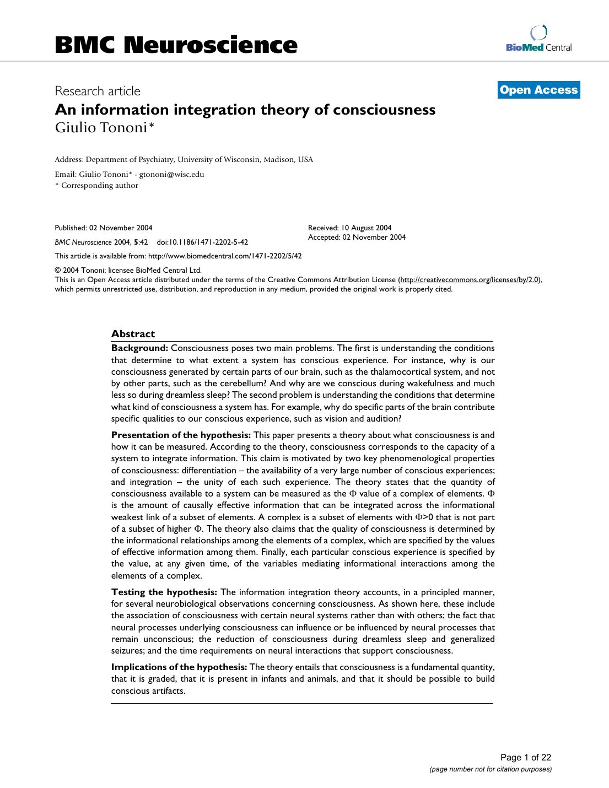
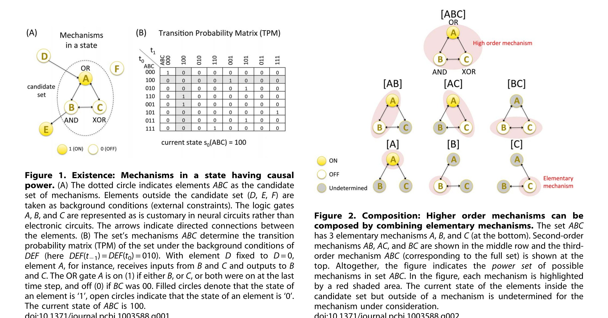
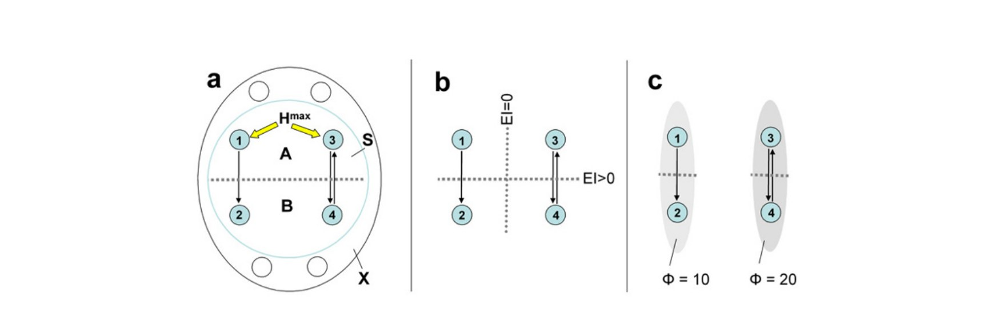
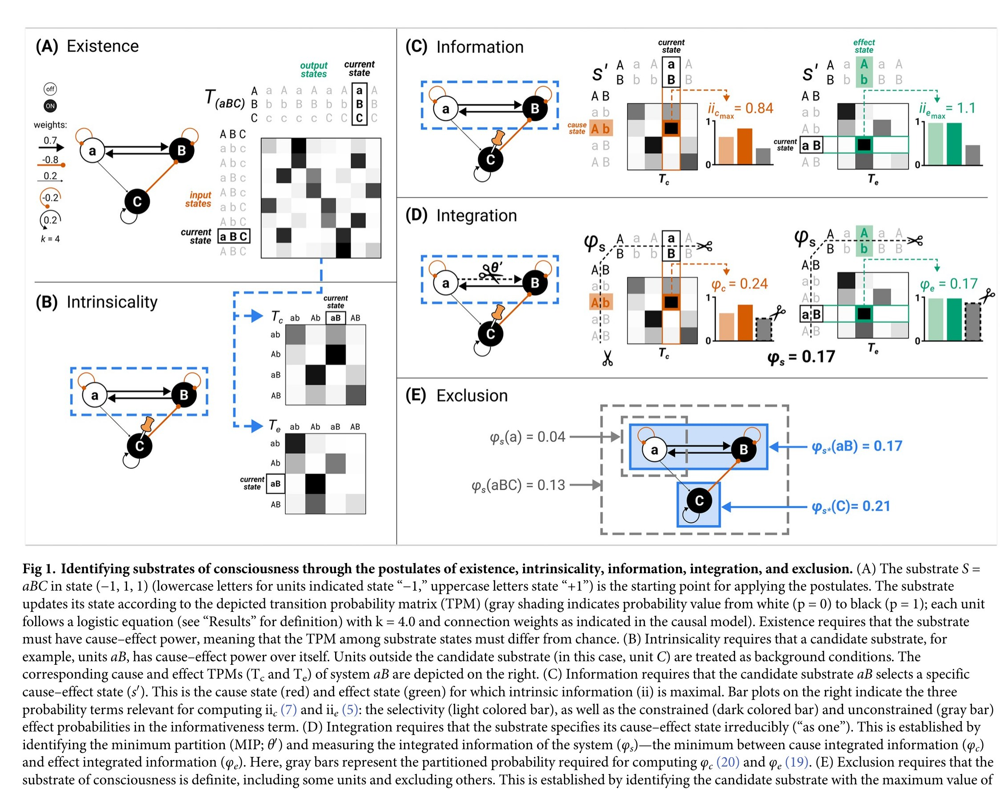
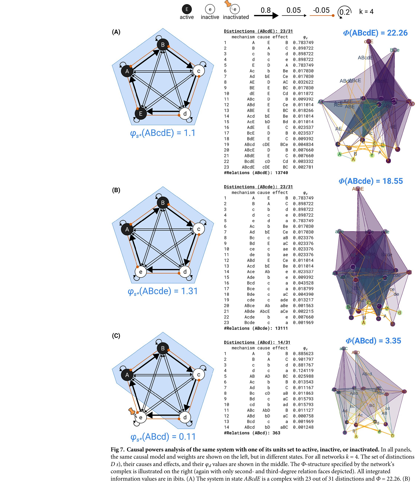
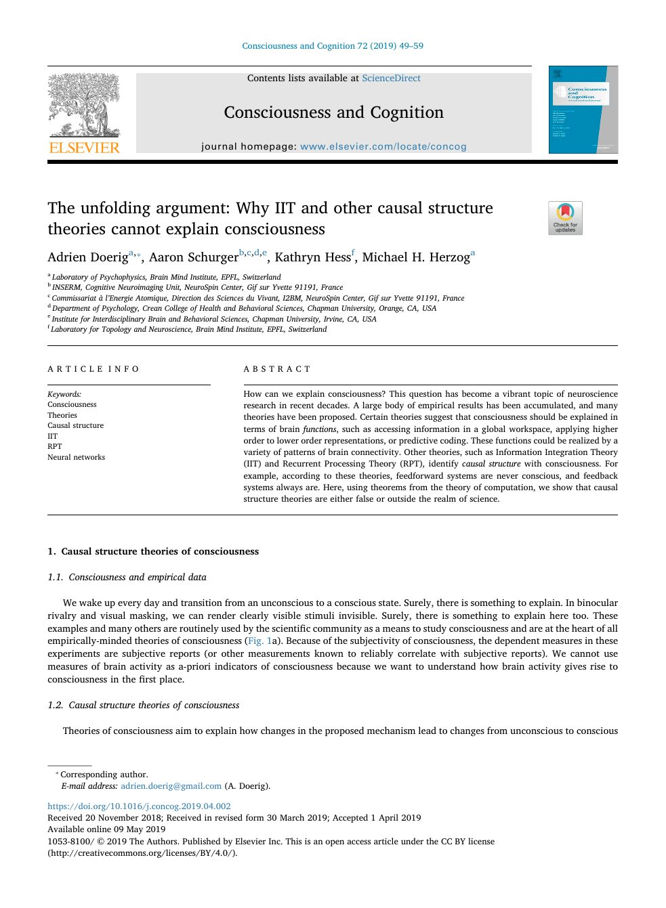

نظریهٔ اطلاعات یکپارچه <span class="ltr">(Integrated Information Theory — IIT)</span> با یک وارونگی روش‌شناختی آغاز می‌شود. تقریباً همهٔ نظریه‌های آگاهی از مغز آغاز می‌کنند و به تجربه می‌رسند: فعالیت عصبی مشاهده می‌شود و سپس پرسیده می‌شود که کدام بخش آن «آگاهانه» است. IIT مسیر را برعکس می‌رود. نقطهٔ آغاز، خودِ تجربه است؛ زیرا تجربه تنها چیزی است که وجودش بی‌واسطه و بدون استنتاج معلوم است. سپس پرسش این می‌شود: هر سامانهٔ فیزیکی، برای آن‌که چنین تجربه‌ای وجود داشته باشد، باید چه ویژگی‌هایی داشته باشد؟ پاسخ این پرسش، نخست به صورت آکسیوم‌هایی دربارهٔ تجربه و سپس به صورت اصل‌هایی <span class="ltr">(postulates)</span> دربارهٔ فیزیک صورت‌بندی می‌شود، و از دل آن‌ها یک دستگاه ریاضی بیرون می‌آید که کمیت مرکزی‌اش Φ (فی بزرگ) است.

این یادداشت در شش لایه پیش می‌رود: نخست مسئلهٔ دقیق و تمایزهای لازم؛ سپس تاریخ فشردهٔ چهار نسل نظریه؛ سپس آکسیوم‌ها و اصل‌ها؛ سپس ریاضیات کامل — از ماتریس احتمال گذار تا ساختار Φ در IIT 4.0 — با یک مثال عددی که همهٔ گام‌ها در آن با دست حساب می‌شود؛ سپس مثال‌هایی که هر یک وجه تازه‌ای از نظریه را نشان می‌دهند؛ و در پایان نقدها، پاسخ‌ها و آزمون‌های مرزی.

@@TOC@@

## <span class="no">۰ ـ</span> مسئلهٔ دقیق: دو پرسش، نه یک پرسش {#question}

IIT از همان مقالهٔ نخست دو پرسش را از هم جدا می‌کند و مدعی است نظریه‌ای کامل باید به هر دو پاسخ دهد:

- **پرسش سطح <span class="ltr">(level)</span>:** چه چیزی تعیین می‌کند که یک سامانه چه مقدار تجربه دارد؟ چرا مغز بیدار تجربهٔ غنی دارد، مغز در خواب عمیقِ بی‌رویا تقریباً هیچ، و مخچه — با نورون‌هایی بیشتر از قشر — سهمی در تجربه ندارد؟
- **پرسش کیفیت <span class="ltr">(quality)</span>:** چه چیزی تعیین می‌کند که یک تجربه چرا *همین* تجربه است و نه تجربه‌ای دیگر؟ چرا دیدن رنگ قرمز با شنیدن صدای زنگ فرق دارد، در حالی که هر دو «آگاهانه»اند؟

بیشتر نظریه‌ها فقط به پرسش نخست پاسخ می‌دهند و برای دومی چیزی جز همبستگی عصبی عرضه نمی‌کنند. ادعای متمایز IIT این است که یک ساختار ریاضی واحد به هر دو پاسخ می‌دهد: مقدار Φ به پرسش سطح پاسخ می‌دهد و *شکل* ساختار علّیِ سامانه — هندسهٔ آن در فضای حالت‌ها — به پرسش کیفیت.

<DefBox label="صورت‌بندی دقیق ادعای مرکزی IIT">تجربه با یک ساختار علّی یکسان است: هر تجربه دقیقاً همان «ساختار Φ» <span class="ltr">(Φ-structure)</span>ای است که یک مجموعهٔ بیشینه‌ناپذیرپذیر از واحدها، در یک حالت معین، مشخص می‌کند؛ و مقدار آگاهی آن تجربه برابر است با Φ همان ساختار. نه همبستگی، نه هم‌ارزی کارکردی؛ این‌همانی <span class="ltr">(identity)</span>.</DefBox>

سه تمایز از همین آغاز لازم است. نخست، **اطلاعات شانون** <span class="ltr">(Shannon information)</span> با «اطلاعات» در IIT یکی نیست: اطلاعات شانون دربارهٔ انتقال پیام میان فرستنده و گیرنده و کاهش عدم‌قطعیت گیرنده است و ناظر بیرونی می‌خواهد؛ اطلاعات در IIT «تفاوتی است که برای خودِ سامانه تفاوت می‌سازد» — درون‌زاد <span class="ltr">(intrinsic)</span> است و ناظر نمی‌خواهد. دوم، **پیچیدگی** با یکپارچگی یکی نیست: سامانه‌ای کاملاً تصادفی پیچیده است اما یکپارچه نیست؛ سامانه‌ای کاملاً هم‌زمان یکپارچه است اما متمایز نیست. IIT هر دو را با هم می‌خواهد. سوم، IIT نظریه‌ای دربارهٔ **قدرت علّی** <span class="ltr">(cause–effect power)</span> است، نه دربارهٔ همبستگی یا جریان داده: پرسش همیشه این است که حالت فعلی سامانه، حالت‌های گذشته و آیندهٔ خودش را چقدر و چگونه محدود می‌کند.

## <span class="no">۱ ـ</span> چهار نسل نظریه: ۲۰۰۴ تا ۲۰۲۳ {#history}

نظریه در چهار صورت‌بندی اصلی منتشر شده است و تفاوت نسل‌ها صوری نیست؛ کمیت مرکزی، واحد تحلیل و حتی پاسخ نظریه به برخی مثال‌ها میان نسل‌ها عوض شده است.

| نسل | متن اصلی | کمیت مرکزی | واحد تحلیل |
|---|---|---|---|
| IIT 1.0 | تونونی <span class="ltr">(Giulio Tononi)</span>، ۲۰۰۴، *BMC Neuroscience* | خوشه‌های اطلاعات و Φ بر پایهٔ اطلاعات مؤثر | مجموعهٔ عناصر و زیرمجموعه‌ها |
| IIT 2.0 | تونونی، ۲۰۰۸، *The Biological Bulletin* | Φ بر پایهٔ مخزن‌های علّی ـ معلولی و فاصلهٔ متحرک زمین <span class="ltr">(EMD)</span> | مکانیسم‌ها و مخزن‌ها |
| IIT 3.0 | اویزومی <span class="ltr">(Masafumi Oizumi)</span>، آلبانتاکیس <span class="ltr">(Larissa Albantakis)</span> و تونونی، ۲۰۱۴، *PLOS Computational Biology* | Φ با برش کمینهٔ اطلاعات <span class="ltr">(MIP)</span> و اصل طرد | کمپلکس‌ها <span class="ltr">(complexes)</span> |
| IIT 4.0 | آلبانتاکیس و همکاران، ۲۰۲۳، *PLOS Computational Biology* | ساختار Φ؛ Φ به صورت مجموع تمایزها و رابطه‌ها، با سنجهٔ «تفاوت درون‌زاد» | تمایزها <span class="ltr">(distinctions)</span> و رابطه‌ها <span class="ltr">(relations)</span> |

متن پل میان نسل‌ها مقالهٔ مروری تونونی و کوخ <span class="ltr">(Christof Koch)</span> است: <span class="ltr">“Consciousness: Here, There and Everywhere?”</span> در *Philosophical Transactions of the Royal Society B*، سال ۲۰۱۵، جلد ۳۷۰، شمارهٔ ۱۶۶۸ ([پیوند مقاله](https://doi.org/10.1098/rstb.2014.0167)). آن مقاله صورت‌بندی پنج آکسیوم را به زبان غیرفنی عرضه می‌کند و پیامدهای نظریه — از آگاهی در سامانه‌های ساده تا مسئلهٔ شبیه‌سازی — را صریح می‌پذیرید. صورت‌بندی آموزشی کامل دستگاه در مقالهٔ تونونی و همکاران، <span class="ltr">“Integrated Information Theory: From Consciousness to Its Physical Substrate”</span>، در *Nature Reviews Neuroscience*، سال ۲۰۱۶، جلد ۱۷، صص. ۴۵۰–۴۶۱ آمده است ([پیوند مقاله](https://doi.org/10.1038/nrn.2016.44)).

<Bio name="جولیو تونونی (Giulio Tononi)" role="عصب‌شناس و روان‌پزشک ایتالیایی · زادهٔ ۱۹۶۰، ترنتو (Trento)" img="../bio/tononi.jpg" alt="پرترهٔ جولیو تونونی">

**مسیر علمی.** تونونی پزشکی و روان‌پزشکی را در پیزا <span class="ltr">(Pisa)</span> گذراند و در مؤسسهٔ علوم اعصاب سن‌دیگو <span class="ltr">(The Neurosciences Institute, San Diego)</span> با جرالد ادلمن <span class="ltr">(Gerald Edelman)</span> روی پیچیدگی عصبی کار کرد؛ اکنون استاد دانشگاه ویسکانسین ـ مدیسن <span class="ltr">(University of Wisconsin–Madison)</span> است. زندگی‌نامهٔ کامل‌تر او در یادداشت ۲ آمده است؛ این‌جا فقط آنچه به ریاضیات نظریه مربوط است ثبت می‌شود.

**از پیچیدگی عصبی تا Φ.** پیش از IIT، تونونی با ادلمن و اسپورنز <span class="ltr">(Olaf Sporns)</span> سنجهٔ «پیچیدگی عصبی» را ساخته بود: سامانه‌ای پیچیده است که در آن گروه‌های کوچک نورونی تخصصی و مستقل‌اند و گروه‌های بزرگ یکپارچه. مقالهٔ تونونی، اسپورنز و ادلمن، <span class="ltr">“A Measure for Brain Complexity”</span>، در *Proceedings of the National Academy of Sciences*، سال ۱۹۹۴، جلد ۹۱، صص. ۵۰۳۳–۵۰۳۷ منتشر شد. Φ صورت پخته و علّیِ همان شهود است: تمایز و یکپارچگی، این بار نه در همبستگی فعالیت، بلکه در قدرت علّی.

**این ادعا دقیقاً از کدام متن‌هاست؟** مقالهٔ بنیان‌گذار: <span class="ltr">“An Information Integration Theory of Consciousness”</span>، *BMC Neuroscience*، ۲۰۰۴، جلد ۵، مقالهٔ ۴۲ ([پیوند مقاله](https://doi.org/10.1186/1471-2202-5-42)). نسل سوم: <span class="ltr">“From the Phenomenology to the Mechanisms of Consciousness: Integrated Information Theory 3.0”</span>، *PLOS Computational Biology*، ۲۰۱۴، جلد ۱۰، شمارهٔ ۵ ([پیوند مقاله](https://doi.org/10.1371/journal.pcbi.1003588)). نسل چهارم: <span class="ltr">“Integrated Information Theory (IIT) 4.0: Formulating the Properties of Phenomenal Existence in Physical Terms”</span>، *PLOS Computational Biology*، ۲۰۲۳، جلد ۱۹، شمارهٔ ۱۰ ([پیوند مقاله](https://doi.org/10.1371/journal.pcbi.1011465)).

**نقدها و پاسخ‌ها** در بخش ۶ همین یادداشت با آدرس دقیق آمده است.

<p class="credit">عکس: پرترهٔ تونونی، از مجلهٔ Quanta.</p>

</Bio>

<figure class="papershot"><a href="https://doi.org/10.1186/1471-2202-5-42"></a><figcaption>صفحهٔ نخست مقالهٔ بنیان‌گذار IIT ـ <span class="ltr">BMC Neuroscience</span>، ۲۰۰۴. برای گشودن متن کامل، روی تصویر کلیک کنید.</figcaption></figure>

## <span class="no">۲ ـ</span> پنج آکسیوم و پنج اصل {#axioms}

دستگاه IIT با پنج گزاره دربارهٔ تجربه آغاز می‌شود که «آکسیوم» <span class="ltr">(axiom)</span> نام دارند، چون قرار نیست از چیزی بنیادی‌تر استنتاج شوند؛ هر کس می‌تواند آن‌ها را در تجربهٔ خودش بی‌واسطه بررسی کند. در برابر هر آکسیوم، یک «اصل» <span class="ltr">(postulate)</span> دربارهٔ سامانهٔ فیزیکی قرار می‌گیرد: شرطی که بستر فیزیکی تجربه باید داشته باشد تا آن ویژگی تجربه وجود داشته باشد. صورت‌بندی زیر صورت‌بندی IIT 4.0 است؛ در نسل‌های پیشین ترتیب و نام‌ها اندکی فرق داشت — آکسیوم پنجم در صورت‌بندی‌های قدیمی «طرد» <span class="ltr">(exclusion)</span> بود و در 4.0 «معین‌بودن» <span class="ltr">(definiteness)</span> نام دارد و طرد به صورت اصلِ متناظر آن بازگشته است.

| آکسیوم (دربارهٔ تجربه) | اصل (دربارهٔ سامانهٔ فیزیکی) | معنای ریاضی آن |
|---|---|---|
| **وجود درون‌زاد** <span class="ltr">(intrinsic existence)</span> — تجربه وجود دارد و برای خودِ تجربه‌کننده است | سامانه باید بر خود قدرت علّی داشته باشد: حالت‌هایش، گذشته و آیندهٔ خودش را محدود کند | مخزن علّی و معلولیِ سامانه از حاصل‌ضرب مخزن‌های اجزای مستقل بیشتر است |
| **ساختار** <span class="ltr">(structure)</span> — تجربه مرکب است: از تمایزهای بسیار ساخته شده، مانند صحنه‌ای با رنگ‌ها، لبه‌ها، صداها و فکرها | هر زیرمجموعهٔ سامانه که قدرت علّی مشخصی دارد، یک «تمایز» به ساختار می‌افزاید | ساختار Φ از تمایزها و رابطه‌های میان آن‌ها ساخته می‌شود |
| **اطلاعات** <span class="ltr">(information)</span> — هر تجربه همین تجربهٔ خاص است: از میان بی‌شمار تجربهٔ ممکن، دقیقاً این یکی | حالت فعلی سامانه باید گذشته و آینده را به یک حالت خاص محدود کند، نه به هر حالتی | مخزن علّی ـ معلولی «مشخص» است: توزیعی تیز، نه یکنواخت |
| **یکپارچگی** <span class="ltr">(integration)</span> — تجربه یکی است و به تجربه‌های مستقل تجزیه‌پذیر نیست | ساختار باید ناپذیرپذیر <span class="ltr">(irreducible)</span> باشد: بریدنش باید چیزی از قدرت علّی بکاهد | φ و Φ بزرگ‌تر از صفر؛ برش کمینه دقیقاً همان‌جا که کمترین کاستن رخ می‌دهد |
| **معین‌بودن** <span class="ltr">(definiteness)</span> — تجربه دقیقاً همین مقدار محتوا دارد؛ نه کمتر، نه بیشتر | فقط مجموعه‌ای که Φ آن بیشینه است وجود دارد؛ مجموعه‌های دربرگیرنده و دربرگرفته‌شده طرد می‌شوند | اصل طرد <span class="ltr">(exclusion postulate)</span>: یک کمپلکس، با مرز معین |

<Mind title="صحنهٔ ذهنی پشت آکسیوم‌ها: صحنهٔ دیداری و صفحهٔ کتاب">تونونی برای آکسیوم اطلاعات مثالی ساده می‌آورد: صفحه‌ای از کتاب را می‌بینید. تجربهٔ فعلی فقط «روشنایی» نیست؛ همین صفحه است، با همین واژه‌ها، در همین جای میدان دید، و نه هیچ‌یک از بی‌شمار صفحهٔ دیگری که می‌توانست باشد. هر تجربه، با بودنِ همین تجربه، بی‌شمار تجربهٔ ممکن دیگر را *نفی* می‌کند و دقیقاً همین نفی‌کردن، محتوای اطلاعاتی آن است. و برای یکپارچگی: صحنهٔ دیداری را نمی‌توان به «نیمهٔ چپِ مستقل» و «نیمهٔ راستِ مستقل» برید؛ نیمهٔ چپِ صحنه، بدون راست، همان تجربه نیست. تجربه یا کل است یا اصلاً آن تجربه نیست.</Mind>

نکتهٔ روش‌شناختی مهم: آکسیوم‌ها در IIT «فرضیه» نیستند که با آزمایش رد شوند؛ چارچوب‌اند. آنچه آزمون‌پذیر است اصل‌ها و پیامدهای آن‌هاست: مثلاً این پیش‌بینی که در خواب عمیق و بیهوشی، پاسخ مغز به تحریک، هم از نظر گسترش و هم از نظر تمایز فرو می‌کاهد — پیش‌بینی‌ای که با سنجهٔ PCI در بخش ۵ بررسی می‌شود.

## <span class="no">۳ ـ</span> ریاضیات: از ماتریس گذار تا ساختار Φ {#math}

پیش از ورود به فرمول‌ها، نقشهٔ راه این بخش را باید دید: هر یک از پنج آکسیوم، در یک گامِ ریاضیِ معین به اصل تبدیل می‌شود و همان گام است که فرمولِ آن را می‌سازد. جدول زیر این تناظر را نشان می‌دهد؛ بقیهٔ بخش، همان جدول است که باز شده است.

| آکسیوم (دربارهٔ تجربه) | اصلِ متناظر (دربارهٔ سامانه) | صورت ریاضی | گام |
|---|---|---|---|
| وجود درون‌زاد | سامانه بر خود قدرت علّی دارد | TPM و مخزن‌های علّی ـ معلولی | ۳ـ۲ و ۳ـ۳ |
| اطلاعات | حالت فعلی، گذشته و آینده را به یک حالت خاص محدود می‌کند | مخزن مشخص؛ اطلاعات درون‌زاد (ii) | ۳ـ۳ و ۳ـ۵ |
| ساختار | هر زیرمجموعهٔ دارای قدرت علّی، یک تمایز است | تمایزها و رابطه‌ها؛ ساختار Φ | ۳ـ۸ |
| یکپارچگی | ساختار ناپذیرپذیر است | برش، MIP و φ سامانه | ۳ـ۶ |
| معین‌بودن | فقط مجموعهٔ بیشینه وجود دارد | بیشینه‌گیری روی نامزدها؛ کمپلکس | ۳ـ۷ |

و زنجیرهٔ اتصال فرمول‌ها چنین است: از TPM دو مخزن خوانده می‌شود (۳ـ۳)؛ فاصلهٔ هر مخزن از بی‌قید، اطلاعاتِ درون‌زاد است (۳ـ۵)؛ بریدنِ پیوندها این اطلاعات را می‌کاهد و کمینهٔ کاستن، φ است (۳ـ۶)؛ بیشینه‌گیری روی همهٔ نامزدها کمپلکس را می‌سازد (۳ـ۷)؛ و درونِ کمپلکس، مجموعِ تمایزها و رابطه‌ها Φ را می‌دهد (۳ـ۸). فضای کیفی (۳ـ۹) همان ساختار را به‌مثابهٔ هندسهٔ تجربه می‌خواند و دانه‌بندی و مقیاس زمانی (۳ـ۱۰) تعیین می‌کنند این محاسبه روی کدام واحدها و کدام گام انجام شود.

### ۳ـ۱. نقطهٔ شروع: اطلاعات شانون در برابر اطلاعات درون‌زاد

پیش از هر فرمولی، تفاوت دو مفهوم «اطلاعات» باید با عدد روشن شود. آنتروپی شانونِ یک متغیر تصادفی و اطلاعات متقابل دو متغیر چنین تعریف می‌شوند:

```tex
\begin{aligned}
H(X) &= -\sum_{x} p(x)\,\log_2 p(x) \\
I(X;Y) &= \sum_{x,y} p(x,y)\,\log_2 \frac{p(x,y)}{p(x)\,p(y)} = H(X) - H(X \mid Y)
\end{aligned}
```

هر دو کمیت دربارهٔ *توزیع مشاهده‌شده*‌اند: ناظری بیرونی نمونه‌ها را می‌شمارد و عدم‌قطعیتش کم می‌شود. هیچ مداخله‌ای در کار نیست؛ $I(X;Y)$ بالا می‌تواند از یک علت مشترک پنهان بیاید، بی‌آن‌که $X$ هیچ قدرت علّی بر $Y$ داشته باشد. اطلاعات در IIT از جنس دیگری است: فقط با **مداخله** <span class="ltr">(intervention)</span> تعریف می‌شود — سامانه به زور در حالتی نشانده می‌شود و دیده می‌شود که این نشاندن، احتمال حالت‌های دیگر خودش را چقدر جابه‌جا می‌کند. نماد این مداخله، عملگر <span class="ltr">do</span> جودیا پرل <span class="ltr">(Judea Pearl)</span> است: $p(y \mid do(x))$ احتمال $y$ است وقتی $x$ از بیرون تحمیل شده، نه وقتی که فقط دیده شده است. همهٔ فرمول‌های بعدی IIT روی همین احتمال‌های مداخله‌ای ساخته می‌شوند، و دقیقاً به همین دلیل است که دو سامانهٔ هم‌رفتار و هم‌آنتروپی می‌توانند Φ متفاوت بگیرند.

نمادهای دو فرمول نخست را یک‌به‌یک بخوانید: $X$ و $Y$ دو متغیر تصادفی‌اند؛ $p(x)$ احتمالِ آن است که $X$ دقیقاً حالت $x$ را بگیرد؛ $H(X)$ آنتروپیِ $X$ است، یعنی میانگینِ شگفتیِ مشاهدهٔ $X$، بر حسب بیت — لگاریتم در مبنای ۲ یعنی واحد، بیت است؛ $H(X \mid Y)$ آنتروپیِ $X$ است وقتی $Y$ دانسته شده؛ و $I(X;Y)$ اطلاعات متقابل است: چقدر دانستنِ $Y$ از عدم‌قطعیتِ $X$ می‌کاهد. هر دو فرمول فقط روی توزیعِ مشاهده‌شده حساب می‌شوند و به همین دلیل، علت را از همبستگی جدا نمی‌کنند.

تفاوت مشاهده و مداخله را با دو سامانهٔ دودوییِ کوچک می‌توان با عدد نشان داد. در سامانهٔ الف، $Y$ کپیِ مستقیمِ $X$ است ($Y = X$) و $X$ یکنواخت است: اطلاعات متقابل $I(X;Y) = 1$ بیت است، چون $H(Y) = 1$ و $H(Y \mid X) = 0$؛ و مداخله هم همین را می‌گوید: $p(Y=1 \mid do(X=1)) = 1$. در سامانهٔ ب، یک علت مشترکِ پنهانِ $Z$ یکنواخت، هر دو را می‌سازد ($X = Z$ و $Y = Z$): از بیرون همان همبستگیِ کامل دیده می‌شود و باز $I(X;Y) = 1$ بیت است؛ اما مداخله روی $X$ به $Z$ نمی‌رسد و $Y$ یکنواخت می‌ماند: $p(Y=1 \mid do(X=1)) = 1/2$. پس دو سامانه با اطلاعات شانونِ یکسان، قدرت علّیِ متفاوت دارند؛ و فرمول‌های IIT، که همه روی $p(y \mid do(x))$ ساخته می‌شوند، دقیقاً همین تفاوت را می‌گیرند.

### ۳ـ۲. سامانه، حالت و ماتریس احتمال گذار

سامانه $S$ مجموعه‌ای از $n$ واحد <span class="ltr">(units)</span> است. در صورت‌بندی ۲۰۲۳ هر واحد دو حالت دارد ($-1$ و $+1$؛ در نسل‌های پیشین $0$ و $1$) و فضای حالت سامانه $\Omega_S$ دقیقاً $2^n$ عضو دارد. دینامیک کامل سامانه در **ماتریس احتمال گذار** <span class="ltr">(transition probability matrix — TPM)</span> خلاصه می‌شود:

```tex
T_e = \Bigl[\, p_e\bigl(s' \mid do(s)\bigr) \Bigr]_{s,\, s' \,\in\, \Omega_S}, \qquad \sum_{s'} p_e(s' \mid do(s)) = 1
```

یعنی سطر $s$ام TPM توزیع احتمال حالت بعدی است، وقتی سامانه با مداخله در حالت $s$ نشانده شده باشد. دو فرض ساختاری در همهٔ نسل‌ها ثابت است: **شرط مارکوف** <span class="ltr">(Markov property)</span> — حالت بعدی، داده‌شدهٔ حالت فعلی، از تاریخچه مستقل است — و **استقلال شرطی** <span class="ltr">(conditional independence)</span> — نویز واحدها مستقل است، تا TPM کل از ضرب TPM تک‌تک واحدها ساخته شود:

```tex
p_e\bigl(s' \mid do(s)\bigr) = \prod_{i=1}^{n} p_e\bigl(s'_i \mid do(s)\bigr)
```

در IIT 4.0 دو TPM از هم جدا نگه داشته می‌شوند: $T_e$ برای جهت معلولی (از حالت فعلی به آینده) و $T_c$ برای جهت علّی، و واحدهای بیرون از نامزدِ مورد بررسی — پس‌زمینه <span class="ltr">(background conditions)</span> با نماد $W$ — به صورت علّی حاشیه‌ای‌سازی <span class="ltr">(causally marginalised)</span> می‌شوند: ورودی‌هایشان با نویز مستقل جایگزین می‌شود تا قدرت علّیِ «خودِ» نامزد سنجیده شود، نه قدرتِ وام‌گرفته از محیط.

نمادهای این بخش را یک‌به‌یک بخوانید: $S$ خودِ سامانه است؛ $n$ شمار واحدهای آن؛ $\Omega_S$ فضای حالت سامانه، یعنی همهٔ ترکیب‌های ممکنِ حالت واحدها — چون هر واحد دو حالت دارد، شمار عضوهای آن $2^n$ است؛ $s$ حالت فعلی و $s'$ حالت بعدی است؛ $T_e$ ماتریس گذارِ معلولی (به‌سوی آینده) و $T_c$ ماتریس گذارِ علّی (از سوی گذشته) است؛ و $W$ پس‌زمینه است، یعنی واحدهایی که بیرون از نامزدِ مورد بررسی‌اند. برای سامانهٔ سه‌واحدیِ مقالهٔ ۲۰۱۴، فضای حالت $2^3 = 8$ عضو دارد و TPM یک ماتریس $8 \times 8$ با $64$ درایه است — هر درایه، احتمالِ یک گذارِ معین است.

دو فرض ساختاریِ TPM هر یک کاری مشخص می‌کنند. شرط مارکوف می‌گوید آینده، داده‌شدهٔ حالت فعلی، از تاریخچه مستقل است؛ بی‌آن، TPM به‌تنهایی دینامیک را خلاصه نمی‌کرد و برای هر گذار باید کل گذشته دانسته می‌شد. استقلال شرطی می‌گوید نویز واحدها مستقل است؛ بی‌آن، TPM کل از TPM تک‌تک واحدها ساخته نمی‌شد و هر سامانه به ماتریسی نیاز داشت که درایه‌هایش را نتوان از اجزا به دست آورد. و حاشیه‌ای‌سازیِ پس‌زمینه برای این است که قدرت علّیِ سنجیده‌شده، قدرتِ «خودِ» نامزد باشد: اگر ورودی‌های $W$ آزاد گذاشته شوند، قیدی که در مخزن دیده می‌شود ممکن است قیدِ محیط باشد، نه قیدِ سامانه.

<figure class="figshot"><a href="https://doi.org/10.1371/journal.pcbi.1003588"></a><figcaption>برش از PDF اصلی مقالهٔ IIT 3.0 ـ اویزومی <span class="ltr">(Oizumi)</span>، آلبانتاکیس <span class="ltr">(Albantakis)</span> و تونونی، <span class="ltr">PLOS Computational Biology</span>، ۲۰۱۴، شکل‌های ۱ و ۲: سامانهٔ آموزشیِ سه واحدی با گیت‌های OR و AND و XOR در حالت ABC = 100، و TPM کامل آن (ماتریس 8 × 8). همین سامانه در سراسر مقالهٔ ۲۰۱۴ مثال محاسباتی اصلی است. برای متن کامل، روی تصویر کلیک کنید.</figcaption></figure>

<figure class="diagram"><p class="d-title">TPM یک سامانهٔ دوواحدیِ قطعی</p><p class="d-sub">سامانهٔ SWAP: هر واحد در گام بعد حالت واحد دیگر را می‌گیرد؛ A' = B و B' = A</p><table class="tpm"><thead><tr><th>s \ s′</th><th>00</th><th>01</th><th>10</th><th>11</th></tr></thead><tbody><tr><th>00</th><td class="on">1</td><td>0</td><td>0</td><td>0</td></tr><tr><th>01</th><td>0</td><td>0</td><td class="on">1</td><td>0</td></tr><tr><th>10</th><td>0</td><td class="on cur">1</td><td>0</td><td>0</td></tr><tr><th>11</th><td>0</td><td>0</td><td>0</td><td class="on">1</td></tr></tbody></table><figcaption>هر سطر یک توزیع کامل است: سامانهٔ قطعی در هر سطر دقیقاً یک ۱ دارد. خانهٔ قاب‌گرفته گذار از حالت فعلیِ ۱۰ به ۰۱ است؛ همین یک خانه، در بخش بعد، هم مخزن معلولی و هم مخزن علّی را تعیین می‌کند. در سامانه‌های تصادفی، مانند واحدهای لجستیک مقالهٔ ۲۰۲۳، سطرها توزیع‌هایی پهن‌اند و دقیقاً همین پهن‌شدن است که اطلاعات درون‌زاد را می‌کاهد.</figcaption></figure>

### ۳ـ۳. مخزن علّی و مخزن معلولی: دو توزیع از یک TPM

سامانه در حالت فعلی $s$ است. دو پرسش علّی از TPM پرسیده می‌شود: این حالت، کدام آینده را می‌سازد؟ و از کدام گذشته می‌توانسته بیاید؟ پاسخ‌ها دو توزیع‌اند.

**مخزن معلولی** <span class="ltr">(effect repertoire)</span> مستقیم از سطر $s$ام TPM خوانده می‌شود:

```tex
p_e\bigl(s' \mid s\bigr) = p_e\bigl(s' \mid do(s)\bigr)
```

**مخزن علّی** <span class="ltr">(cause repertoire)</span> با وارون‌سازی بیزی به دست می‌آید، با پیشین یکنواخت روی حالت‌های گذشته؛ یکنواختی پیشین یعنی هر حالت گذشته، از دید مداخله، به یک اندازه در دسترس است:

```tex
p_c\bigl(s_{\mathrm{past}} \mid s\bigr) = \frac{p_e\bigl(s \mid do(s_{\mathrm{past}})\bigr)\; p(s_{\mathrm{past}})}{\sum_{\tilde{s}} p_e\bigl(s \mid do(\tilde{s})\bigr)\; p(\tilde{s})}, \qquad p(s_{\mathrm{past}}) = \frac{1}{2^n}
```

در برابر این دو، **مخزن بی‌قید** <span class="ltr">(unconstrained repertoire)</span> قرار می‌گیرد: توزیعی که اگر حالت فعلی هیچ قیدی نمی‌گذاشت به دست می‌آمد — میانگین مخزن روی همهٔ مداخله‌های ممکن:

```tex
p_e(s') = \frac{1}{2^n} \sum_{s} p_e\bigl(s' \mid do(s)\bigr)
```

برای سامانهٔ SWAP در حالت $s = 10$: مخزن معلولی تک‌نقطه‌ای است، $p_e(01 \mid 10) = 1$؛ مخزن علّی نیز تک‌نقطه‌ای است، چون تنها گذشته‌ای که به ۱۰ می‌رسد ۰۱ است؛ و مخزن بی‌قید یکنواخت است، $p_e(s') = 1/4$، چون TPM یک جایگشت است و هر ستون هم دقیقاً یک ۱ دارد. فاصلهٔ مخزن‌ها از بی‌قید، مادهٔ خام همهٔ سنجه‌های بعدی است.

حساب مخزن علّیِ SWAP را قدم‌به‌قدم می‌توان دید. درایه‌های ستونِ حالتِ ۱۰ در TPM چنین‌اند: فقط گذشتهٔ ۰۱ به ۱۰ می‌رسد، پس $p_e(10 \mid do(01)) = 1$ و برای سه گذشتهٔ دیگر صفر است. صورتِ کسرِ بیز برای گذشتهٔ ۰۱ می‌شود $1 \times \frac{1}{4} = \frac{1}{4}$ و مخرج، مجموع روی هر چهار گذشته، نیز $\frac{1}{4}$ است؛ پس $p_c(01 \mid 10) = \frac{1/4}{1/4} = 1$. پیشینِ یکنواخت، $p(s_{\mathrm{past}}) = \frac{1}{2^n}$، این‌جا کارِ مهمی می‌کند: بی‌آن، گذشته‌هایی که در مشاهدهٔ بیرونی پرتکرارند، در مخزن علّی سنگین‌تر می‌شدند و مخزن، به‌جای قدرت علّیِ سامانه، فراوانیِ محیط را نشان می‌داد. و مخزن بی‌قیدِ معلولی، $p_e(s') = \frac{1}{4}$ برای هر چهار حالت، از این می‌آید که TPM یک جایگشت است: هر سطر یک ۱ دارد و هر ستون نیز یک ۱، پس میانگینِ ستون‌ها یکنواخت می‌شود.

<figure class="diagram"><p class="d-title">سه توزیعِ یک حالت: بی‌قید، معلولی، بریده‌شده</p><p class="d-sub">سامانهٔ SWAP در حالت ۱۰ ـ احتمال حالت‌های ۰۰، ۰۱، ۱۰، ۱۱</p><svg viewBox="0 0 640 210" role="img" aria-label="نمودار میله‌ای سه توزیع احتمال"><text x="320" y="18" text-anchor="middle" font-size="13" fill="var(--muted)" class="svg-label">ارتفاع میله = احتمال</text><g font-size="12" class="svg-label"><text x="90" y="42" text-anchor="middle" fill="var(--ink)">بی‌قید</text><text x="320" y="42" text-anchor="middle" fill="var(--ink)">معلولیِ کامل</text><text x="550" y="42" text-anchor="middle" fill="var(--ink)">پس از برش A|B</text></g><g fill="var(--muted)" opacity="0.55"><rect x="40" y="110" width="22" height="40"/><rect x="70" y="110" width="22" height="40"/><rect x="100" y="110" width="22" height="40"/><rect x="130" y="110" width="22" height="40"/></g><g fill="var(--teal)"><rect x="270" y="150" width="22" height="0"/><rect x="300" y="50" width="22" height="100"/><rect x="330" y="150" width="22" height="0"/><rect x="360" y="150" width="22" height="0"/></g><g fill="var(--ochre)"><rect x="500" y="100" width="22" height="50"/><rect x="530" y="100" width="22" height="50"/><rect x="560" y="150" width="22" height="0"/><rect x="590" y="150" width="22" height="0"/></g><g font-size="11" fill="var(--muted)" class="svg-label"><text x="90" y="172" text-anchor="middle">¼ ، ¼ ، ¼ ، ¼</text><text x="320" y="172" text-anchor="middle">۰ ، ۱ ، ۰ ، ۰</text><text x="550" y="172" text-anchor="middle">½ ، ½ ، ۰ ، ۰</text></g><line x1="30" y1="150" x2="620" y2="150" stroke="var(--line2, var(--line))" stroke-width="1"/></svg><figcaption>حالت فعلیِ ۱۰ آینده را به یک نقطه فشرده می‌کند (میلهٔ میانی). بریدن پیوند میان دو واحد، همین فشردگی را نیمه می‌کند: هر واحد جدا فقط نیمی از قید را نگه می‌دارد. سنجه‌های ii و φ در ادامه، دقیقاً همین فاصله‌ها را به بیت تبدیل می‌کنند.</figcaption></figure>

### ۳ـ۴. نسل اول و دوم: اطلاعات مؤثر و EMD

در IIT 1.0 (تونونی، ۲۰۰۴) کمیت پایه **اطلاعات مؤثر** <span class="ltr">(effective information — EI)</span> بود: سامانه به دو بخش $A$ و $B$ بریده می‌شود، به خروجی‌های $A$ نویز با آنتروپی بیشینه ($H^{\max}$) تزریق می‌شود — یعنی $A$ با مداخله به همهٔ حالت‌هایش واداشته می‌شود — و اطلاعات متقابلِ حاصل با $B$ سنجیده می‌شود:

```tex
\begin{aligned}
EI(A \to B) &= I\bigl(A^{H^{\max}}; B\bigr) \\
EI(A \rightleftharpoons B) &= EI(A \to B) + EI(B \to A) \\
\Phi_{1.0}(S) &= \frac{EI(A \rightleftharpoons B)\big|_{\mathrm{MIB}}}{K}, \qquad K = \min\bigl\{ H^{\max}(A),\, H^{\max}(B) \bigr\}
\end{aligned}
```

که در آن MIB همان **دوشقهٔ کمینهٔ اطلاعات** <span class="ltr">(minimum information bipartition)</span> است: دوشقه‌ای که اطلاعات مؤثرِ نرمال‌شده در آن کمینه است. در شکل ۱ مقالهٔ ۲۰۰۴، زیرمجموعهٔ چهارعنصری $\{1,2,3,4\}$ در دوشقهٔ $\{1,2\}/\{3,4\}$ اطلاعات مؤثر صفر می‌گیرد و همان MIB است، و دو جفت $\{1,2\}$ و $\{3,4\}$ به ترتیب با $\Phi = 10$ و $\Phi = 20$ کمپلکس‌اند، چون در هیچ ابرمجموعه‌ای با Φ بزرگ‌تر حل نمی‌شوند.

<figure class="figshot"><a href="https://doi.org/10.1186/1471-2202-5-42"></a><figcaption>برش از PDF اصلی مقالهٔ بنیان‌گذار ـ تونونی، <span class="ltr">BMC Neuroscience</span>، ۲۰۰۴، شکل ۱: (a) تزریق آنتروپی بیشینه برای سنجش اطلاعات مؤثر میان دو بخش یک زیرمجموعه؛ (b) دوشقه‌ای که در آن EI = 0 است و MIB همان است؛ (c) دو کمپلکس با Φ = 10 و Φ = 20. برای متن کامل، روی تصویر کلیک کنید.</figcaption></figure>

در IIT 2.0 و 3.0 فاصلهٔ میان توزیع‌ها با **فاصلهٔ متحرک زمین** <span class="ltr">(earth mover's distance — EMD)</span> سنجیده می‌شود: کمینهٔ هزینهٔ جابه‌جایی تودهٔ احتمال از توزیعی به توزیع دیگر، وقتی هزینهٔ جابه‌جایی میان دو حالت برابر فاصلهٔ همینگ آن‌هاست:

```tex
\mathrm{EMD}(p, q) = \min_{f} \sum_{x, y} f(x, y)\, d_H(x, y), \qquad \text{subject to } f \text{ transports } p \text{ to } q
```

اطلاعات علّی و معلولیِ یک مکانیسم، فاصلهٔ مخزن‌هایش از مخزن بی‌قید است و اطلاعات علّی ـ معلولی مکانیسم کمینهٔ آن دو:

```tex
\begin{aligned}
ci &= \mathrm{EMD}\bigl(p_{\mathrm{cause}},\, p^{uc}\bigr), \qquad ei = \mathrm{EMD}\bigl(p_{\mathrm{effect}},\, p^{uc}\bigr) \\
\mathrm{cei} &= \min(ci,\, ei)
\end{aligned}
```

در سطح سامانه نیز همین الگو با «اطلاعات مفهومی» <span class="ltr">(conceptual information — CI)</span> تکرار می‌شود: فاصلهٔ ساختار مفهومی از «مفهوم تهی». در مثال آموزشی مقالهٔ ۲۰۱۴، برای سامانهٔ ABC در حالت ۱۰۰، مقاله مقدار $CI = 2.11$ را گزارش می‌کند (معادلهٔ ۱۰ آن مقاله)؛ و برای مکانیسم $A = 1$، هستهٔ علّی $\varphi^{\max}_{cause} = 0.17$ و هستهٔ معلولی $\varphi^{\max}_{effect} = 0.25$ است و $\varphi^{\max}$ مکانیسم کمینهٔ آن دو، یعنی $0.17$ (شکل ۹ آن مقاله).

نمادهای این بخش: $H^{\max}$ بیشینهٔ آنتروپیِ ممکنِ یک بخش است، یعنی آنتروپی وقتی همهٔ حالت‌هایش هم‌احتمال‌اند؛ $K$ عاملِ نرمال‌سازی است، کمینهٔ $H^{\max}$ دو بخش، تا Φ زیرمجموعه‌های بزرگ‌تر را فقط به‌سبب بزرگی‌شان برنده نکند؛ $MIB$ دوشقه‌ای است که EIِ نرمال‌شده در آن کمینه است؛ در EMD، $f(x, y)$ طرحِ حمل است — چه مقدار از تودهٔ احتمال از حالت $x$ به حالت $y$ برده شود — و $d_H(x, y)$ فاصلهٔ همینگ است، یعنی شمارِ واحدهایی که حالت‌شان در $x$ و $y$ فرق می‌کند.

فاصلهٔ EMD را روی همان SWAP می‌توان با دست حساب کرد. مخزن معلولی در حالت ۱۰، تک‌نقطه‌ای است: همهٔ تودهٔ احتمال روی ۰۱ است؛ و مخزن بی‌قید، $\frac{1}{4}$ روی هر چهار حالت. برای بردن توده از اولی به دومی باید $\frac{1}{4}$ را به ۰۰ برد (فاصلهٔ همینگ ۱)، $\frac{1}{4}$ را به ۱۰ برد (فاصلهٔ ۲) و $\frac{1}{4}$ را به ۱۱ برد (فاصلهٔ ۱)؛ هزینه می‌شود $\frac{1}{4} \times 1 + \frac{1}{4} \times 2 + \frac{1}{4} \times 1 = 1$. پس $ei = 1$، بر حسب فاصلهٔ همینگ، نه بیت. از تقارنِ SWAP — ماتریس گذارش جایگشت است و وارونِ خودش است — مخزن علّی نیز تک‌نقطه‌ای و مخزن بی‌قیدِ علّی نیز یکنواخت است، پس $ci = 1$ و $cei = \min(1, 1) = 1$.

### ۳ـ۵. IIT 4.0: اطلاعات درون‌زاد (ii) و تفاوت درون‌زاد (ID)

نسل چهارم EMD را کنار می‌گذارد. سنجهٔ پایهٔ آن **تفاوت درون‌زاد** <span class="ltr">(intrinsic difference — ID)</span> است: برای دو توزیع $p$ و $q$، فقط حالتی شمرده می‌شود که نسبت احتمالش بیشینه است:

```tex
\mathrm{ID}(p \,\|\, q) = p(x^{*}) \log_2 \frac{p(x^{*})}{q(x^{*})}, \qquad x^{*} = \arg\max_{x} \frac{p(x)}{q(x)}
```

**اطلاعات درون‌زاد** <span class="ltr">(intrinsic information — ii)</span> دقیقاً یک ID است: میان مخزنِ مقید و مخزن بی‌قید، در حالت علّی یا معلولیِ برگزیده $\bar{s}$. صورت معلولی آن، معادلهٔ (۵) مقالهٔ ۲۰۲۳، چنین است:

```tex
ii_e\bigl(s, \bar{s}\bigr) = p_e\bigl(\bar{s} \mid s\bigr)\; \log_2 \frac{p_e\bigl(\bar{s} \mid s\bigr)}{p_e\bigl(\bar{s}\bigr)}
```

و صورت علّی (معادلهٔ (۷) همان مقاله) با همان ساختار، از راه بیز ساخته می‌شود:

```tex
ii_c\bigl(s, \bar{s}\bigr) = p_c\bigl(\bar{s} \mid s\bigr)\; \log_2 \frac{p_c\bigl(\bar{s} \mid s\bigr)}{p_c\bigl(\bar{s}\bigr)}
```

که در آن $p_c(\bar{s} \mid s)$ مخزن علّی است و $p_c(\bar{s})$ مخزن علّیِ بی‌قید — میانگینِ مخزن علّی روی همهٔ حالت‌های فعلیِ ممکن، با وزنِ یکسان. عامل نخست، **گزینش‌گری** <span class="ltr">(selectivity)</span> است — چه سهمی از مخزن روی همان یک حالت متمرکز است — و عامل لگاریتمی **اطلاع‌رسانی** <span class="ltr">(informativeness)</span> — آن حالت نسبت به شانس چقدر محتمل‌تر شده است. حالت علّی ـ معلولیِ بیشینه $\bar{s} = s'$ حالتی است که $ii$ روی آن بیشینه می‌شود، جداگانه در هر جهت:

```tex
s' = \bigl(s'_c,\, s'_e\bigr), \qquad s'_e = \arg\max_{\bar{s}} ii_e(s, \bar{s}), \qquad s'_c = \arg\max_{\bar{s}} ii_c(s, \bar{s})
```

چرا ID فقط حالتی را می‌شمارد که نسبتِ احتمالش بیشینه است، و نه همهٔ حالت‌ها؟ چون اطلاعاتِ درون‌زاد، اطلاعاتی است که سامانه «برای خودش» مشخص می‌کند: سامانه یک حالتِ خاص را برمی‌گزیند و بقیه را کنار می‌گذارد؛ مقایسهٔ دو توزیع از بیرون، با جمع‌زدن روی همهٔ حالت‌ها، کاری است که ناظر می‌کند، نه سامانه. EMD از همین‌جا کنار گذاشته شد: EMD میانگینِ هزینهٔ جابه‌جاییِ کلِ تودهٔ احتمال است و حالتی را که سامانه واقعاً مشخص کرده است، در میانِ همهٔ حالت‌ها حل می‌کند. ID فقط همان حالتِ برگزیده را می‌سنجد و به همین دلیل، واحدش ibit است، نه بیتِ شانون و نه فاصلهٔ همینگ.

برای سامانهٔ SWAP در حالت ۱۰، هر دو جهت کامل‌اند: $p_e(01 \mid 10) = 1$ و $p_e(01) = 1/4$، پس:

```tex
ii_e = 1 \times \log_2 \frac{1}{1/4} = 2 \ \text{ibits}
```

واحد ii و همهٔ کمیت‌های نسل چهارم **ibit** است: بیتِ درون‌زاد. تفاوت با بیت شانون در مخرج کسر است: در شانون، مخرج فراوانیِ مشاهده‌شده است؛ این‌جا احتمالِ بی‌قیدِ حاصل از مداخله‌های یکنواخت است. فتودیودِ تک‌واحدی را با همین فرمول می‌توان سنجید: یک واحد با دو حالت، در بهترین حالت $p(\bar{s} \mid s) = 1$ و $p(\bar{s}) = 1/2$، پس سقف $ii$ آن دقیقاً ۱ ibit است — یک تمایز، و نه چیزی بیشتر؛ و چون درونش هیچ برشی نیست، همین ۱ ibit همهٔ آن چیزی است که می‌تواند وجود داشته باشد. در مثال مقالهٔ ۲۰۲۳ نیز واحد منفرد $C$ به‌تنهایی یک کمپلکس است، با $\varphi_s(C) = 0.21$ (شکل ۱ آن مقاله)؛ کوچک، اما صفر نیست.


### ۳ـ۶. برش، MIP و φ سامانه در IIT 4.0

یک **برش** <span class="ltr">(partition)</span> با نماد $\theta$ سامانه را به بخش‌هایی تقسیم و پیوندهای میان بخش‌ها را «نویزی» می‌کند: سهم هر پیوند بریده‌شده با میانگین‌گیری روی حالت‌های ممکنِ سمت بریده‌شده جایگزین می‌شود (حاشیه‌ای‌سازی علّی؛ معادله‌های (۱۷) و (۱۸) مقالهٔ ۲۰۲۳). برش‌ها در IIT 4.0 **جهت‌دار**ند: برای هر بخش باید مشخص شود پیوندهای ورودی‌اش بریده می‌شوند، خروجی‌اش، یا هر دو؛ پس فضای برش‌ها از دوشقه‌های سادهٔ نسل اول بسیار بزرگ‌تر است. اطلاعات یکپارچهٔ معلولی روی برش $\theta$، افتِ $ii$ در اثر همان برش است (معادلهٔ (۱۹) مقالهٔ ۲۰۲۳):

```tex
\begin{aligned}
\varphi_e\bigl(T_e;\, s;\, \theta\bigr) &= p_e\bigl(s'_e \mid s\bigr) \left[ \log_2 \frac{p_e\bigl(s'_e \mid s\bigr)}{p_e^{\theta}\bigl(s'_e \mid s\bigr)} \right]_{+} \\
\varphi_c\bigl(T_c;\, s;\, \theta\bigr) &= p_c\bigl(s'_c \mid s\bigr) \left[ \log_2 \frac{p_c\bigl(s'_c \mid s\bigr)}{p_c^{\theta}\bigl(s'_c \mid s\bigr)} \right]_{+} \\
\varphi_s\bigl(T_e, T_c;\, s;\, \theta\bigr) &= \min\bigl\{ \varphi_c(\theta),\, \varphi_e(\theta) \bigr\}
\end{aligned}
```

که در آن $[x]_{+} = \max(x, 0)$ است و $p^{\theta}$ احتمالِ پس از نویزی‌کردن پیوندهای بریده‌شده. **برش کمینه** <span class="ltr">(minimum partition — MIP)</span> با نرمال‌سازی تعریف می‌شود (معادلهٔ (۲۳) مقالهٔ ۲۰۲۳): برشی که نسبتِ $\varphi_s$ به بیشینهٔ ممکنِ آن روی همان برش کمینه شود؛ مخرج این نسبت دقیقاً شمار پیوندهای دوبه‌دویی است که برش قطع می‌کند:

```tex
\begin{aligned}
\theta' &= \arg\min_{\theta \in \Theta(S)} \; \frac{\varphi_s\bigl(T_e, T_c;\, s;\, \theta\bigr)}{\displaystyle \max_{T'_e, T'_c} \varphi_s\bigl(T'_e, T'_c;\, s;\, \theta\bigr)}, \qquad \max_{T'_e, T'_c} \varphi_s(\theta) = \sum_{i=1}^{k} \bigl| S^{(i)} \bigr| \, \bigl| X^{(i)} \bigr| \\
\varphi_s(S) &:= \varphi_s\bigl(T_e, T_c;\, s;\, \theta'\bigr)
\end{aligned}
```

نرمال‌سازی جلوی یک سوگیری بدیهی را می‌گیرد: بدون آن، برشِ جداکردنِ یک واحدِ تنها تقریباً همیشه «کمینه» می‌شد، چون پیوندهای کمی را قطع می‌کند؛ با آن، خط گسل واقعی سامانه — مثلاً پلی باریک میان دو خوشهٔ بزرگ — درست شناسایی می‌شود. در سامانهٔ SWAP، برش $A \mid B$ احتمال معلولیِ حالت برگزیده را از $1$ به $1/2$ می‌رساند (نمودار بخش ۳ـ۳)؛ پس $\varphi_e = 1 \times \log_2(1 / \tfrac{1}{2}) = 1$ ibit روی آن برش است، و چون هر دو واحد فقط از راه همین پیوندها به هم مربوط‌اند، همین برش MIP است.

نمادهای این بخش: $\theta$ یک برشِ معین است؛ $\Theta(S)$ مجموعهٔ همهٔ برش‌های ممکنِ سامانه؛ $p^{\theta}$ احتمالِ پس از نویزی‌کردنِ پیوندهای بریده‌شده — یعنی سهمِ هر پیوندِ بریده‌شده با میانگین‌گیری روی حالت‌های سمتِ بریده‌شده جایگزین می‌شود؛ $[x]_{+}$ بخشِ مثبتِ $x$ است، یعنی $\max(x, 0)$: برش نمی‌تواند اطلاعات را «بیشتر» کند، پس اگر لگاریتم منفی شد، صفر گذاشته می‌شود؛ و مخرجِ نرمال‌سازی، $\sum_{i=1}^{k} |S^{(i)}| \, |X^{(i)}|$، شمارِ پیوندهای جهت‌داری است که برش قطع می‌کند — $|S^{(i)}|$ شمار واحدهای بخشِ $i$ام و $|X^{(i)}|$ شمار واحدهای دامنهٔ آن بخش است.

حسابِ نرمال‌سازی را روی SWAP می‌توان دید: برش $A \mid B$ دو پیوندِ جهت‌دار را قطع می‌کند ($A \to B$ و $B \to A$)؛ پس مخرج می‌شود $1 \times 1 + 1 \times 1 = 2$ و نسبتِ نرمال‌شده $\frac{1}{2}$ است. برشِ بدیهی — یعنی هیچ برشی — $\varphi_s = 0$ می‌دهد؛ پس MIP همان $A \mid B$ است و $\varphi_s(\mathrm{SWAP}) = 1$ ibit. نکته این‌جاست که $\varphi_s$ سامانهٔ SWAP، یعنی ۱ ibit، از $ii$ آن، یعنی ۲ ibit، کمتر است: حالتِ ۱۰ دو ibit اطلاعاتِ درون‌زاد مشخص می‌کند، اما نیمی از آن با بریدنِ یک پیوند از دست می‌رود؛ همان نیمِ باقی‌مانده است که «یکپارچگی» نام دارد.

<figure class="diagram"><p class="d-title">برش کمینه کجاست؟ خط گسل، نه نازک‌ترین برش</p><p class="d-sub">دو خوشهٔ متراکم با یک پل باریک؛ برش از پل می‌گذرد</p><svg viewBox="0 0 640 220" role="img" aria-label="نمودار دو خوشه و برش کمینه از روی پل میان آن‌ها"><g stroke="var(--teal)" stroke-width="1.6" opacity="0.75"><line x1="110" y1="70" x2="180" y2="55"/><line x1="110" y1="70" x2="150" y2="130"/><line x1="180" y1="55" x2="150" y2="130"/><line x1="110" y1="70" x2="215" y2="120"/><line x1="180" y1="55" x2="215" y2="120"/><line x1="150" y1="130" x2="215" y2="120"/><line x1="430" y1="60" x2="520" y2="75"/><line x1="430" y1="60" x2="470" y2="135"/><line x1="520" y1="75" x2="470" y2="135"/><line x1="430" y1="60" x2="545" y2="125"/><line x1="520" y1="75" x2="545" y2="125"/><line x1="470" y1="135" x2="545" y2="125"/></g><line x1="215" y1="120" x2="430" y2="60" stroke="var(--ochre)" stroke-width="2.4"/><line x1="320" y1="30" x2="320" y2="185" stroke="var(--ochre)" stroke-width="2" stroke-dasharray="7 6"/><g fill="var(--teal)"><circle cx="110" cy="70" r="13"/><circle cx="180" cy="55" r="13"/><circle cx="150" cy="130" r="13"/><circle cx="215" cy="120" r="13"/><circle cx="430" cy="60" r="13"/><circle cx="520" cy="75" r="13"/><circle cx="470" cy="135" r="13"/><circle cx="545" cy="125" r="13"/></g><g font-size="13" class="svg-label"><text x="160" y="185" text-anchor="middle" fill="var(--ink)">خوشهٔ ۱: پیوندهای درونیِ بسیار</text><text x="490" y="185" text-anchor="middle" fill="var(--ink)">خوشهٔ ۲: پیوندهای درونیِ بسیار</text><text x="322" y="205" text-anchor="middle" fill="var(--ochre)">MIP: برش از روی پل</text></g></svg><figcaption>بریدن یک واحد از خوشه پیوندهای بسیاری را قطع می‌کند و اطلاعات زیادی می‌کاهد؛ بریدن پل فقط یک پیوند را قطع می‌کند. MIP با نرمال‌سازی بر شمار پیوندهای بریده‌شده (معادلهٔ ۲۳ مقالهٔ ۲۰۲۳) همان برشی است که به ازای هر پیوندِ بریده، کمترین اطلاعات از دست می‌رود ـ و φ روی همان برش خوانده می‌شود.</figcaption></figure>

در سطح مکانیسم‌ها (IIT 3.0) همین منطق با EMD اجرا می‌شد: $\varphi$ یک مکانیسم فاصلهٔ مخزن علّی ـ معلولیِ آن از نسخهٔ بریده‌شده در MIP خودش است، روی **تصفیه** <span class="ltr">(purview)</span>ای که بیشترین قید را می‌پذیرد:

```tex
\varphi\bigl(m\bigr) = \mathrm{EMD}\Bigl( p_{\mathrm{cause\text{-}effect}}(m),\; p_{\mathrm{cause\text{-}effect}}^{\mathrm{MIP}}(m) \Bigr), \qquad \varphi(m) = \min\bigl(\varphi_{\mathrm{cause}}^{\max},\, \varphi_{\mathrm{effect}}^{\max}\bigr)
```

مکانیسمی که $\varphi$ مثبت دارد در IIT 3.0 یک «مفهوم» <span class="ltr">(concept)</span> و در IIT 4.0 یک **تمایز** <span class="ltr">(distinction)</span> است.

### ۳ـ۷. کمپلکس و اصل طرد: بیشینه‌گیری روی همهٔ نامزدها

$\varphi_s$ به‌تنهایی مرز آگاهی را تعیین نمی‌کند؛ هر زیرمجموعه و ابرمجموعهٔ هم‌پوشان نیز $\varphi_s$ خودش را دارد. **اصل طرد** <span class="ltr">(exclusion postulate)</span> می‌گوید فقط نامزدی «وجود دارد» که $\varphi_s$ آن روی همهٔ رقیب‌های هم‌پوشان بیشینه باشد (معادله‌های (۲۴) تا (۲۶) مقالهٔ ۲۰۲۳):

```tex
S^{*} = \arg\max_{S \subseteq U} \; \varphi_s\bigl(T_e, T_c;\, s\bigr), \qquad S \cap \tilde{S} \neq \varnothing \;\Rightarrow\; \varphi_s(S^{*}) > \varphi_s(\tilde{S})
```

نامزد برنده **کمپلکس** <span class="ltr">(complex)</span> است و مقدارش $\varphi_s^{*}$ خوانده می‌شود. جست‌وجو بازگشتی است: پس از یافتن یک کمپلکس، واحدهایش کنار گذاشته می‌شوند و در باقی‌ماندهٔ جهان $U$ دوباره بیشینه‌گیری می‌شود؛ جهان به چند کمپلکسِ ناهم‌پوشان «فشرده» می‌شود و هر چیز دیگری فقط پس‌زمینه است.

نمادها: $U$ جهانِ مورد بررسی است، یعنی همهٔ واحدهای در دسترس؛ $S$ یک نامزدِ زیرمجموعه است؛ $S^{*}$ نامزدِ برنده؛ و $\varphi_s^{*}$ مقدارِ $\varphi_s$ همان برنده است، یعنی همان عددی که مرزِ کمپلکس را می‌بندد. شرطِ دومِ فرمول — این‌که هر رقیبِ هم‌پوشان باید $\varphi_s$ کمتری داشته باشد — دقیقاً همان «اصل طرد» است: دو کمپلکس نمی‌توانند واحدِ مشترک داشته باشند، چون در آن صورت تجربهٔ آن واحدِ مشترک دو بار شمرده می‌شد.

در مثال aBC شمارِ نامزدها را می‌توان شمرد: زیرمجموعه‌های ناتهیِ یک سامانهٔ سه‌واحدی $2^3 - 1 = 7$ تاست ($a$، $B$، $C$، $aB$، $aC$، $BC$، $aBC$) و مقاله هر هفت‌تا را می‌سنجد؛ سه‌تایی که در شکل ۱ آمده‌اند — $a$ با ۰٫۰۴، $aBC$ با ۰٫۱۳ و $aB$ با ۰٫۱۷ — همان‌هایی‌اند که در رقابتِ نهایی باقی می‌مانند. و جست‌وجو بازگشتی است: پس از آن‌که $aB$ کمپلکس شد، واحدهایش کنار گذاشته می‌شوند و بیشینه‌گیری روی باقی‌مانده — یعنی فقط $C$ — تکرار می‌شود؛ $C$ با $\varphi_s^{*}(C) = 0.21$ کمپلکسی جدا می‌شود و جهان به دو کمپلکسِ ناهم‌پوشان فشرده می‌شود.

<figure class="figshot"><a href="https://doi.org/10.1371/journal.pcbi.1011465"></a><figcaption>برش از PDF اصلی مقالهٔ IIT 4.0 ـ آلبانتاکیس و همکاران، <span class="ltr">PLOS Computational Biology</span>، ۲۰۲۳، شکل ۱: پنج اصل روی سامانهٔ aBC در حالت (-1, 1, 1). عددهای خودِ شکل: ii_c,max = 0.84 و ii_e,max = 1.1؛ روی MIP ‏φ_c = 0.24 و φ_e = 0.17 و در نتیجه φ_s = 0.17؛ و در پنل طرد، φ_s(a) = 0.04، ‏φ_s(aBC) = 0.13، ‏φ_s^{*}(aB) = 0.17 و φ_s^{*}(C) = 0.21. برای متن کامل، روی تصویر کلیک کنید.</figcaption></figure>

**مثال aBC، با عددهای خودِ مقالهٔ ۲۰۲۳.** سامانه سه واحد لجستیک $a, B, C$ دارد (پارامتر شیب $k = 4.0$ و وزن‌های پیوندیِ شکل ۱) و در حالت $aBC$ یعنی $(-1, +1, +1)$ بررسی می‌شود. نامزد $aB$ — با $C$ به‌مثابهٔ پس‌زمینه — حالت علّی ـ معلولیِ بیشینه‌ای با $ii_{c,\max} = 0.84$ و $ii_{e,\max} = 1.1$ ibit مشخص می‌کند. برش کمینهٔ آن، از جهت علّی $0.24$ و از جهت معلولی $0.17$ ibit می‌کاهد؛ پس $\varphi_s(aB) = \min(0.24, 0.17) = 0.17$. مقایسه با رقیب‌های هم‌پوشان: واحد تنها $\varphi_s(a) = 0.04$ و کل سه‌تایی $\varphi_s(aBC) = 0.13$. چون $0.17$ از هر دو بزرگ‌تر است، $aB$ کمپلکس است؛ و $C$، که با $aB$ هم‌پوشانی ندارد، خودش کمپلکسی جدا با $\varphi_s^{*}(C) = 0.21$ است. درس مثال در همین نابرابری‌هاست: بزرگ‌تر بودنِ مجموعه، $\varphi_s$ را تضمین نمی‌کند ($aBC$ از $aB$ کمتر گرفت) و یک واحد تنها نیز می‌تواند وجود داشته باشد، اما با ساختاری فقیر.

### ۳ـ۸. تمایز، رابطه و ساختار Φ: IIT 4.0 کامل

درون یک کمپلکس، هر زیرمجموعهٔ واحدها که مکانیسمی با $\varphi_d > 0$ بسازد یک **تمایز** است؛ $\varphi_d$ آن، مانند $\varphi_s$، کمینهٔ جهت علّی و معلولیِ افتِ اطلاعات روی MIP خودِ مکانیسم است. میان تمایزها نیز **رابطه‌ها** <span class="ltr">(relations)</span> تعریف می‌شود: هرگاه تصفیه‌های علّی یا معلولیِ دو یا چند تمایز بر واحدهای مشترکی هم‌پوشانی کنند، آن هم‌پوشانی یک رابطه است و $\varphi_r$ آن برابر $\varphi_d$ کوچک‌ترین تمایزِ شرکت‌کننده ضرب‌در سهم هم‌پوشانی است (صورت دقیق در بخش «رابطه‌ها»ی مقالهٔ ۲۰۲۳). مجموعهٔ همهٔ تمایزها و رابطه‌ها **ساختار Φ** است و Φ کمپلکس مجموع ارزش همهٔ اجزای آن (معادلهٔ (۵۹) مقالهٔ ۲۰۲۳):

```tex
\Phi\bigl(T_e, T_c;\, s^{*}\bigr) = \sum_{d \,\in\, \mathcal{D}} \varphi_d \;+\; \sum_{r \,\in\, \mathcal{R}} \varphi_r
```

پس در نسل چهارم دو عدد متفاوت نباید با هم خلط شوند: $\varphi_s$ «چقدر»یِ وجودِ خودِ کمپلکس است (معیار طرد) و $\Phi$ «چقدر»یِ محتوای تجربهٔ آن. کیفیت تجربه با خودِ ساختار یکی گرفته می‌شود: هر تمایز یک وجه تجربه و هر رابطه پیوند آن وجه با وجه‌های دیگر.

نمادها: $\mathcal{D}$ مجموعهٔ همهٔ تمایزهای کمپلکس است؛ $\mathcal{R}$ مجموعهٔ همهٔ رابطه‌های آن؛ $\varphi_d$ ارزشِ یک تمایز و $\varphi_r$ ارزشِ یک رابطه است. یک تمایز، مکانیسمی است با $\varphi_d > 0$ — یعنی زیرمجموعه‌ای از واحدها که حالتِ فعلیِ کمپلکس، گذشته و آیندهٔ آن را به‌صورتِ ناپذیرپذیر محدود می‌کند؛ و یک رابطه، هم‌پوشانیِ تصفیه‌های دو یا چند تمایز است: هرگاه دو تمایز، در تصفیهٔ علّی یا معلولی‌شان، بر واحدهای مشترکی تکیه کنند، آن اشتراک یک رابطه می‌سازد و ارزشش، $\varphi_d$ کوچک‌ترین تمایزِ شرکت‌کننده ضرب‌در سهمِ هم‌پوشانی است.

عددهای شکل ۷ را می‌توان شمرد: در شبکهٔ پنج‌واحدی، مکانیسم‌های ممکن — یعنی زیرمجموعه‌های ناتهیِ واحدها — $2^5 - 1 = 31$ تاست و ۲۳ تای آن‌ها $\varphi_d > 0$ دارند؛ پس ۲۳ تمایز. اما رابطه‌ها از ترکیبِ تمایزها ساخته می‌شوند و شمارشان ترکیبیاتی رشد می‌کند: ۱۳٬۷۴۰ رابطه در برابر ۲۳ تمایز. به همین دلیل است که در $\Phi = 22.26$ ibitِ آن وضعیت، سهمِ بزرگِ Φ از رابطه‌هاست، نه از تمایزها؛ و به همین دلیل دو کمپلکس با $\varphi_s$ نزدیک می‌توانند Φ بسیار متفاوت داشته باشند — چنان‌که در شکل ۸ همان مقاله، دو شبکهٔ هم‌کارکرد با همان $\varphi_s$، یکی $\Phi = 21.01$ و دیگری $\Phi = 3.64$ می‌گیرند.

<figure class="figshot"><a href="https://doi.org/10.1371/journal.pcbi.1011465"></a><figcaption>برش از PDF اصلی مقالهٔ IIT 4.0 ـ آلبانتاکیس و همکاران، ۲۰۲۳، شکل ۷: یک شبکهٔ پنج‌واحدی در سه وضعیت. در وضعیت ABcdE کمپلکس ۲۳ تمایز از ۳۱ تمایز ممکن و ۱۳٬۷۴۰ رابطه دارد و Φ = 22.26 ibit؛ با خاموش‌شدن یک واحد (ABcde) ‏Φ = 18.55 می‌شود؛ و با غیرفعال‌سازی کامل همان واحد، کمپلکس به ABcd فرو می‌کاهد، تمایزها به ۱۴ و رابطه‌ها به ۳۶۳ می‌رسند و Φ = 3.35. برای متن کامل، روی تصویر کلیک کنید.</figcaption></figure>

<figure class="diagram"><p class="d-title">ساختار Φ: تمایزها و رابطه‌ها</p><p class="d-sub">طرح شماتیک: هر دایره یک تمایز با φd خودش؛ هر هم‌پوشانی یک رابطه</p><svg viewBox="0 0 640 240" role="img" aria-label="طرح شماتیک ساختار Φ از تمایزها و رابطه‌ها"><polygon points="180,60 300,180 60,180" fill="var(--teal)" opacity="0.16"/><polygon points="330,50 450,170 230,170" fill="var(--ochre)" opacity="0.16"/><polygon points="470,70 570,180 380,180" fill="var(--teal)" opacity="0.12"/><g fill="var(--surface, #fff)" stroke="var(--teal)" stroke-width="2"><circle cx="180" cy="60" r="26"/><circle cx="300" cy="180" r="26"/><circle cx="60" cy="180" r="26"/><circle cx="330" cy="50" r="26"/><circle cx="450" cy="170" r="26"/><circle cx="230" cy="170" r="26"/></g><g font-size="13" text-anchor="middle" fill="var(--ink)" class="svg-label"><text x="180" y="65">d۱</text><text x="300" y="185">d۲</text><text x="60" y="185">d۳</text><text x="330" y="55">d۴</text><text x="450" y="175">d۵</text><text x="230" y="175">d۶</text></g><g font-size="12" fill="var(--muted)" class="svg-label"><text x="320" y="225" text-anchor="middle">Φ = مجموع φ همهٔ تمایزها + مجموع φ همهٔ رابطه‌ها (وجه‌های رنگی)</text></g></svg><figcaption>در شبکهٔ پنج‌واحدیِ شکل ۷ مقالهٔ ۲۰۲۳، سهم رابطه‌ها از Φ بسیار بزرگ‌تر از سهم تمایزهاست: ۱۳٬۷۴۰ رابطه در برابر ۲۳ تمایز. به همین دلیل دو کمپلکس با φs نزدیک می‌توانند Φ بسیار متفاوت داشته باشند ـ یکی از سه شبکهٔ هم‌کارکردِ شکل ۸ همان مقاله Φ برابر 21.01 و دیگری، با همان φs، فقط 3.64 ibit می‌گیرد.</figcaption></figure>

در IIT 3.0 صورت‌بندی یک گام پایین‌تر بود: ساختار مفهومی $C$ مجموعهٔ مفهوم‌ها بود و Φ فاصلهٔ EMD آن از نسخهٔ بریده‌شده در MIP سامانه:

```tex
\Phi_{3.0} = \mathrm{EMD}\Bigl( C,\; C^{\mathrm{MIP}} \Bigr)
```

گذر از 3.0 به 4.0 یعنی گذر از «یک فاصلهٔ واحد» به «مجموعِ اجزای ساختار»؛ و همین گذر است که اجازه می‌دهد اجزای تجربه — تمایزها و رابطه‌ها — تک‌تک شمرده و با محتوای تجربه متناظر شوند.

### ۳ـ۹. فضای کیفی: از مفهوم‌ها تا هندسهٔ تجربه

پرسش کیفیت در نسل دوم صورت هندسی صریح گرفت: مقالهٔ بالدوتسی و تونونی <span class="ltr">(Balduzzi &amp; Tononi)</span>، <span class="ltr">“Qualia Beyond Formalism”</span>، در *PLOS Computational Biology*، سال ۲۰۰۸، جلد ۴، شمارهٔ ۸ ([پیوند مقاله](https://doi.org/10.1371/journal.pcbi.1000091))، برای هر سامانه یک «فضای Q» <span class="ltr">(Q-space)</span> می‌سازد: فضایی $2^n$-بُعدی، با یک محور برای هر حالت ممکن، که در آن مخزن علّی ـ معلولیِ هر مکانیسم یک نقطه است و کل تجربه یک شکل هندسی — در زبان IIT 3.0، «صورت فلکی» <span class="ltr">(constellation)</span> مفهوم‌ها در فضای مفهومی. دو تجربه متفاوت‌اند چون شکل‌هایشان متفاوت است، نه چون برچسب‌هایشان. در IIT 4.0 همان ایده بدون فضای Q و با زبان تمایزها و رابطه‌ها بازنویسی شده است: کیفیت تجربه = ساختار Φ، با همهٔ اجزایش.

برای سامانهٔ دوواحدی می‌توان این فضا را به‌صورتِ نقطه نشان داد: فضای Q چهار محور دارد — یکی برای هر حالتِ ممکنِ ۰۰، ۰۱، ۱۰ و ۱۱ — و مخزن معلولیِ SWAP در حالت ۱۰، نقطهٔ $(0, 1, 0, 0)$ است: همهٔ تودهٔ احتمال روی محورِ ۰۱. مخزنِ بی‌قید نقطهٔ $(\frac{1}{4}, \frac{1}{4}, \frac{1}{4}, \frac{1}{4})$ است، یعنی مرکزِ سیمپلکس. فاصلهٔ میان این دو نقطه، در نسل دوم با EMD و با متریکِ فاصلهٔ همینگ سنجیده می‌شد؛ و «شکل» تجربه — صورتِ فلکیِ همهٔ این نقطه‌ها — همان چیزی است که دو تجربه را از هم جدا می‌کند: دو تجربه متفاوت‌اند چون نقطه‌هایشان در این فضا جای دیگری‌اند، نه چون برچسبِ متفاوتی دارند.

### ۳ـ۱۰. دانه‌بندی و مقیاس زمانی: کمپلکس روی کدام واحدها و کدام گام؟

دو درجهٔ آزادی در تعریف سامانه باقی می‌ماند و اصل طرد هر دو را می‌بندد. **دانه‌بندی** <span class="ltr">(grain)</span>: واحدها می‌توانند نورون‌های منفرد باشند یا ستون‌های قشری؛ گروه‌بندی واحدهای ریز در واحدهای درشت‌تر یک TPM تازه می‌سازد و $\varphi_s$ می‌تواند با درشت‌شدن دانه بالا برود — هرگاه نویز درون واحدها میانگین‌گیری شود و پیوندهای علّی تیزتر شوند. دانهٔ درست، دانه‌ای است که $\varphi_s^{*}$ را بیشینه می‌کند. **مقیاس زمانی** <span class="ltr">(timescale)</span>: TPM نسبت به یک گام زمانی $\Delta t$ تعریف می‌شود؛ در گام‌های بسیار کوتاه هنوز اثری منتقل نشده و در گام‌های بسیار بلند اثرها شسته شده‌اند، پس $\varphi_s(\Delta t)$ در یک مقیاس ذاتیِ میانی بیشینه می‌شود و کمپلکس در همان مقیاس خوانده می‌شود:

```tex
\bigl(\text{grain}^{*},\, \Delta t^{*}\bigr) = \arg\max_{\text{grain},\, \Delta t} \; \varphi_s^{*}\bigl(\text{grain}, \Delta t\bigr)
```

این بیشینه‌گیری بخشی از تعریف است، نه تنظیمِ پسینی: همان‌طور که از میان مجموعه‌های هم‌پوشان فقط بیشینه می‌ماند، از میان توصیف‌های هم‌پوشانِ یک بستر در دانه‌ها و مقیاس‌های مختلف نیز فقط توصیفِ بیشینه «وجود دارد».

چرا $\varphi_s(\Delta t)$ در میانه بیشینه می‌شود؟ در گام‌های بسیار کوتاه، اثر هنوز از یک واحد به واحدِ دیگر نرسیده است: آیندهٔ هر واحد فقط به خودش بستگی دارد و TPM به‌صورتِ حاصل‌ضربِ واحدها تجزیه می‌شود — پس بریدنِ پیوندها چیزی نمی‌کاهد و $\varphi_s$ نزدیکِ صفر است. در گام‌های بسیار بلند، اثرها شسته می‌شوند: حالتِ آینده تقریباً مستقل از حالتِ فعلی می‌شود، مخزن‌ها به مخزنِ بی‌قید نزدیک می‌شوند و باز $\varphi_s$ فرو می‌کاهد. فقط در مقیاسِ میانی — همان‌جایی که اثر هم رسیده و هم هنوز محو نشده — قیدِ علّیِ واقعی دیده می‌شود. و با دانه‌بندی نیز همین منطق برقرار است: گروه‌بندیِ چند واحدِ ریز در یک واحدِ درشت، نویزِ درونِ واحد را میانگین‌گیری می‌کند؛ اگر پیوندهای علّیِ درونِ گروه قوی باشند، TPM درشت تیزتر می‌شود و $\varphi_s$ بالا می‌رود — و دانهٔ درست، همان دانه‌ای است که این بیشینه را می‌دهد.

زنجیرهٔ کامل، از آغاز تا پایان، چنین است: TPM می‌گوید هر حالتِ فعلی، با مداخله، چه آینده‌ای می‌سازد و از چه گذشته‌ای می‌آمده است؛ از TPM دو مخزن خوانده می‌شود؛ فاصلهٔ هر مخزن از مخزنِ بی‌قید، اطلاعاتِ درون‌زادِ $ii$ است؛ بریدنِ پیوندها این اطلاعات را می‌کاهد و کمینهٔ کاستنِ نرمال‌شده، $\varphi_s$ است؛ بیشینه‌گیریِ $\varphi_s$ روی همهٔ نامزدهای هم‌پوشان، کمپلکس را می‌سازد؛ و درونِ کمپلکس، مجموعِ تمایزها و رابطه‌ها $\Phi$ را می‌دهد — عددی که مقدارِ تجربه است و شکلی که کیفیتِ آن است. هر فرمولِ این بخش، یک حلقه از همین زنجیره است؛ و هر مثالی در بخش بعد، یک حلقه را با عدد نشان می‌دهد.

<Callout type="key" title="هزینهٔ محاسبه — ">تعداد زیرمجموعه‌های یک سامانهٔ n واحدی $2^n$ است، برای هر مکانیسم باید همهٔ تصفیه‌ها و برش‌های جهت‌دار آزموده شود، و شمار رابطه‌ها از شمار تمایزها نیز سریع‌تر رشد می‌کند؛ پس محاسبهٔ دقیق Φ برای مغز واقعی ناممکن است و حتی برای شبکه‌های چندده‌واحدی به تقریب و ابررایانه نیاز دارد. ابزار محاسباتی نظریه، PyPhi، در مقالهٔ می <span class="ltr">(Mayner)</span> و همکاران با عنوان <span class="ltr">“PyPhi: A Toolbox for Integrated Information Theory”</span> در *PLOS Computational Biology*، سال ۲۰۱۸، جلد ۱۴، شمارهٔ ۷ معرفی شده است ([پیوند مقاله](https://doi.org/10.1371/journal.pcbi.1006343)). ناممکن‌بودن محاسبهٔ مستقیم، انگیزهٔ ساختن سنجه‌های جانشین تجربی مانند PCI در بخش ۵ است.</Callout>


## <span class="no">۴ ـ</span> مثال‌هایی که هر یک وجه تازه‌ای نشان می‌دهند {#examples}

هر مثال، یک حلقه از زنجیرهٔ بخش ۳ را با عدد نشان می‌دهد: مثال نخست، تفاوتِ $ii$ و $\varphi_s$ را؛ دو مثالِ بعد، تفاوتِ همبستگی و قدرت علّی را؛ و مثال‌های بعد، همان منطق را در مقیاس بزرگ می‌آزمایند.

**فتودیود در برابر سامانهٔ SWAP — وجه گزینش‌گری.** فتودیود یک واحد است: سقف اطلاعات درون‌زادش ۱ ibit است (بخش ۳ـ۵) و هیچ رابطه‌ای در کار نیست، چون رابطه دست‌کم دو تمایز می‌خواهد. سامانهٔ SWAP دو واحد دارد و حالت فعلی‌اش ۲ ibit اطلاعات درون‌زاد در هر جهت مشخص می‌کند، چون گذشته و آینده هر دو به یک نقطه از چهار نقطه فشرده می‌شوند. تفاوت دو سامانه در «حساسیت» نیست؛ در شمار حالت‌هایی است که سامانه برای خودش از هم جدا می‌کند و به هم می‌بندد.

زنجیرهٔ عددیِ این دو سامانه را کنار هم بگذارید: فتودیود $ii = 1$ ibit مشخص می‌کند و همین‌جا می‌ایستد — یک مکانیسم، یک تمایز، هیچ رابطه‌ای. SWAP در حالت ۱۰، در هر جهت $ii = 2$ ibit مشخص می‌کند، اما برش $A \mid B$ یک ibit از آن می‌کاهد و $\varphi_s = 1$ ibit می‌ماند. پس تفاوتِ دو سامانه فقط در عددِ $ii$ نیست؛ در این است که SWAP چیزی دارد که بریدن، آن را کم کند — و فتودیود ندارد. به همین دلیل است که $ii$ «چقدر مشخص می‌کند» را می‌سنجد و $\varphi_s$ «چقدر از آنِ کل است» را.

**دو واحد COPY و اطلاعات متقابلِ فریبنده — وجه مداخله در برابر مشاهده.** دو واحد $A$ و $B$ را در نظر بگیرید که $B$ در هر گام حالت $A$ را کپی می‌کند ($A' = A$، ‏$B' = A$). با ورودی یکنواخت، اطلاعات متقابل میان حالت فعلی و بعدی دقیقاً ۱ بیت است:

```tex
I\bigl(S_t ; S_{t+1}\bigr) = H(S_{t+1}) - H(S_{t+1} \mid S_t) = 1 - 0 = 1 \ \text{bit}
```

چون $S_{t+1}$ فقط دو حالتِ $00$ و $11$ را، هر یک با احتمال $1/2$، می‌گیرد و گذار قطعی است. اما این ۱ بیت، همبستگیِ میان دو مشاهده است، نه قدرت علّیِ جفت: در TPM این سامانه، حالت فعلیِ $B$ در تعیین حالت بعدیِ هیچ واحدی وارد نمی‌شود ـ $A$ فقط از خودش و $B$ فقط از $A$ می‌آید. پس هر برشی که خروجی‌های $B$ را قطع کند دقیقاً هیچ اطلاعاتی نمی‌کاهد، و هرچه یکپارچگی در این جفت هست فقط از کانال $A$ می‌آید؛ اطلاعات متقابلِ مشاهده‌ای، سهم $B$ را مستقل و هم‌وزنِ $A$ جلوه داده بود.

جدول گذارِ این جفت را بنویسید — هر سطر، آیندهٔ قطعیِ یک حالتِ فعلی است:

| حالت فعلی | حالت بعدی |
|---|---|
| ۰۰ | ۰۰ |
| ۰۱ | ۰۰ |
| ۱۰ | ۱۱ |
| ۱۱ | ۱۱ |

از جدول دو چیز خوانده می‌شود. نخست، حسابِ اطلاعات متقابل: حالتِ بعدی فقط ۰۰ و ۱۱ را، هر یک با احتمال $\frac{1}{2}$، می‌گیرد، پس $H(S_{t+1}) = -\left(\frac{1}{2} \log_2 \frac{1}{2} + \frac{1}{2} \log_2 \frac{1}{2}\right) = 1$ بیت؛ و چون گذار قطعی است، $H(S_{t+1} \mid S_t) = 0$؛ پس $I(S_t; S_{t+1}) = 1 - 0 = 1$ بیت، همان عددِ متن.

دوم، حسابِ علّی: از جدول دیده می‌شود که حالتِ فعلیِ $B$ در آیندهٔ هیچ واحدی وارد نمی‌شود — سطرهای ۰۰ و ۰۱ آیندهٔ یکسان (۰۰) دارند و سطرهای ۱۰ و ۱۱ نیز آیندهٔ یکسان (۱۱). پس $B$، به‌مثابهٔ علت، هیچ‌کاره است. مخزن علّیِ جفت در حالت ۱۱ را هم می‌توان حساب کرد: گذشته‌هایی که به ۱۱ می‌رسند ۱۰ و ۱۱‌اند؛ صورتِ بیز برای هر یک $\frac{1}{4}$ و مخرج $\frac{1}{2}$ است، پس $p_c(10 \mid 11) = p_c(11 \mid 11) = \frac{1}{2}$. مخزن علّیِ بی‌قید یکنواخت ($\frac{1}{4}$) است، پس $ii_c = \frac{1}{2} \times \log_2 \frac{1/2}{1/4} = 0.5$ ibit؛ و مخزن معلولی تک‌نقطه‌ای است با مخزنِ بی‌قیدِ $(\frac{1}{2}, \frac{1}{2})$ روی ۰۰ و ۱۱، پس $ii_e = 1 \times \log_2 \frac{1}{1/2} = 1$ ibit.

و برشِ $A \mid B$ حساب را تمام می‌کند: در جهت معلولی، $B'$ پس از برش یکنواخت می‌شود و $p_e^{\theta}(11 \mid 11) = \frac{1}{2}$، پس $\varphi_e = 1 \times \log_2 \frac{1}{1/2} = 1$ ibit؛ اما در جهت علّی، مخزنِ علّی پیشاپیش فقط دربارهٔ $A$ چیزی می‌گفت — $A_p = 1$ — و بریدنِ پیوند آن را تغییر نمی‌دهد، پس $\varphi_c = 0$. در نتیجه $\varphi_s = \min(0, 1) = 0$: اطلاعاتِ متقابل ۱ بیت است، اما قدرتِ علّیِ ناپذیرپذیرِ جفت صفر است.

**جفتِ صرفاً پیش‌خور — Φ صفر با وجود MI بالا.** حالا پیوند را یک‌سویه کنید: $A$ یک منبع و $B' = A$، بی‌آن‌که $B$ هیچ خروجی‌ای به $A$ یا به خودش داشته باشد. اطلاعات متقابل میان $A_t$ و $B_{t+1}$ باز ۱ بیت کامل است. اما برش جهت‌داری که پیوند $A \to B$ را می‌بُرد، در دو جهت دو اثرِ متفاوت دارد: در جهت معلولی، $B'$ دیگر به $A$ وابسته نیست و یکنواخت می‌شود، پس $\varphi_e = 1$ ibit از دست می‌رود؛ ولی در جهت علّی، مخزنِ علّیِ جفت پیشاپیش فقط دربارهٔ $A$ چیزی می‌گفت و بریدنِ پیوند آن را تغییر نمی‌دهد، پس $\varphi_c = 0$. کمینهٔ دو جهت صفر است:

```tex
I(A_t ; B_{t+1}) = 1 \ \text{bit}, \qquad \varphi_s = \min(\varphi_c, \varphi_e) = 0
```

این نتیجه در IIT 4.0 قضیه‌ای کلی است: هر شبکهٔ صرفاً پیش‌خور، در هر اندازه‌ای، $\varphi_s = 0$ دارد و کمپلکس نیست. شکل ۸ مقالهٔ ۲۰۲۳ همین را با عدد نشان می‌دهد: سه شبکهٔ هم‌کارکرد — با تابع ورودی ـ خروجی یکسان — به ترتیب $\Phi = 21.01$، ‏$\Phi = 3.64$ و برای شبکهٔ گشودنی به پیش‌خور $\varphi_s = 0$ می‌گیرند. رفتار یکسان، سرنوشت سه‌گانه.

توجه کنید که اگر $A$ نیز خودش را کپی کند ($A' = A$)، TPM این جفت دقیقاً همان TPM مثال COPY است — همان جدول گذار، همان $I = 1$ بیت و همان $\varphi_s = 0$؛ دو مثال، یک سامانه‌اند که از دو زاویه دیده شده است: یکی نشان می‌دهد اطلاعات متقابل چرا فریبنده است و دیگری نشان می‌دهد $\varphi_s$ چرا صفر است. و اگر $A$ منبعی تصادفی باشد نیز نتیجه همان است: قضیهٔ کلیِ IIT 4.0 می‌گوید هر شبکهٔ صرفاً پیش‌خور، در هر اندازه‌ای، $\varphi_s = 0$ دارد و کمپلکس نیست.

**دوربین یک‌مگاپیکسلی در برابر قشر — وجه تمایزِ بدون یکپارچگی.** حسگر دوربین $10^6$ پیکسل دارد؛ فضای حالتش $2^{1{,}000{,}000}$ حالت و سقف آنتروپی‌اش $10^6$ بیت است، و برای تصاویر طبیعی اطلاعات متقابل میان دو نیمهٔ حسگر نیز بزرگ است. اما TPM حسگر واحدبه‌واحد تجزیه می‌شود: حالت بعدیِ هر پیکسل فقط به نورِ ورودیِ خودش بستگی دارد، نه به حالت پیکسل‌های دیگر. هر برش میان پیکسل‌ها دقیقاً هیچ اطلاعاتی کم نمی‌کند:

```tex
p_e\bigl(s' \mid do(s)\bigr) = \prod_{i=1}^{10^6} p_e\bigl(s'_i \mid do(s_i)\bigr) \;\;\Rightarrow\;\; \varphi_s = 0, \quad \Phi = 0
```

قشر دیداری، با واحدهایی بسیار کمتر از یک مگاپیکسل در هر ناحیه، وارونه است: واحدهایش بر گذشته و آیندهٔ یکدیگر قید می‌گذارند و بریدن پیوندهای بازگشتی‌اش اطلاعات واقعی می‌کاهد. IIT میان «شمار تمایزهای حس‌شده» و «تمایزهایی که برای خودِ سامانه ساخته می‌شود» همین‌جا خط می‌کشد.

حسابِ برش این‌جا کوتاه است: چون TPM به‌صورتِ حاصل‌ضربِ پیکسل‌ها تجزیه می‌شود، TPMِ بریده‌شده دقیقاً همان TPMِ کامل است ($p^{\theta} = p$) و $\log_2 \frac{p}{p^{\theta}} = \log_2 1 = 0$؛ پس روی هر برشی $\varphi_s = 0$ و در نتیجه $\Phi = 0$. حتی اطلاعات متقابل میان دو نیمهٔ حسگر نیز بزرگ است — چون هر دو نیمه نورِ یک صحنه را می‌بینند — اما آن اطلاعات، اطلاعاتِ «دربارهٔ صحنه» است، نه قدرتِ علّیِ نیمه‌ها بر یکدیگر؛ و Φ فقط دومی را می‌شمارد.

**مخچه در برابر قشر — وجه آناتومیک.** مخچه حدود چهار برابر قشر نورون دارد، اما معماری‌اش عمدتاً پیش‌خور و ماژولار است: ورودی‌ها در زنجیره‌های موازی پردازش می‌شوند و بازخورد گسترده کم است. پیش‌بینی IIT: $\Phi$ مخچه ناچیز است و آسیبش تجربه را تغییر نمی‌دهد — و همین در بالین دیده می‌شود. قشر، برعکس، شبکه‌ای با پیوندهای بازگشتی متراکم است، به‌ویژه کمربند پس‌سری ـ آهیانه‌ای ـ گیجگاهی که در IIT «شبکهٔ داغ پسین» <span class="ltr">(posterior hot zone)</span> نام دارد. مثال نشان می‌دهد نظریه به مقدار مادهٔ عصبی حساس نیست؛ به توپولوژی پیوند حساس است.

به زبانِ بخش ۳ـ۷، ماژول‌های مخچه هر یک شاید کمپلسی کوچک باشند، اما هیچ‌یک بزرگ نیست؛ و چون پیوندهای بازگشتیِ میان ماژول‌ها کم است، برشِ میان آن‌ها چیزیِ چندانی نمی‌کاهد و هیچ کمپلکسِ بزرگی از ترکیبشان ساخته نمی‌شود.

**دو نیم‌کره و جسم پینه‌ای — وجه برش.** اگر پیوند میان دو نیمهٔ یک سامانه بریده شود، $\Phi$ کل سقوط می‌کند، اما ممکن است هر نیمه به‌تنهایی کمپلکسی با $\Phi$ قابل توجه باقی بماند. IIT این را نه تناقض، بلکه پیش‌بینی می‌داند: بریدن جسم پینه‌ای در بیماران دوشقه‌مغز باید — و به گزارش ادبیات بالینی، می‌تواند — به دو کانون تجربه بینجامد. مثال نشان می‌دهد «مرز» آگاهی در این نظریه تشریحی نیست؛ محاسباتی است و با بریدن پیوند جابه‌جا می‌شود.

به زبانِ بخش ۳ـ۷، پس از برش، جست‌وجوی بازگشتیِ کمپلکس دو بار اجرا می‌شود: یک بار روی نیمهٔ چپ و یک بار روی نیمهٔ راست؛ هر نیمه کمپلکسِ خودش را می‌سازد و Φ هر یک جداگانه حساب می‌شود — و Φ کل، که دیگر کمپلکسی ندارد، معنا ندارد.

**شبیه‌سازی رایانه‌ای — وجه این‌همانی در برابر هم‌ارزی.** رایانه‌ای که مغز را نورون‌به‌نورون شبیه‌سازی می‌کند، از بیرون همان رفتار را دارد، اما معماری علّی درونی‌اش — واحدهای منطقیِ ترتیبیِ یک پردازنده — $\Phi$ ناچیزی دارد. حکم IIT: شبیه‌سازیِ کاملِ کارکرد، تجربه نمی‌سازد؛ همان‌طور که شبیه‌سازی گرانش، جرم نمی‌سازد. این مثال وجه «درون‌زاد بودن» را نشان می‌دهد: $\Phi$ از روی TPM واقعیِ سامانهٔ فیزیکی حساب می‌شود، نه از روی توصیف کارکردی آن.

به زبانِ TPM، پردازندهٔ شبیه‌ساز زنجیره‌ای ترتیبی است: در هر تیکِ ساعت، فقط چند ترانزیستور بر پایهٔ ورودیِ موضعیِ خود سوئیچ می‌کنند و حالتِ بعدیِ هر بخش فقط به بخشِ پیشینِ زنجیره بستگی دارد؛ بریدنِ زنجیره در هر نقطه، تقریباً هیچ اطلاعاتی نمی‌کاهد، چون قدرت علّی در طول زنجیره پخش است، نه درهم‌تنیده.

**گرید آرونسون — وجه درجه و هزینهٔ نظریه.** شبکه‌ای از گیت‌های XOR با ساختار گراف گسترش‌دهنده <span class="ltr">(expander graph)</span> می‌تواند $\Phi$ بزرگی بگیرد، بی‌آن‌که هیچ رفتار جالبی داشته باشد. این مثالِ منتقدان است و در بخش ۶ می‌آید؛ این‌جا فقط وجهش ثبت می‌شود: نظریه میان «پیچیدگی رفتاری» و «مقدار تجربه» جدایی کامل می‌گذارد و این جدایی را هزینه نمی‌داند، تعریف می‌داند.

مکانیسمِ این مثال را می‌توان چنین دید: در کدِ تصحیح خطا، هر بیت با چند بیتِ وارسی (parity check) گره خورده است و هر وارسی به چند بیت تکیه می‌کند؛ پس بریدنِ یک پیوند، قیدِ بسیاری از بیت‌ها را هم‌زمان می‌کاهد و $\varphi_s$ بزرگ می‌شود — بی‌آن‌که سامانه رفتارِ جالبی داشته باشد یا تمایزهای غنی بسازد. این‌جا نیز Φ فقط توپولوژیِ علّی را می‌سنجد، نه «جالب‌بودن» را.


## <span class="no">۵ ـ</span> پل تجربی: PCI و شبکهٔ داغ پسین {#empirical}

چون محاسبهٔ Φ مغز ناممکن است، شاخهٔ تجربی نظریه سنجه‌ای جانشین ساخته است: **شاخص پیچیدگی آشوبی** <span class="ltr">(Perturbational Complexity Index — PCI)</span>. مغز با پالس مغناطیسی TMS تحریک می‌شود و پاسخ EEG ثبت می‌گردد؛ پاسخ سپس فشرده‌سازی می‌شود (الگوریتم Lempel–Ziv) تا هم‌زمان «گستردگی» و «تمایز» پاسخ در یک عدد خلاصه شود. در بیداری پاسخ گسترده و نامنظم است (PCI بالا)؛ در خواب عمیق و بیهوشی پاسخ یا موضعی می‌ماند یا موجی ساده و کلی می‌شود (PCI پایین). مقالهٔ کلیدی: کاسالی و همکاران <span class="ltr">(Casali et al.)</span>، <span class="ltr">“A Theoretically Based Index of Consciousness Independent of Sensory Processing and Behavior”</span>، *Science Translational Medicine*، سال ۲۰۱۳، جلد ۵، شمارهٔ ۱۹۸ ([پیوند مقاله](https://doi.org/10.1126/scitranslmed.3006294)). اعتبارسنجی بالینی گسترده‌تر در کاساروتو و همکاران <span class="ltr">(Casarotto et al.)</span>، *Annals of Neurology*، سال ۲۰۱۶، جلد ۸۰، صص. ۷۱۸–۷۳۳ آمده است. PCI خودِ Φ نیست و IIT نیز چنین ادعایی ندارد؛ سایهٔ تجربیِ همان دو آکسیوم است: تمایز × یکپارچگی.

صورت فشردهٔ تعریف PCI چنین است: پاسخ برانگیختهٔ مغز به پالس TMS دودویی می‌شود (هر کانال و هر لحظه: فعال یا غیرفعال)، رشتهٔ حاصل با الگوریتم لمپل ـ زیو فشرده می‌شود و طول فشرده‌شده بر آنتروپی منبع نرمالیزه می‌گردد:

```tex
\mathrm{PCI} = \frac{\text{Lempel--Ziv complexity of the binarised TMS-evoked response}}{\text{source entropy normalisation}} \in [0, 1]
```

در اعتبارسنجی بالینی کاساروتو و همکاران (۲۰۱۶)، آستانهٔ $\mathrm{PCI}^{*} = 0.31$ موارد هشیار و ناهشیارِ مجموعهٔ معیار را از هم جدا کرد. نکتهٔ مفهومی: PCI هیچ‌کدام از گام‌های محاسبهٔ Φ ـ نه TPM، نه برش، نه طرد ـ را اجرا نمی‌کند؛ فقط دو خاصیتی را که Φ قرار است بسنجد، تمایز و یکپارچگیِ پاسخ، به صورت فشرده‌سازی‌پذیری تقریب می‌زند. به همین دلیل در ادبیات IIT از PCI به‌عنوان «پروکسی تجربی» یاد می‌شود، نه اندازه‌گیریِ Φ.

دومین تعهد تجربی نظریه مکانی است: کمپلکس اصلی در قشر پسین قرار دارد، نه در شبکهٔ پیش‌پیشانی. این تعهد در رقابت خصمانهٔ COGITATE مستقیم آزموده شد و نتیجه‌اش در بخش بعد می‌آید.

## <span class="no">۶ ـ</span> نقدها و پاسخ‌ها، با آدرس دقیق {#critiques}

**نقد ۱ ـ گریدهای گسترش‌دهنده (آرونسون، ۲۰۱۴).** اسکات آرونسون <span class="ltr">(Scott Aaronson)</span> در نقد <span class="ltr">“Why I Am Not an Integrated Information Theorist”</span> (وبلاگ *Shtetl-Optimized*، ۲۰۱۴؛ [پیوند نقد](https://scottaaronson.blog/?p=1799)) نشان داد ماتریس‌های تصحیح خطا و گراف‌های گسترش‌دهنده Φ بزرگی می‌گیرند؛ پس نظریه باید برای شبکه‌ای از گیت‌های خاموش‌وروشن آگاهی زیادی قائل شود. پاسخ تونونی در همان بحث و در مقالهٔ ۲۰۱۵: این پیامد پذیرفته می‌شود؛ شهود «فقط مغز پیچیده آگاه است» خود محل سؤال است، و آنچه شهوداً بعید است مقدار زیاد نیست، بلکه غنای ساختار است — گرید ساده ساختار Φ فقیری دارد، هرچند Φاش صفر نباشد. داوری باز: مرز میان «پذیرش پیامد» و «ابطال شهودی» هنوز محل نزاع است.

**نقد ۲ ـ استدلال گشودن <span class="ltr">(The Unfolding Argument)</span> (دوریگ و همکاران، ۲۰۱۹).** آدریان دوریگ <span class="ltr">(Adrian Doerig)</span>، مایکل هرتسوگ <span class="ltr">(Michael Herzog)</span> و همکاران در <span class="ltr">“The Unfolding Argument: Why IIT and Other Causal Structure Theories Cannot Explain Consciousness”</span>، *Consciousness and Cognition*، سال ۲۰۱۹، جلد ۷۲، صص. ۴۹–۵۹ ([پیوند مقاله](https://doi.org/10.1016/j.concog.2019.04.002)) استدلال کردند که هر سامانهٔ بازگشتی را می‌توان به سامانه‌ای پیش‌خور با رفتار یکسان «گشود»؛ اگر Φ سامانهٔ پیش‌خور صفر است و رفتار همان است، پس یا نظریه میان دو سامانهٔ هم‌رفتار تبعیض بی‌جهت می‌گذارد، یا باید بپذیرد آگاهی با رفتار تعیین نمی‌شود و آن‌گاه آزمون‌پذیری‌اش فرو می‌ریزد. پاسخ مدافعان IIT — از جمله در پاسخ‌های منتشرشده در همان مجله و در IIT Wiki — این است که نظریه از آغاز این‌همانی با ساختار علّی را ادعا کرده، نه با رفتار؛ هم‌رفتاریِ دو سامانه برای نظریه هیچ‌گاه دلیل هم‌تجربگی نبوده است. این نزاع حل نشده و دقیق‌ترین صورت امروزیِ همان مسئلهٔ قدیمی است: آیا آگاهی ساختار علّی است یا نقش کارکردی؟

<figure class="papershot"><a href="https://doi.org/10.1016/j.concog.2019.04.002"></a><figcaption>صفحهٔ نخست نقد دوریگ و همکاران ـ <span class="ltr">Consciousness and Cognition</span>، ۲۰۱۹. برای گشودن صفحهٔ مقاله، روی تصویر کلیک کنید.</figcaption></figure>

**نقد ۳ ـ آزمون تجربی COGITATE (۲۰۲۵).** همکاری خصمانهٔ COGITATE دو پیش‌بینی ثبت‌شدهٔ IIT را آزمود: پایداری هم‌زمانی فعالیت در قشر پسین در طول تجربه، و وابستگی متقابل نواحی پسین. نتایج در *Nature*، سال ۲۰۲۵، جلد ۶۴۲، صص. ۱۳۳–۱۴۲ منتشر شد ([پیوند مقاله](https://doi.org/10.1038/s41586-025-08888-1)): محتوای تجربه در قشر پسین یافت شد — هم‌سو با شبکهٔ داغ پسین — اما هم‌زمانی پایدارِ پیش‌بینی‌شده دیده نشد. کنسرسیوم، داوری را «به چالش کشیده‌شدن» یکی از پیش‌بینی‌های IIT ثبت کرد، نه ابطال کل نظریه؛ و این تمایز مهم است، زیرا Φ کمیتی دربارهٔ ساختار علّی است و هم‌زمانی فعالیت فقط یکی از سایه‌های تجربی آن بود.

**نقد ۴ ـ نامهٔ «شبه‌علم» (۲۰۲۳).** نامهٔ سرگشادهٔ ۱۲۴ پژوهشگر در سال ۲۰۲۳ IIT را «شبه‌علم» خواند، با این استدلال که ادعای مرکزی‌اش در عمل آزمون‌ناپذیر است. پاسخ منتشرشدهٔ مدافعان نظریه بر فهرست پیش‌بینی‌های ثبت‌شده و آزموده‌شده — از PCI تا COGITATE — تکیه کرد. وضعیت فعلی: برچسب «شبه‌علم» در ادبیات داوری‌شده تثبیت نشده، اما پرسش زیر آن — دقیقاً کدام مشاهده، اگر رخ دهد، مدافعان نظریه آن را ابطال خواهند شمرد؟ — پرسشی باز و مشروع باقی مانده است.

**نقد ۵ ـ سرل: اطلاعات، بدون سوژه (۲۰۱۳).** جان سرل <span class="ltr">(John Searle)</span> در <span class="ltr">“Can Information Theory Explain Consciousness?”</span>، *The New York Review of Books*، سال ۲۰۱۳، استدلال کرد که «اطلاعات» در نظریهٔ شانون مفهومی ناظرنسبی است: چیزی فقط نسبت به یک مفسر اطلاعات است، و نظریه‌ای که آگاهی را با ساختار اطلاعاتی یکی می‌گیرد، دقیقاً همان وجه ذهنی و کیفیِ تجربه را بیرون می‌گذارد که قرار بود توضیحش دهد. پاسخ تونونی و کوخ در همان مجله این بود که اطلاعات در IIT شانونی و ناظرنسبی نیست، بلکه قدرت علّیِ درون‌زاد است ـ تمایزی که بخش ۳ـ۱ همین یادداشت صورت ریاضی‌اش را نشان می‌دهد. داوری باز: نزاع بر سر این است که آیا گذر از «اطلاعات برای ناظر» به «قدرت علّی برای خود سامانه» وجه ذهنی را نجات می‌دهد یا فقط نامش را عوض می‌کند.

**نقد ۶ ـ چرولو: مسئله با خودِ Φ (۲۰۱۵).** مایکل چرولو <span class="ltr">(Michael Cerullo)</span> در <span class="ltr">“The Problem with Phi: A Critique of Integrated Information Theory”</span>، *PLOS Computational Biology*، سال ۲۰۱۵، جلد ۱۱، شمارهٔ ۹ ([پیوند مقاله](https://doi.org/10.1371/journal.pcbi.1004286))، نقد را از فلسفه به خودِ سنجه برد: در چند سامانهٔ ساده و موارد مرزی ـ از جمله شبکه‌های پیش‌خور و مغز دوشقه ـ مقادیر Φ با داوری‌های معقول دربارهٔ آگاهی ناسازگار می‌افتد، و آکسیوم‌ها نیز مقدار Φ را یکتا تعیین نمی‌کنند. این نقد از همان خانوادهٔ نقد ۷ است، اما زودتر و از درون ادبیات خودِ نظریه منتشر شده است.

**نقد ۷ ـ انتخاب‌های فنی درون دستگاه.** سه انتخاب ریاضی نظریه مستقل از فلسفه‌اش محل بحث است: پیشین یکنواخت در مخزن علّی؛ انتخاب MIP با «کمینه» به جای قاعده‌ای دیگر؛ و سنجهٔ فاصله (EMD در نسل‌های پیشین، ID در 4.0). هر یک از این انتخاب‌ها مقدار Φ را تغییر می‌دهد، بی‌آن‌که آکسیوم‌ها آن را یکتا تعیین کنند. پاسخ رسمی نظریه این است که این انتخاب‌ها با قیود آکسیوم‌ها و سادگی توجیه می‌شوند؛ نقد مقابل این است که دستگاهی که مدعی «استنتاج» از آکسیوم‌هاست نباید در این نقاط به انتخاب قراردادی نیاز داشته باشد. این نقد، از درون‌ریزترین نقدهای موجود است و پاسخ نهایی ندارد.

## <span class="no">۷ ـ</span> آزمون‌های مرزی {#lab}

<CaseLab>
```json
[
{"label":"مخچه","desc":"بخشی از مغز با بیشترین نورون، معماری عمدتاً پیش‌خور و ماژولار؛ آسیبش حرکت را مختل می‌کند، تجربه را نه.","verdicts":[["IIT","no","x","پیوندهای بازگشتی اندک و ماژولار بودن، Φ را ناچیز می‌کند؛ مقدار مادهٔ عصبی تعیین‌کننده نیست."]]},
{"label":"مغز در خواب عمیق","desc":"مغز سالم و کامل، اما در خواب عمیقِ بی‌رویا؛ فعالیت به موج‌های کند و هم‌زمان فرو می‌کاهد.","verdicts":[["IIT","no","x","ساختار سر جای خود است، اما حالت فعلی تمایز را از دست می‌دهد: مخزن‌ها پهن و کم‌قید می‌شوند و Φ سقوط می‌کند. آگاهی به حالت وابسته است، نه فقط به سیم‌کشی."]]},
{"label":"شبیه‌سازی کامل مغز","desc":"برنامه‌ای که رفتار تک‌تک نورون‌های یک مغز را روی پردازنده‌ای ترتیبی شبیه‌سازی می‌کند؛ خروجی رفتاری‌اش عین مغز است.","verdicts":[["IIT","no","x","TPM واقعیِ پردازنده ساختار علّی دیگری دارد و Φ آن ناچیز است؛ هم‌ارزی کارکردی، این‌همانی علّی نیست."]]},
{"label":"کلونی مورچه‌ها","desc":"کلونی با هزاران مورچه، ارتباط فرومونی و تقسیم کار؛ به صورت یک کل، لانه می‌سازد و دما را تنظیم می‌کند.","verdicts":[["IIT","maybe","x","هر مورچه شاید کمپلکسی کوچک باشد؛ اما پیوندهای میان مورچه‌ها کند و کم‌ظرفیت است و کلونی به احتمال زیاد Φای بیش از اجزایش ندارد. داوری نهایی محاسباتی است، نه شهودی؛ و به گسسته یا پیوسته گرفتن واحدها حساس است."]]},
{"label":"شبکهٔ پیش‌خور عظیم","desc":"شبکه‌ای مصنوعی با میلیاردها واحد، فقط پیش‌خور، که در طبقه‌بندی تصویر به دقت انسان می‌رسد.","verdicts":[["IIT","no","x","در IIT 4.0 Φ شبکه‌های صرفاً پیش‌خور دقیقاً صفر است، در هر مقیاسی؛ چون هیچ واحدی بر گذشتهٔ خود سامانه قدرت علّی بازگشتی ندارد."]]}
]
```
</CaseLab>

## منابع این یادداشت {#sources}

<div class="sources"><ul>
<li>Tononi, G. (2004). An Information Integration Theory of Consciousness. <span class="ltr">BMC Neuroscience</span>, 5, 42. <a href="https://doi.org/10.1186/1471-2202-5-42">doi:10.1186/1471-2202-5-42</a></li>
<li>Tononi, G. (2008). Consciousness as Integrated Information: A Provisional Manifesto. <span class="ltr">The Biological Bulletin</span>, 215(3), 216–242.</li>
<li>Balduzzi, D., &amp; Tononi, G. (2008). Qualia Beyond Formalism. <span class="ltr">PLOS Computational Biology</span>, 4(8), e1000091. <a href="https://doi.org/10.1371/journal.pcbi.1000091">doi:10.1371/journal.pcbi.1000091</a></li>
<li>Oizumi, M., Albantakis, L., &amp; Tononi, G. (2014). From the Phenomenology to the Mechanisms of Consciousness: IIT 3.0. <span class="ltr">PLOS Computational Biology</span>, 10(5), e1003588. <a href="https://doi.org/10.1371/journal.pcbi.1003588">doi:10.1371/journal.pcbi.1003588</a></li>
<li>Tononi, G., &amp; Koch, C. (2015). Consciousness: Here, There and Everywhere? <span class="ltr">Philosophical Transactions of the Royal Society B</span>, 370(1668), 20140167. <a href="https://doi.org/10.1098/rstb.2014.0167">doi:10.1098/rstb.2014.0167</a></li>
<li>Tononi, G., Boly, M., Massimini, M., &amp; Koch, C. (2016). Integrated Information Theory: From Consciousness to Its Physical Substrate. <span class="ltr">Nature Reviews Neuroscience</span>, 17, 450–461. <a href="https://doi.org/10.1038/nrn.2016.44">doi:10.1038/nrn.2016.44</a></li>
<li>Albantakis, L., et al. (2023). Integrated Information Theory (IIT) 4.0. <span class="ltr">PLOS Computational Biology</span>, 19(10), e1011465. <a href="https://doi.org/10.1371/journal.pcbi.1011465">doi:10.1371/journal.pcbi.1011465</a></li>
<li>Casarotto, S., et al. (2016). An Officially Based Index of Consciousness: PCI Benchmark Validation. <span class="ltr">Annals of Neurology</span>, 80, 718–733.</li>
<li>Mayner, W. G. P., et al. (2018). PyPhi: A Toolbox for Integrated Information Theory. <span class="ltr">PLOS Computational Biology</span>, 14(7), e1006343. <a href="https://doi.org/10.1371/journal.pcbi.1006343">doi:10.1371/journal.pcbi.1006343</a></li>
<li>Casali, A. G., et al. (2013). A Theoretically Based Index of Consciousness Independent of Sensory Processing and Behavior. <span class="ltr">Science Translational Medicine</span>, 5(198), 198ra105. <a href="https://doi.org/10.1126/scitranslmed.3006294">doi:10.1126/scitranslmed.3006294</a></li>
<li>Doerig, A., Schurger, A., Herzog, M. H., et al. (2019). The Unfolding Argument. <span class="ltr">Consciousness and Cognition</span>, 72, 49–59. <a href="https://doi.org/10.1016/j.concog.2019.04.002">doi:10.1016/j.concog.2019.04.002</a></li>
<li>COGITATE Consortium (2025). Adversarial Testing of Global Neuronal Workspace and Integrated Information Theories of Consciousness. <span class="ltr">Nature</span>, 642, 133–142. <a href="https://doi.org/10.1038/s41586-025-08888-1">doi:10.1038/s41586-025-08888-1</a></li>
</ul></div>
