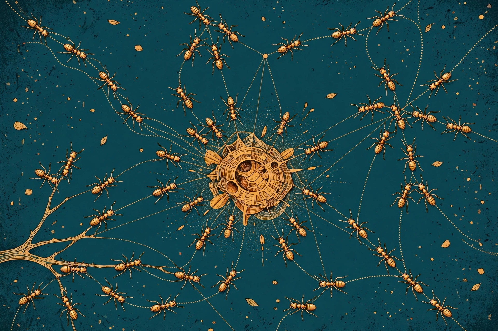

یک نظریهٔ آگاهی را نمی‌توان فقط با آزمایش‌های معمول آزمایشگاهی سنجید. سخت‌ترین داده‌ها از جاهایی آمده‌اند که سامانه از هم گسسته است: بیماری که می‌بیند اما نمی‌داند که می‌بیند؛ بیماری که نیمی از جهان برایش وجود ندارد و از این نبودن هم بی‌خبر است؛ ذهنی که پس از بریده‌شدن پل میان دو نیم‌کره، دو کانون نشان می‌دهد؛ بیماری که در بدن کاملاً فلج، ذهنی سالم دارد؛ و کلونی‌ای که هیچ عضوش نقشهٔ کل را ندارد اما مانند یک کل تصمیم می‌گیرد. این یادداشت آن داده‌ها را — با اولویتِ شگفت‌بودن و غیرمنتظره‌بودن — در شش خانواده گرد می‌آورد. ترتیب خانواده‌ها از «گسست درون یک ذهن» به «گسترش بیرون از یک مغز» است، و در پایان، همه در یک جدول قیدها خلاصه می‌شوند تا معلوم باشد هر نظریه دقیقاً چه چیزهایی را باید پوشش دهد.

@@TOC@@

## ۰ ـ نقشهٔ شش خانواده {#map}

| خانواده | پرسش محوری | نمونه‌های شاخص |
|---|---|---|
| ۱. گسست دسترسی و تجربه | آیا پردازش می‌تواند بدون تجربه باشد — و تجربه بدون دسترسی؟ | بینایی کور، غفلت فضایی، نابینایی تغییر |
| ۲. گسست وحدت و مالکیت | «من» چگونه چندپاره یا بی‌صاحب می‌شود؟ | مغز دوشقه، دست بیگانه، ناآگاهی از بیماری |
| ۳. دگرگونی حالت کلی | آگاهی چگونه کم و زیاد و خاموش و روشن می‌شود؟ | خواب و رؤیا، بیهوشی، کما و حالت نباتی، قفل‌شدگی، رؤیای شفاف |
| ۴. مرز مرگ | در آستانهٔ مرگ و بازگشت از آن چه گزارش می‌شود؟ | تجربهٔ نزدیک به مرگ (NDE)، شفافیت پایانی |
| ۵. دگرگونی محتوای تجربه | محتوای تجربه چگونه می‌تواند وارونه، افزوده یا حذف شود؟ | هم‌حسی، اندام خیالی، کاپگرا و کوتارد، ناتوانی تصویرسازی ذهنی |
| ۶. بیرون از مغز واحد | مرز سامانهٔ آگاه کجاست؟ | کلونی مورچه‌ها، هشت‌پا، کپک لجن |

سه درس کلی از همین نقشه بیرون می‌آید و در سراسر یادداشت تکرار می‌شود: نخست، **تجربه و رفتار قابل جدایی‌اند**؛ پس هیچ نظریه‌ای که فقط رفتار را توضیح دهد کافی نیست. دوم، **وحدت تجربه ساخته می‌شود و می‌تواند بشکند**؛ پس وحدت، داده نیست، مسئله است. سوم، **مرز سامانهٔ آگاه بدیهی نیست**؛ نه پوست، نه جمجمه و نه تعداد نورون، هیچ‌یک به‌تنهایی مرز را تعیین نمی‌کنند.

## ۱ ـ خانوادهٔ اول: گسست دسترسی و تجربه {#access}

### بینایی کور (Blindsight)

**مشاهده.** بیماری با آسیب قشر بینایی اولیه اصرار دارد که در بخشی از میدان دیدش هیچ نمی‌بیند؛ اما در آزمون حدس اجباری، مکان و جهت حرکت محرک را بسیار بالاتر از شانس درست می‌گوید. سامانهٔ بینایی او کار می‌کند و رفتار را هدایت می‌کند، اما تجربهٔ دیدن غایب است — دست‌کم به گزارش خود او.

**سند.** وایسکرانتز و همکاران (Weiskrantz et al.)، *Brain*، سال ۱۹۷۴، جلد ۹۷، صص. ۷۰۹–۷۲۸؛ و صورت‌بندی کتابی: وایسکرانتز، *Blindsight: A Case Study and Implications* (۱۹۸۶، Oxford University Press).

**قید نظری.** هر نظریه باید دو متغیر جدا داشته باشد: پردازشِ هدایت‌کنندهٔ رفتار، و تجربه. نظریه‌ای که این دو را یکی می‌گیرد، یا باید گزارش بیمار را انکار کند یا دادهٔ رفتاری را.

### غفلت فضایی یک‌طرفه (Hemispatial Neglect)

**مشاهده.** پس از سکتهٔ نیم‌کرهٔ راست، بیمار نیمهٔ چپ جهان را نه فقط نمی‌بیند، بلکه برایش *وجود ندارد*: نیمهٔ چپ بشقاب را نمی‌خورد، نیمهٔ چپ صورت را اصلاح نمی‌کند و وقتی از او خواسته می‌شود میدان مشهوری را از حافظه توصیف کند، فقط بناهای سمت راست را می‌گوید — و وقتی از سمت مقابل همان میدان توصیف می‌کند، بناهای قبلیِ «نیمهٔ چپ» ظاهر می‌شوند و قبلی‌ها ناپدید. جهان او نصف شده و خود او از نصف‌شدن بی‌خبر است.

**سند.** بیزیاک و لوتزاتی (Bisiach &amp; Luzzatti)، “Unilateral Neglect of Representational Space”، *Cortex*، سال ۱۹۷۸، جلد ۱۴، صص. ۱۲۹–۱۳۳.

**قید نظری.** تجربه فقط دریافت حسی نیست؛ بازنمایی فضاییِ درونی هم می‌تواند نیمه‌کاره باشد. و مهم‌تر: فقدان تجربه می‌تواند خودش تجربه نشود — «ندانستنِ ندیدن» داده‌ای است که هر نظریه‌ای دربارهٔ خودآگاهی باید جا برایش داشته باشد.

### نابینایی تغییر و نابینایی بی‌توجهی (Change / Inattentional Blindness)

**مشاهده.** در فیلم مشهور شمارش پاس‌های بسکتبال، حدود نیمی از بینندگان فردی با لباس گوریل را که وسط صحنه می‌آید و سینه‌اش را می‌کوبد اصلاً نمی‌بینند. در آزمایش‌های نابینایی تغییر نیز جابه‌جایی بزرگ اشیای صحنه، وقتی با برش یا چشمک هم‌زمان شود، دیده نمی‌شود؛ در حالی که بیننده مطمئن است صحنه را «کامل» می‌بیند.

**سند.** سایمونز و چابریس (Simons &amp; Chabris)، “Gorillas in Our Midst: Sustained Inattentional Blindness for Dynamic Events”، *Perception*، سال ۱۹۹۹، جلد ۲۸، صص. ۱۰۵۹–۱۰۷۴ ([پیوند مقاله](https://doi.org/10.1068/p2950)).

**قید نظری.** غنای احساس‌شدهٔ صحنهٔ دیداری با مقدار اطلاعاتی که واقعاً در دسترس است یکی نیست. هر نظریه باید میان «حسِ کامل‌دیدن» و «دسترسی واقعی» فرق بگذارد — همان شکافی که نزاع «سرریز» در یادداشت‌های ۲ و ۴ بر سرش است.

## ۲ ـ خانوادهٔ دوم: گسست وحدت و مالکیت {#unity}

### مغز دوشقه (Split-Brain)

**مشاهده.** در بیمارانی که برای کنترل صرع، جسم پینه‌ای — پل بزرگ میان دو نیم‌کره — بریده شده است، اطلاعاتی که فقط به نیم‌کرهٔ راست می‌رسد می‌تواند رفتار دست چپ را هدایت کند، در حالی که نیم‌کرهٔ چپِ سخن‌گو از آن بی‌خبر است و برای رفتار دست چپ دلیل می‌تراشد. دو نیمه، در برخی آزمون‌ها، مانند دو کانون جدا عمل می‌کنند که هر یک جهان را از یک چشم و با یک دست می‌شناسد.

**سند.** اسپری (Roger Sperry)، “Hemisphere Deconnection and Unity in Conscious Awareness”، *American Psychologist*، سال ۱۹۶۸، جلد ۲۳، صص. ۷۲۳–۷۳۳؛ و مرور گازانیگا (Michael Gazzaniga)، “Forty-Five Years of Split-Brain Research and Still Going Strong”، *Nature Reviews Neuroscience*، سال ۲۰۰۵، جلد ۶، صص. ۶۵۳–۶۵۹.

**قید نظری.** وحدت آگاهی به پیوند فیزیکی وابسته است و با بریدن آن پیوند می‌تواند دوپاره شود؛ پس «یک مغز، یک من» قانون طبیعت نیست، پیامد اتصال است. نظریه باید بگوید مرز «من» را چه چیزی تعیین می‌کند و چرا بریدن چند میلیون رشتهٔ عصبی آن مرز را جابه‌جا می‌کند.

### دست بیگانه (Alien Hand)

**مشاهده.** پس از آسیب جسم پینه‌ای یا قشر پیشانی میانی، یک دست بیمار کارهایی هدفمند می‌کند که بیمار آن‌ها را کار «خود» نمی‌داند: دکمه‌ای را که دست دیگر بسته باز می‌کند، اشیا را می‌گیرد و رها نمی‌کند؛ بیمار گاهی با دست سالم جلوی آن را می‌گیرد و از آن به ضمیر سوم‌شخص سخن می‌گوید.

**سند.** شپکوفسکی و کرونین ـ گلومب (Scepkowski &amp; Cronin-Golomb)، “The Alien Hand: Cases, Categorizations, and Anatomical Correlates”، *Neuropsychology Review*، سال ۲۰۰۳، جلد ۱۳، صص. ۲۱۹–۲۳۵.

**قید نظری.** «مالکیت» عمل و «عاملیت» تجربه‌هایی جدا از خود عمل‌اند و می‌توانند حذف شوند. نظریه باید برای حس مالکیتِ بدن و عمل، سازوکار جدا از سازوکار حرکت داشته باشد.

### ناآگاهی از بیماری (Anosognosia)

**مشاهده.** بیماری که نیمهٔ چپ بدنش کاملاً فلج است، فلج‌بودن را انکار می‌کند، برای تکان‌نخوردن دست دلیل می‌آورد («خسته است») و گاهی حتی پس از دیدن دست بی‌حرکت، انکار را نگه می‌دارد. این دروغ یا لجبازی نیست؛ نظام نظارت بر خود، همان‌جا که آسیب دیده، گزارش آسیب را هم از دست داده است.

**سند.** توصیف کلاسیک بابینسکی (Joseph Babinski)، سال ۱۹۱۴؛ و صورت‌بندی معاصر در ادبیات عصب‌روان‌شناسی آسیب نیم‌کرهٔ راست.

**قید نظری.** خودآگاهی بازتابی، لایه‌ای جدا و آسیب‌پذیر است: سامانه می‌تواند کار نکند *و* کارنکردنش را هم ثبت نکند. هر نظریه‌ای که «شفافیت ذهن برای خودش» را بدیهی بگیرد با این پدیده ناسازگار است.

## ۳ ـ خانوادهٔ سوم: دگرگونی حالت کلی {#states}

### خواب، رؤیا و رؤیای شفاف (Lucid Dreaming)

**مشاهده.** در خواب REM مغز تقریباً به اندازهٔ بیداری فعال است، ورودی حسی و خروجی حرکتی بسته‌اند و تجربه‌ای کامل — رؤیا — در جریان است: آگاهی بدون جهان بیرون. در رؤیای شفاف، خواب‌بیننده در میانهٔ رؤیا می‌فهمد که خواب است و می‌تواند با حرکات از پیش‌توافق‌شدهٔ چشم، از درون رؤیا به آزمایشگاه علامت بفرستد؛ و تحریک الکتریکی ملایم قشر پیشانی در باند گاما در پژوهش‌ها احتمال شفاف‌شدن رؤیا را بالا برده است.

**سند.** ووس و همکاران (Voss et al.)، “Lucid Dreaming: A State of Consciousness with Features of Both Waking and Non-Lucid Dreaming”، *Sleep*، سال ۲۰۰۹، جلد ۳۲، صص. ۱۱۹۱–۱۲۰۰؛ و ووس و همکاران، “Induction of Self Awareness in Dreams Through Frontal Low Current Stimulation of Gamma Activity”، *Nature Neuroscience*، سال ۲۰۱۴، جلد ۱۷، صص. ۸۱۰–۸۱۲ ([پیوند مقاله](https://doi.org/10.1038/nn.3719)).

**قید نظری.** تجربه به ورودی حسی وابسته نیست؛ مغز می‌تواند جهان کامل را از درون بسازد. و خودآگاهی بازتابی (دانستن این‌که در چه حالتی هستیم) لایه‌ای جدا از تجربهٔ پایه است که می‌تواند در میانهٔ همان تجربه روشن شود.

### راه‌رفتن در خواب و گسست‌های خواب (Parasomnias)

**مشاهده.** در خواب‌روی از خواب عمیقِ غیر REM، فرد می‌نشیند، راه می‌رود، گاهی کارهای پیچیده و هدفمند می‌کند، چشمانش باز است و به محرک‌ها تا حدی پاسخ می‌دهد؛ اما صبح هیچ خاطره‌ای ندارد و در لحظه، گزارش‌پذیری و داوری‌اش غایب است. مغز در این حالت به معنای تحت‌اللفظی «بخشی بیدار و بخشی خواب» است: نواحی حرکتی فعال و نواحی پیشانیِ ناظر در خواب عمیق.

**سند.** زادرا و همکاران (Zadra et al.)، “Somnambulism: Clinical Aspects and Pathophysiological Hypotheses”، *The Lancet Neurology*، سال ۲۰۱۳، جلد ۱۲، صص. ۲۸۵–۲۹۴.

**قید نظری.** «حالت آگاهی» یک کلید یکپارچهٔ مغز نیست؛ حالت‌ها می‌توانند موضعی و ترکیبی باشند. نظریه باید اجازه دهد بخش‌هایی از یک مغز در رژیم‌های متفاوت باشند و بگوید در چنین ترکیب‌هایی تجربه کجاست.

### بیهوشی عمومی (General Anesthesia)

**مشاهده.** داروهایی با سازوکارهای مولکولی متفاوت — از پروپوفول تا گازهای بیهوشی — همه به یک نتیجه می‌رسند: تجربه خاموش می‌شود، در حالی که مغز زنده است و حتی به محرک‌های ساده پاسخ می‌دهد. آنچه در بیهوشی فرو می‌پاشد، به گزارش پژوهش‌های تصویربرداری و EEG، بیش از فعالیت موضعی، ارتباط مؤثر و بازخورد میان نواحی است.

**سند.** آلکایر، هودتز و تونونی (Alkire, Hudetz &amp; Tononi)، “Consciousness and Anesthesia”، *Science*، سال ۲۰۰۸، جلد ۳۲۲، صص. ۸۷۶–۸۸۰ ([پیوند مقاله](https://doi.org/10.1126/science.1149211)).

**قید نظری.** خاموش‌شدن تجربه با خاموش‌شدن نورون‌ها یکی نیست؛ هر نظریه باید متغیری داشته باشد که در بیهوشی فرو می‌پاشد ولی در فعالیت موضعی باقی‌مانده حفظ نمی‌شود — و آن متغیر باید برای داروهای متفاوت یکسان عمل کند.

### کما، حالت نباتی و حالت کمینهٔ آگاهی (Disorders of Consciousness)

**مشاهده.** برخی بیمارانِ به‌ظاهر کاملاً بی‌پاسخ، وقتی در اسکنر از آن‌ها خواسته می‌شود بازی تنیس را تصور کنند، همان الگوی فعالیت حرکتیِ افراد سالم را نشان می‌دهند؛ و شماری از آنان با همین رمز — تصور تنیس برای «بله»، تصور خانه برای «نه» — به پرسش‌ها پاسخ درست داده‌اند. رفتار بیرونی، نبودِ آگاهی را ثابت نمی‌کند.

**سند.** اوون و همکاران (Owen et al.)، “Detecting Awareness in the Vegetative State”، *Science*، سال ۲۰۰۶، جلد ۳۱۳، ص. ۱۴۰۲ ([پیوند مقاله](https://doi.org/10.1126/science.1130197))؛ و مونتی و همکاران (Monti et al.)، “Willful Modulation of Brain Activity in Disorders of Consciousness”، *New England Journal of Medicine*، سال ۲۰۱۰، جلد ۳۶۲، صص. ۴۸۹–۴۹۶ ([پیوند مقاله](https://doi.org/10.1056/NEJMoa0905370)).

**قید نظری.** این خانواده مهم‌ترین قید اخلاقی ـ نظری فهرست را می‌گذارد: معیار آگاهی نمی‌تواند فقط رفتار باشد، چون رفتار به خروجی حرکتی وابسته است و تجربه شاید به آن وابسته نباشد. هر نظریه باید در اصل اجازه دهد آگاهیِ بی‌رفتار ممکن باشد و راهی — هر قدر دشوار — برای کشفش بدهد.

### سندرم قفل‌شدگی (Locked-in Syndrome)

**مشاهده.** پس از سکتهٔ پل مغزی، تقریباً همهٔ عضلات ارادی فلج می‌شوند و فقط حرکت عمودی چشم و پلک می‌ماند؛ ذهن، حافظه، شخصیت و تجربه سالم‌اند. مشهورترین سند آن کتابی است که با پلک‌زدن حرف‌به‌حرف دیکته شد.

**سند.** بودبی (Jean-Dominique Bauby)، *The Diving Bell and the Butterfly* (۱۹۹۷) — خاطرات خود بیمار، دیکته‌شده با پلک؛ و ادبیات بالینی سندرم قفل‌شدگی کلاسیک.

**قید نظری.** مکمل خانوادهٔ قبل از سمت دیگر: تقریباً صفرشدن خروجی رفتاری با کامل‌بودن تجربه سازگار است. هر معیار رفتاریِ آگاهی در این‌جا نمرهٔ صفر می‌دهد و خطاست.

## ۴ ـ خانوادهٔ چهارم: مرز مرگ {#death}

### تجربهٔ نزدیک به مرگ (Near-Death Experience — NDE)

**مشاهده.** بخشی از بازماندگان ایست قلبی، پس از بازگشت، روایتی ساخت‌یافته گزارش می‌کنند: احساس خروج از بدن، گذر از تونل، نور، دیدار درگذشتگان، مرور زندگی و آرامشی عمیق — در حالی که در همان بازه، فعالیت قشری سازمان‌یافته به معنای معمول در دسترس نبوده است. در مطالعهٔ آینده‌نگر هلندی، ۱۸ درصد از ۳۴۴ بازماندهٔ ایست قلبی چنین تجربه‌ای گزارش کردند و گزارش‌ها با مدت ایست یا داروها توضیح داده نشدند. در مطالعهٔ AWARE، از حدود دو هزار رویداد ایست قلبی، موارد اندکی از آگاهی و خاطرهٔ دورهٔ احیا به دست آمد و یک مورد، جزئیات شنیداریِ قابل تطبیق با رویدادهای واقعی احیا داشت. وضعیت سندی را باید دقیق گفت: گزارش‌ها واقعی و مستندند؛ تفسیرشان — از «فعالیت مغز در حال مرگ» تا خوانش‌های دیگر — مناقشه‌دار و حل‌نشده است و هیچ‌یک از دو سو حق ندارد داده را بیش از آنچه هست عرضه کند.

**سند.** فان لومل و همکاران (van Lommel et al.)، “Near-Death Experience in Survivors of Cardiac Arrest: A Prospective Study in the Netherlands”، *The Lancet*، سال ۲۰۰۱، جلد ۳۵۸، صص. ۲۰۳۹–۲۰۴۵ ([پیوند مقاله](https://doi.org/10.1016/S0140-6736(01)07100-8))؛ و پارنیا و همکاران (Parnia et al.)، “AWARE — Awareness During Resuscitation”، *Resuscitation*، سال ۲۰۱۴، جلد ۸۵، صص. ۱۷۹۹–۱۸۰۵ ([پیوند مقاله](https://doi.org/10.1016/j.resuscitation.2014.09.004)).

**قید نظری.** هر نظریه باید دست‌کم سه چیز را از هم جدا کند: زمانِ ساخته‌شدن تجربه (هنگام ایست؟ هنگام بازگشت جریان خون؟ هنگام به‌هوش‌آمدن؟)، زمانِ گزارش آن، و مبنای عصبی حداقلی لازم برای تجربهٔ ساخت‌یافته. نظریه‌ای که این سه را یکی بگیرد، در برابر این داده‌ها بی‌دفاع است؛ و نظریه‌ای که از این داده‌ها نتیجه‌های فراتر از سند بگیرد، از روش علمی بیرون رفته است.

### شفافیت پایانی (Terminal Lucidity)

**مشاهده.** در گزارش‌های بالینی متعدد، بیماران مبتلا به زوال عقل پیشرفته یا آسیب شدید مغزی که ماه‌ها یا سال‌ها ارتباط معناداری نداشته‌اند، اندکی پیش از مرگ برای دقایقی یا ساعت‌هایی به وضوحی غیرمنتظره برمی‌گردند: نزدیکان را می‌شناسند، منسجم سخن می‌گویند و سپس می‌میرند. پدیده در ادبیات پزشکی ثبت شده، اما هنوز مطالعهٔ آینده‌نگرِ نظام‌مند و سازوکار شناخته‌شده‌ای ندارد؛ وزنش در این فهرست «گزارش مستند، توضیح باز» است.

**سند.** نام و همکاران (Nahm et al.)، “Terminal Lucidity: A Review and a Case Collection”، *Archives of Gerontology and Geriatrics*، سال ۲۰۱۲، جلد ۵۵، صص. ۱۳۸–۱۴۲.

**قید نظری.** اگر وضوح ذهن فقط تابع مقدار بافت سالم بود، بازگشت ناگهانی آن در مغزی به‌شدت تخریب‌شده نباید رخ دهد. نظریه باید یا سازوکاری برای این بازگشت موقت داشته باشد یا صریحاً آن را در فهرست ناشناخته‌های خود نگه دارد.

## ۵ ـ خانوادهٔ پنجم: دگرگونی محتوای تجربه {#content}

### هم‌حسی (Synesthesia)

**مشاهده.** در هم‌حس‌ها، محرک یک حس به‌طور خودکار و پایدار تجربه‌ای در حسی دیگر می‌سازد: حروف رنگ ثابت دارند، صداها شکل می‌سازند. این رنگ‌ها «تداعی» نیستند؛ در آزمون‌های ادراکی مانند یافتن رقم در میان ارقام هم‌رنگ، مانند رنگ واقعی عمل می‌کنند و در طول عمر فرد ثابت می‌مانند.

**سند.** هابارد و راماچاندران (Hubbard &amp; Ramachandran)، “Neurocognitive Mechanisms of Synesthesia”، *Neuron*، سال ۲۰۰۵، جلد ۴۸، صص. ۵۵۰–۵۵۶ ([پیوند مقاله](https://doi.org/10.1016/j.neuron.2005.10.019)).

**قید نظری.** کیفیت‌های حسی به مسیرهای ثابت و جدا گره نخورده‌اند؛ نظریه باید بگوید «سرخی» دقیقاً به چه چیزی در سامانه وابسته است که می‌تواند به حرفی الفبایی هم بچسبد.

### اندام خیالی (Phantom Limb)

**مشاهده.** پس از قطع عضو، بیشتر بیماران اندام را همچنان حس می‌کنند: جایش، وضعیتش و گاهی درد شدیدش را — گاهی در اندامی که سال‌هاست نیست، و گاهی در اندامی که هرگز نبوده است (در نبود مادرزادی اندام نیز گزارش شده است). آینه‌درمانی، با نشان‌دادن تصویر آینه‌ای اندام سالم به جای اندام قطع‌شده، در برخی بیماران درد را کم می‌کند: تجربهٔ بدن با ورودی دیداری بازنویسی می‌شود.

**سند.** راماچاندران و هرستاین (Ramachandran &amp; Hirstein)، “The Perception of Phantom Limbs”، *Brain*، سال ۱۹۹۸، جلد ۱۲۱، صص. ۱۶۰۳–۱۶۳۰.

**قید نظری.** بدنِ تجربه‌شده یک مدل درونی است، نه خود بدن؛ مدل می‌تواند از بدن واقعی جدا شود و پافشاری کند. هر نظریه باید میان «بدن فیزیکی» و «بدنِ حاضر در تجربه» تمایز ساختاری داشته باشد.

### سندرم کاپگرا و هذیان کوتارد (Capgras / Cotard)

**مشاهده.** در کاپگرا، بیمار نزدیک‌ترین کسانش را می‌شناسد اما اصرار دارد آن‌ها بدل‌اند و جای شخص واقعی را گرفته‌اند؛ خوانش عصبی مشهور: مسیر شناسایی چهره سالم است، اما پاسخ هیجانیِ آشنایی قطع شده و ذهن برای این ترکیبِ «چهرهٔ آشنا بدون حس آشنایی» توضیح «بدل بودن» می‌سازد. در قطب مخالف، در کوتارد، بیمار باور دارد مرده است یا وجود ندارد — تجربهٔ «بودن» خودش موضوع هذیان می‌شود.

**سند.** الیس و یانگ (Ellis &amp; Young)، “Accounting for Delusional Misidentification”، *British Journal of Psychiatry*، سال ۱۹۹۰، جلد ۱۵۷، صص. ۲۳۹–۲۴۵؛ و بریوس و لوکه (Berrios &amp; Luque)، تحلیل تاریخی و بالینی سندرم کوتارد، *Acta Psychiatrica Scandinavica*، سال ۱۹۹۵.

**قید نظری.** باورهای بنیادین دربارهٔ هویت و وجود، از احساس‌های قابل حذف ساخته می‌شوند؛ «آشنایی» و «حس بودن» اجزای تجربه‌اند، نه داوری‌های عقلانیِ روی آن. نظریه باید برای این اجزای ظریف جا داشته باشد.

### ناتوانی تصویرسازی ذهنی (Aphantasia)

**مشاهده.** برخی افراد هیچ تصویر ذهنی‌ای ندارند: چهرهٔ نزدیکان را «نمی‌بینند» در ذهن، هرچند آن‌ها را بی‌درنگ می‌شناسند، رؤیا می‌بینند و حافظهٔ واقعی خوبی دارند. در قطب مقابل، تصویرسازیِ فوق‌شفاف (hyperphantasia) قرار دارد. تفاوت، در کارکرد روزمره تقریباً نامرئی است و فقط با پرسش مستقیم آشکار می‌شود.

**سند.** زیمن و همکاران (Zeman et al.)، “Lives Without Imagery — Congenital Aphantasia”، *Cortex*، سال ۲۰۱۵، جلد ۷۳، صص. ۳۷۸–۳۸۰ ([پیوند مقاله](https://doi.org/10.1016/j.cortex.2015.05.019)).

**قید نظری.** تجربهٔ ذهنی می‌تواند در یک کانال کامل حذف شود بی‌آن‌که شناختِ وابسته به آن کانال فروبپاشد؛ پس «تصویر ذهنی» با «دانستن» یکی نیست و نظریه باید هر دو را و رابطه‌شان را جدا نگه دارد.

### سندرم شارل بونه (Charles Bonnet Syndrome)

**مشاهده.** در افرادی که بینایی‌شان را از دست داده‌اند اما ذهن سالمی دارند، توهم‌های دیداری پیچیده و کاملاً شکل‌گرفته — چهره‌ها، آدم‌ها، منظره‌ها — ظاهر می‌شود، با این ویژگی که بیمار می‌داند واقعی نیستند. ورودی که قطع می‌شود، قشر بینایی محتوای خودش را آزاد می‌کند و «بینش» نسبت به غیرواقعی‌بودن آن سالم می‌ماند.

**سند.** ففیچه (ffytche)، “Visual Hallucinations and the Charles Bonnet Syndrome”، *Current Psychiatry Reports*، سال ۲۰۰۵، جلد ۷، صص. ۱۶۸–۱۷۹.

**قید نظری.** محتوای تجربه می‌تواند کاملاً درون‌زاد تولید شود و لایهٔ داوری دربارهٔ واقعی‌بودن آن جدا از لایهٔ تولید محتواست؛ تجربه و باور دربارهٔ تجربه دو چیزند.

### نابینایی انتخابیِ انتخاب (Choice Blindness)

**مشاهده.** آزمودنی میان دو چهره یکی را انتخاب می‌کند؛ با تردستی، کارتِ انتخاب‌نشده به او داده می‌شود و بیشتر آزمودنی‌ها متوجه جابه‌جایی نمی‌شوند و برای «انتخاب»ی که نکرده‌اند دلیل مفصل می‌آورند. دسترسی ذهن به دلیل‌های خودش، بسیار کمتر از آن است که از درون به نظر می‌رسد.

**سند.** یوهانسون و همکاران (Johansson et al.)، “Failure to Detect Mismatches Between Intention and Outcome in a Simple Decision Task”، *Science*، سال ۲۰۰۵، جلد ۳۱۰، صص. ۱۱۶–۱۱۹ ([پیوند مقاله](https://doi.org/10.1126/science.1111709)).

**قید نظری.** گزارش اول‌شخص دربارهٔ علت‌های تصمیم، دادهٔ خام نیست؛ ساخته می‌شود و می‌تواند ساختگی باشد. هر نظریه‌ای که بر گزارش کلامی تکیه دارد باید لایه‌ای برای این ساخته‌شدن داشته باشد.

## ۶ ـ خانوادهٔ ششم: بیرون از مغز واحد {#beyond}

### کلونی مورچه‌ها: هوش جمعی بدون نقشهٔ مرکزی

**مشاهده.** کلونی مورچه‌ها دما و رطوبت لانه را تنظیم می‌کند، میان منابع غذا کوتاه‌ترین مسیر را پیدا و با تغییر شرایط جابه‌جا می‌کند، کار را میان اعضا تقسیم و بر اساس نیاز بازتوزیع می‌کند و لانه‌هایی با معماری چندطبقه و تهویه می‌سازد — در حالی که هیچ مورچه‌ای نقشهٔ کل، فرمانده یا حتی بازنمایی‌ای از مسئلهٔ کلی ندارد. تصمیم‌ها از برهم‌کنش‌های موضعی و ردهای فرومونی برمی‌خیزند؛ حافظهٔ مسیر بهینه نه در هیچ مورچه، که در خود محیط و الگوی رفت‌وآمد نوشته می‌شود.

<figure><figcaption>حافظهٔ کلونی در محیط است: مسیر فرومونی هم رسانهٔ ارتباط است و هم حافظهٔ جمعی. تصویرسازی از یادداشت ۱ همین مجموعه.</figcaption></figure>

**سند.** گوردون (Deborah Gordon)، *Ant Encounters: Interaction Networks and Colony Behavior* (۲۰۱۰، Princeton University Press)؛ و هولدوبلر و ویلسون (Hölldobler &amp; Wilson)، *The Ants* (۱۹۹۰، Harvard University Press).

**قید نظری.** این خانواده مرز مسئله است: هوش جمعی کلونی مستند و انکارناپذیر است، اما آیا تجربه‌ای واحد برای «کلونی» وجود دارد؟ هر نظریه باید داوری روشن بدهد و هزینه‌اش را بپذیرد: اگر معیار فقط سازمان و یکپارچگی اطلاعات باشد، باید دربارهٔ سرعت و پهنای باند پیوندها هم حکم بدهد؛ و اگر معیار، داشتن مغز یا نورون باشد، باید بگوید این شرط از کجا آمده است. تعلیق داوری در این مورد یعنی تعریف هنوز دقیق نشده است.

### هشت‌پا: ذهنی که در بازوها پخش است

**مشاهده.** حدود دو سوم نورون‌های هشت‌پا در بازوهایش قرار دارد، نه در مغز مرکزی؛ بازوی جداشده تا مدتی به محرک‌ها پاسخ‌های سازمان‌یافته می‌دهد و هر بازو در چشیدن و گرفتن، استقلال پردازشی چشمگیری دارد. در عین حال رفتار کل حیوان یکپارچه، کنجکاو و یادگیرنده است و خوابش دوره‌هایی شبیه REM با تغییر رنگ و حرکت چشم دارد.

**سند.** هوخنر (Binyamin Hochner)، “An Embodied View of Octopus Neurobiology”، *Current Biology*، سال ۲۰۱۲، جلد ۲۲، صص. R887–R892؛ و گادفری ـ اسمیت (Peter Godfrey-Smith)، *Other Minds: The Octopus, the Sea, and the Deep Origins of Consciousness* (۲۰۱۶).

**قید نظری.** «مرکز» تجربه بدیهی نیست: سامانه‌ای با پردازش به‌شدت توزیع‌شده می‌تواند رفتار یکپارچه داشته باشد. نظریه باید بگوید وحدت تجربه در چنین معماری‌ای کجا و چگونه ساخته می‌شود — یا آیا اصلاً یک وحدت هست.

### کپک لجن: حل مسئله بدون حتی یک نورون (Slime Mold)

**مشاهده.** فیزاروم (Physarum polycephalum)، موجودی تک‌سلولی و چند‌هسته‌ای بی‌هیچ دستگاه عصبی، در هزارتو کوتاه‌ترین مسیر میان دو منبع غذا را پیدا می‌کند و شبکهٔ لوله‌هایش را به شبکه‌هایی کارآمد شبیه شبکه‌های حمل‌ونقل بازطراحی می‌کند. این «حل مسئله» از دینامیک جریان و بازخورد شیمیایی برمی‌خیزد، نه از بازنمایی.

**سند.** ناکاگاکی، یامادا و توت (Nakagaki, Yamada &amp; Tóth)، “Maze-Solving by an Amoeboid Organism”، *Nature*، سال ۲۰۰۰، جلد ۴۰۷، ص. ۴۷۰ ([پیوند مقاله](https://doi.org/10.1038/35035159)).

**قید نظری.** رفتار هوشمندانهٔ ظاهری، به‌تنهایی، هیچ حکمی دربارهٔ تجربه نمی‌دهد؛ این پدیده خط پایهٔ احتیاط است: هر نظریه باید بگوید چه چیزی افزون بر «حل مسئلهٔ توزیع‌شده» لازم است تا از هوش به تجربه برسیم — و آن چیز را در کلونی مورچه‌ها و هشت‌پا هم یکسان به کار ببرد.

## ۷ ـ جدول قیدها: صورت‌مسئلهٔ کامل {#table}

| پدیده | قیدی که بر هر نظریه می‌گذارد |
|---|---|
| بینایی کور | پردازشِ هدایت‌کنندهٔ رفتار از تجربه جداست |
| غفلت فضایی | بازنمایی درونی هم می‌تواند نصف شود؛ فقدان تجربه خودش تجربه نمی‌شود |
| نابینایی تغییر / بی‌توجهی | حسِ غنای صحنه با دسترسی واقعی یکی نیست |
| مغز دوشقه | وحدت «من» به اتصال وابسته است و می‌تواند دوپاره شود |
| دست بیگانه | مالکیت و عاملیت، اجزای جدای تجربه‌اند |
| ناآگاهی از بیماری | خودنظارتی لایه‌ای جدا و آسیب‌پذیر است |
| رؤیا و رؤیای شفاف | تجربه بدون ورودی ممکن است؛ خودآگاهی بازتابی لایه‌ای جدا دارد |
| خواب‌روی | حالت‌های آگاهی می‌توانند موضعی و ترکیبی باشند |
| بیهوشی | متغیر نظریه باید با فعالیت موضعی باقی‌مانده فروبپاشد |
| حالت نباتی / کمینهٔ آگاهی | آگاهیِ بی‌رفتار ممکن است؛ معیار صرفاً رفتاری کافی نیست |
| قفل‌شدگی | صفرشدن خروجی با کامل‌بودن تجربه سازگار است |
| NDE | زمان ساخت تجربه، زمان گزارش و مبنای عصبی حداقلی باید از هم جدا شوند |
| شفافیت پایانی | وضوح ذهن فقط تابع مقدار بافت سالم نیست (توضیح: باز) |
| هم‌حسی | کیفیت‌های حسی به مسیرهای ثابت گره نخورده‌اند |
| اندام خیالی | بدنِ تجربه‌شده مدل درونی است، نه خود بدن |
| کاپگرا / کوتارد | آشنایی و حس بودن، اجزای قابل حذف تجربه‌اند |
| ناتوانی تصویرسازی | تصویر ذهنی با دانستن یکی نیست |
| شارل بونه | تولید محتوا و داوری دربارهٔ واقعی‌بودنش دو لایه‌اند |
| نابینایی انتخاب | گزارش اول‌شخص از علت تصمیم ساخته می‌شود و می‌تواند ساختگی باشد |
| کلونی مورچه‌ها | نظریه باید دربارهٔ آگاهیِ کلِ توزیع‌شده داوری روشن و یکسان بدهد |
| هشت‌پا | وحدت تجربه در معماری توزیع‌شده باید توضیح داده شود |
| کپک لجن | حل مسئلهٔ توزیع‌شده به‌تنهایی نشانهٔ تجربه نیست |

این جدول، چک‌لیست داوری است: نظریه‌ای که برای هر سطر آن پاسخ روشن — پذیرش، رد با دلیل، یا تعلیقِ صریح — نداشته باشد، هنوز دربارهٔ آن سطر نظریه‌ای نداده است. و سطرهایی که در همهٔ نظریه‌های موجود پاسخشان تعلیق است — کلونی، شفافیت پایانی، زمان‌بندی NDE — دقیقاً همان جاهایی‌اند که دادهٔ تازه یا تمایز مفهومی تازه بیشترین ارزش را دارد.

## منابع این یادداشت {#sources}

<ul>
<li>Weiskrantz, L., Warrington, E. K., Sanders, M. D., &amp; Marshall, J. (1974). Visual Capacity in the Hemianopic Field Following a Restricted Occipital Ablation. Brain, 97, 709–728.</li>
<li>Bisiach, E., &amp; Luzzatti, C. (1978). Unilateral Neglect of Representational Space. Cortex, 14, 129–133.</li>
<li>Simons, D. J., &amp; Chabris, C. F. (1999). Gorillas in Our Midst. Perception, 28, 1059–1074. <a href="https://doi.org/10.1068/p2950">doi:10.1068/p2950</a></li>
<li>Sperry, R. W. (1968). Hemisphere Deconnection and Unity in Conscious Awareness. American Psychologist, 23, 723–733.</li>
<li>Voss, U., et al. (2014). Induction of Self Awareness in Dreams Through Frontal Low Current Stimulation of Gamma Activity. Nature Neuroscience, 17, 810–812. <a href="https://doi.org/10.1038/nn.3719">doi:10.1038/nn.3719</a></li>
<li>Alkire, M. T., Hudetz, A. G., &amp; Tononi, G. (2008). Consciousness and Anesthesia. Science, 322, 876–880. <a href="https://doi.org/10.1126/science.1149211">doi:10.1126/science.1149211</a></li>
<li>Owen, A. M., et al. (2006). Detecting Awareness in the Vegetative State. Science, 313, 1402. <a href="https://doi.org/10.1126/science.1130197">doi:10.1126/science.1130197</a></li>
<li>Monti, M. M., et al. (2010). Willful Modulation of Brain Activity in Disorders of Consciousness. New England Journal of Medicine, 362, 489–496. <a href="https://doi.org/10.1056/NEJMoa0905370">doi:10.1056/NEJMoa0905370</a></li>
<li>van Lommel, P., van Wees, R., Meyers, V., &amp; Elfferich, I. (2001). Near-Death Experience in Survivors of Cardiac Arrest. The Lancet, 358, 2039–2045. <a href="https://doi.org/10.1016/S0140-6736(01)07100-8">doi:10.1016/S0140-6736(01)07100-8</a></li>
<li>Parnia, S., et al. (2014). AWARE — Awareness During Resuscitation. Resuscitation, 85, 1799–1805. <a href="https://doi.org/10.1016/j.resuscitation.2014.09.004">doi:10.1016/j.resuscitation.2014.09.004</a></li>
<li>Nahm, M., Greyson, B., Kelly, E. W., &amp; Haraldsson, E. (2012). Terminal Lucidity: A Review and a Case Collection. Archives of Gerontology and Geriatrics, 55, 138–142.</li>
<li>Hubbard, E. M., &amp; Ramachandran, V. S. (2005). Neurocognitive Mechanisms of Synesthesia. Neuron, 48, 550–556. <a href="https://doi.org/10.1016/j.neuron.2005.10.019">doi:10.1016/j.neuron.2005.10.019</a></li>
<li>Ramachandran, V. S., &amp; Hirstein, W. (1998). The Perception of Phantom Limbs. Brain, 121, 1603–1630.</li>
<li>Zeman, A., Dewar, M., &amp; Della Sala, S. (2015). Lives Without Imagery — Congenital Aphantasia. Cortex, 73, 378–380. <a href="https://doi.org/10.1016/j.cortex.2015.05.019">doi:10.1016/j.cortex.2015.05.019</a></li>
<li>Johansson, P., Hall, L., Sikström, S., &amp; Olsson, A. (2005). Failure to Detect Mismatches Between Intention and Outcome in a Simple Decision Task. Science, 310, 116–119. <a href="https://doi.org/10.1126/science.1111709">doi:10.1126/science.1111709</a></li>
<li>Nakagaki, T., Yamada, H., &amp; Tóth, Á. (2000). Maze-Solving by an Amoeboid Organism. Nature, 407, 470. <a href="https://doi.org/10.1038/35035159">doi:10.1038/35035159</a></li>
<li>Gordon, D. M. (2010). Ant Encounters: Interaction Networks and Colony Behavior. Princeton University Press.</li>
<li>Godfrey-Smith, P. (2016). Other Minds. Farrar, Straus and Giroux.</li>
</ul>

