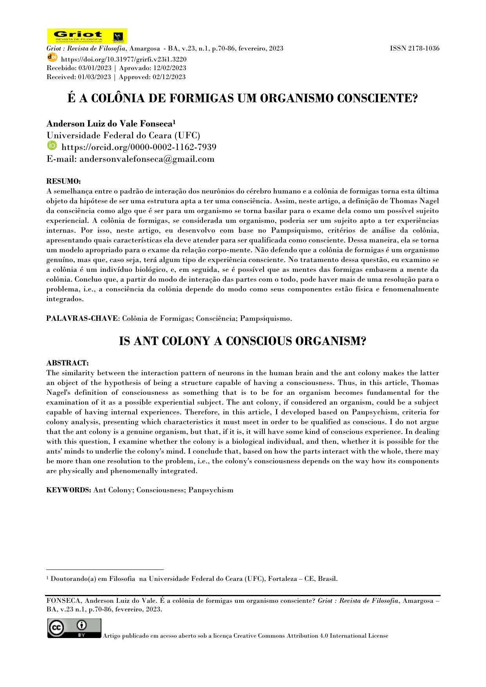
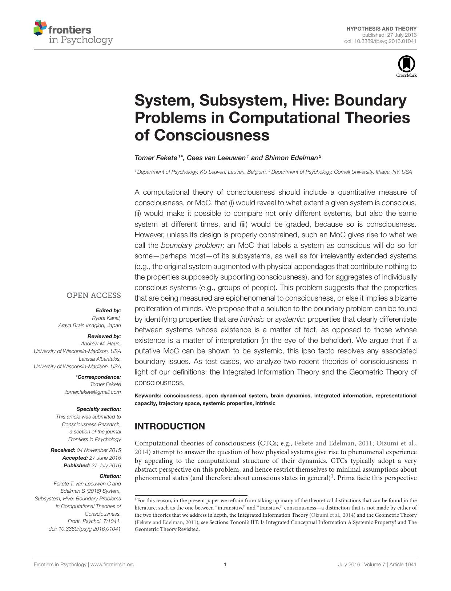
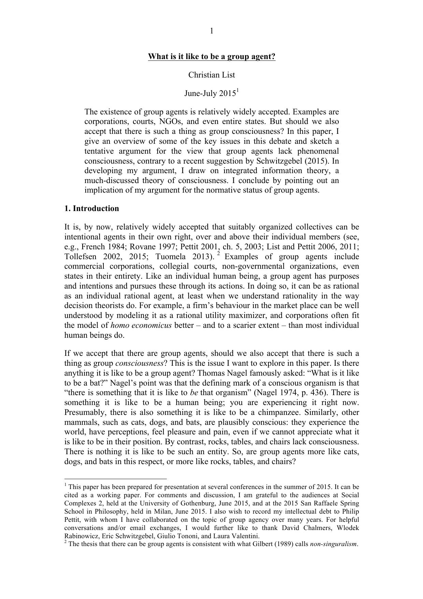

کلونی مورچه‌ها در یادداشت ۱، تصمیمِ سوم بود: با تعریفی که از «حضور» داده شد، کلونی آگاه است یا فقط هوشمند؟ آن تصمیم هنوز گرفته نشده است، چون خودِ «حضور وجودی» هنوز شفاف نیست. این یادداشت، آن تصمیم را از زاویهٔ ادبیات می‌سنجد: چه کسی، با نگاهی شبیه به «حضور» یا نزدیک به آن، دربارهٔ آگاهیِ کلونی یا موردی مشابه نظری داده است؟

پاسخِ کوتاهِ جست‌وجو این است: هیچ‌کس چارچوبِ «حضور» را — به‌معنای یادداشت ۱ — مستقیماً بر کلونی مورچه‌ها تطبیق نداده است. اما سه خانوادهٔ ادبیات، دقیقاً همین پرسش را با واژگانِ خودشان مطرح کرده‌اند: پان‌سایکیسمِ ترکیبی و مسئلهٔ ترکیب، بحثِ آگاهیِ گروهی، و کیهان‌روان‌شناسیِ صدری. نزدیک‌ترینِ آن‌ها به «حضور» سومی است، اما آن هم کلونی را بررسی نکرده است.

## ۱ پرسش دقیق

پرسش، نخست باید از هوش جدا شود. کلونی کوتاه‌ترین مسیر را می‌یابد، کار را تقسیم می‌کند و به تغییر محیط پاسخِ هماهنگ می‌دهد. توماس سیلی (Thomas D. Seeley) نشان داده است که انتخابِ لانهٔ جدید در زنبورِ عسل با همان سازوکارِ «انباشتِ رقابتی تا آستانه» انجام می‌شود که نورون‌ها در تصمیم‌گیریِ پستانداران به کار می‌برند؛ و دبورا گوردون (Deborah M. Gordon) با سی سال مشاهده نشان داده است که کلونی هیچ کنترلِ مرکزی ندارد و تخصیصِ کار از نرخ و ریتمِ تماس‌هایِ شاخکیِ مورچه‌ها بیرون می‌آید. این‌ها هوشِ جمعی‌اند — رفتار و کارکرد. آگاهی چیز دیگری است: حضور و ساختنِ یک «من».

پرسشِ دقیق، با معیارِ توماس نیگل (Thomas Nagel)، چنین است: آیا چیزی هست که «کلونی بودن» برای کلونی باشد؟ آیا برای کلونی، «بودنِ کلونی» حسی دارد؟ نیگل آگاهی را چنین تعریف کرده است: برای یک ارگانیسم، «چیزی بودن» (something it is like to be that organism).

تنها کسی که پرسش را با همین صورت‌بندی مطرح کرده است، اندرسون فونسکا (Anderson Fonseca) است (۲۰۲۳). او از تعریفِ نیگل و چهار اصلِ پان‌سایکیسمِ نیگل (۱۹۷۹) شروع می‌کند — ترکیبِ مادی، ضدِ تقلیل‌گرایی، واقع‌گرایی دربارهٔ حالت‌های ذهنی، و ضدِ ظهورِ قوی (anti-emergence)، یعنی ذهنِ کل از ذهنِ اجزا «به دست نمی‌آید» مگر آنکه ریشه در خاصیت‌های ذهنیِ اجزا داشته باشد — و سپس با نظریهٔ ارگانیسم‌بودنِ کوئلر و استراسمن می‌سنجد که آیا کلونی اصلاً ارگانیسم است یا نه. نتیجهٔ او دو بخش دارد: کلونی «ارگانیسمِ نامعیّن» (indeterminate organism) است، و آگاهیِ آن چهار پاسخِ ممکن دارد:

| پاسخ | صورت‌بندی | وضعیت |
|---|---|---|
| **R1** | هر مورچه موضوعِ تجربه است، کلونی نیست | باز |
| **R2** | هم مورچه‌ها و هم کلونی موضوعِ تجربه‌اند | باز |
| **R3** | کلونی موضوعِ تجربه است، اما هیچ مورچه‌ای نیست | ردشده با ایدهٔ پنجم |
| **R4** | کلونی موضوعِ تجربه است، اما تجربه‌اش ضعیف و مرزی است | حکم فونسکا |

حکمِ فونسکا **R4** است: آگاهیِ کلونی نه «آری» است نه «نه»؛ در ناحیهٔ خاکستریِ پدیدارشناسی است و «گفتنِ اینکه کلونی مورچه آگاهی دارد نادقیق است». دلیلش این است که پیوندِ پدیدارشناختیِ اجزا — ارتباطِ شیمیاییِ پراکندهٔ میان مورچه‌ها — ضعیف است. او تصریح می‌کند که پاسخِ نهایی به حلِ مسئلهٔ ترکیب بستگی دارد که «تا کنون حل‌نشده باقی مانده است».

<figure class="papershot"><figcaption>صفحهٔ نخست مقالهٔ فونسکا — Griot: Revista de Filosofia، ۲۰۲۳، ۲۳(۱)، صص. ۷۰–۸۶. متن اصلی پرتغالی است؛ نسخهٔ انگلیسی ترجمهٔ خودِ نویسنده است. برای گشودن مقاله، روی تصویر کلیک کنید.</figcaption></figure>

<Bio name="اندرسون لوئیز دو واله فونسکا (Anderson Luiz do Vale Fonseca)" role="فیلسوف — «آیا کلونی مورچه یک ارگانیسم آگاه است؟» (۲۰۲۳)">

<b>کیست و کجا کار کرده است؟</b> دکترای فلسفه در دانشگاه فدرال سئارا (Universidade Federal do Ceará)، فورتالزا، برزیل؛ مقالهٔ ۲۰۲۳ او در مجلهٔ گریو (Griot: Revista de Filosofia) منتشر شد.

<b>این ادعا دقیقاً از کدام متن است؟</b> Fonseca (2023), “Is the Ant Colony a Conscious Organism?”, Griot 23(1): 70–86. DOI: 10.31977/grirfi.v23i1.3220. متن اصلی پرتغالی است؛ نسخهٔ انگلیسی ترجمهٔ خودِ نویسنده است.

<b>پیش و پس از این مقاله.</b> پس از این مقاله، ویراستهٔ «کلونی‌های مورچه آگاه‌اند؟ ذهن‌های جمعی و پیامدهای فلسفیِ آن‌ها» (Are Ant Colonies Conscious? Collective Minds and Philosophical Implications، ۲۰۲۵، با سیکوسکی) را منتشر کرد — محتوای آن هنوز بررسی نشده است.

<b>نقدها و پاسخش.</b> حکمِ او (R4) به حلِ مسئلهٔ ترکیب وابسته است؛ خودِ او تصریح می‌کند که این مسئله «تا کنون حل‌نشده باقی مانده است».

<b>سرانجام و اکنون.</b> دربارهٔ زندگی و مسیر علمیِ او، جز مقاله‌ها و ویراستهٔ یادشده، اطلاعاتِ عمومیِ بیشتری در دست نیست.

</Bio>

## ۲ تعریف‌ها و تمایزها

پیش از استدلال، پنج تمایز باید روشن شود؛ این‌ها نامِ رسمیِ همان پرسش‌هایی‌اند که نامزدهای (الف) و (ج) در یادداشت ۱ می‌خواهند جواب بدهند.

**مسئلهٔ ترکیب** (combination problem). تجربه‌هایِ خردِ اجزا چگونه ترکیب می‌شوند تا تجربهٔ واحدِ کل را بسازند؟ دیوید چالمرز (David Chalmers) (۲۰۱۷) و لوک رولفس (Luke Roelofs) (۲۰۱۹) آن را صورتِ رسمیِ پرسشِ ما می‌دانند. رولفس ترکیب‌گرایی را این‌طور تعریف می‌کند: «خاصیت‌های تجربیِ کل گاهی صرفاً ترکیبِ خاصیت‌های تجربیِ موضوع‌هایِ سازنده‌اش هستند» — یعنی تجربهٔ کل هم **بر** تجربهٔ اجزا استوار است و هم **با** آن توضیح داده می‌شود.

**پیوندِ پدیدارشناختی** (phenomenal bonding). فیلیپ گاف (Philip Goff) (۲۰۱۷) راه‌حل را رابطه‌ای میانِ میدان‌های پدیدارشناختیِ جدا می‌داند که آن‌ها را به یک موضوعِ واحد می‌دوزد؛ و گاف و رولفس (۲۰۲۰) استدلال می‌کنند که «اشتراکِ پدیدارشناختیِ ضعیف» ممکن است: یک تجربه می‌تواند به دو موضوع تعلق بگیرد، وقتی آن دو موضوع هم‌پوشانی دارند — مانندِ دوقلوهایِ به‌هم‌چسبیده با پلِ تالاموسی، یا مورچه‌ها از راهِ ارتباطِ چندحسی. فونسکا معیارِ خود برای ترکیب را همین پیوند می‌داند: تجربه‌ها فقط وقتی ترکیب می‌شوند که میانِ موضوع‌ها «اشتراکِ ضعیف» ممکن باشد.

**مسئلهٔ مرز** (boundary problem). تومر فکته (Tomer Fekete) و همکاران (۲۰۱۶) می‌گویند هر نظریهٔ محاسباتیِ آگاهی که معیاری کمّی و درجه‌بندی‌شده بدهد، با این مسئله روبه‌رو می‌شود: همان معیار که یک سیستم را آگاه می‌خواند، بسیاری از زیرسیستم‌های آن، و نیز سیستم‌هایِ گسترش‌یافتهٔ بی‌ربط، و نیز تجمع‌هایِ سیستم‌هایِ آگاه (مثلِ گروهی از انسان‌ها، یا کندو) را هم آگاه می‌خواند. راه‌حلِ پیشنهادیِ آن‌ها: معیار باید «سیستمی» (systemic) باشد — یعنی سیستمی را نشان بدهد که وجودش «امرِ واقع» است، نه «تفسیرِ ناظر».

<figure class="papershot"><figcaption>صفحهٔ نخست مقالهٔ فکته و همکاران — Frontiers in Psychology، ۲۰۱۶، ۷: ۱۰۴۱. برای گشودن مقاله، روی تصویر کلیک کنید.</figcaption></figure>

**ابرارگانیسم** (superorganism). ویلیام مورتون ویلر (William Morton Wheeler) (۱۹۱۱) کلونی را ارگانیسم خواند: تقسیمِ کارِ کاست‌ها مانندِ تقسیمِ کارِ سلول‌ها و اندام‌هاست. هولدوبلر و ویلسون (۲۰۰۸) این را به نظریهٔ «ابرارگانیسم» رساندند: کلونی واحدِ انتخابِ طبیعی است، نه مورچهٔ تنها. کوئلر و استراسمن (۲۰۰۹) معیارِ تجربی دادند: ارگانیسم یعنی همکاریِ بالا و کنترلِ تعارضِ درونی. زیست‌شناسی «یک بدن بودنِ» کلونی را تأیید می‌کند، اما دربارهٔ «یک ذهن بودنِ» آن سکوت می‌کند.

**عاملیتِ گروهی در برابر آگاهیِ پدیدارشناختی.** کریستین لیست (Christian List) و فیلیپ پتیت (۲۰۱۱) می‌پذیرند که گروه‌هایِ سازمان‌یافته (شرکت، دادگاه، دولت) «عاملِ گروهی»‌اند — باور و میل و عملِ خودشان را دارند. اما لیست (۲۰۱۶) استدلال می‌کند که عاملِ گروهی **آگاهیِ پدیدارشناختی ندارد**. این تمایز، دقیقاً همان تمایزی است که یادداشت ۱ میانِ هوش و آگاهی می‌گذارد: عاملیت و یکپارچگیِ کارکردی، آگاهی نیست.

<Bio name="دیوید چالمرز (David Chalmers)" role="فیلسوف ذهن — «مسئلهٔ سخت» آگاهی">

<b>کیست و کجا کار کرده است؟</b> زادهٔ ۱۹۶۶ در سیدنی، استرالیا؛ ریاضیات در دانشگاه آدلاید، دکتری فلسفه در دانشگاه ایندیانا (۱۹۹۳، نزد داگلاس هافستتر)؛ استاد دانشگاه آریزونا، سپس دانشگاه ملی استرالیا، سپس دانشگاه نیویورک؛ مدیر مرکز ذهن، مغز و آگاهی در NYU.

<b>فضای ذهنی و باورهایش.</b> مسئلهٔ سخت (hard problem) در برابر مسئله‌های آسان؛ دوگانه‌انگاریِ طبیعی؛ پان‌سایکیسم به‌مثابهٔ یک گزینهٔ جدی.

<b>این ادعا دقیقاً از کدام متن است؟</b> “The Combination Problem for Panpsychism” (2017), in Goff (ed.), Panpsychism: Contemporary Perspectives, Oxford University Press.

<b>پیش و پس از این مقاله.</b> پیش از آن، «ذهنِ آگاه» (The Conscious Mind، ۱۹۹۶) مسئلهٔ سخت را صورت‌بندی کرد؛ پس از آن، مسئلهٔ ترکیب به یکی از محورهای اصلیِ بحثِ پان‌سایکیسم بدل شد.

<b>نقدها و پاسخش.</b> منتقدان می‌گویند ترکیب‌گرایی هنوز راه‌حلِ روشنی ندارد؛ فصلِ ۲۰۱۷ چالمرز دقیقاً همین دشواری را صورت‌بندی می‌کند.

<b>سرانجام و اکنون.</b> استاد دانشگاه نیویورک؛ از چهره‌های مرکزیِ فلسفهٔ ذهن معاصر.

</Bio>

<Bio name="تومر فکته (Tomer Fekete)" role="روان‌شناس و عصب‌پژوه — «مسئلهٔ مرز» (۲۰۱۶)">

<b>کیست و کجا کار کرده است؟</b> روان‌شناس و عصب‌پژوه؛ در ۲۰۱۶ در گروه روان‌شناسی دانشگاه کاتولیک لوون (KU Leuven) بلژیک کار می‌کرد؛ مقالهٔ «مسئلهٔ مرز» را با سس فان‌لیوون و شیمون ادلمن نوشت.

<b>فضای ذهنی و باورهایش.</b> نظریه‌های محاسباتیِ آگاهی و معیارِ کمّیِ آن‌ها؛ مسئلهٔ مرز: معیاری که یک سیستم را آگاه می‌خواند، زیرسیستم‌ها و تجمع‌های آن را هم آگاه می‌خواند.

<b>این ادعا دقیقاً از کدام متن است؟</b> Fekete, van Leeuwen &amp; Edelman (2016), “System, Subsystem, Hive: Boundary Problems in Computational Theories of Consciousness”, Frontiers in Psychology 7: 1041. DOI: 10.3389/fpsyg.2016.01041.

<b>پیش و پس از این مقاله.</b> این مقاله، مسئلهٔ مرز را از دلِ نظریه‌های محاسباتی بیرون کشید و آن را به‌مثابهٔ قیدی بر هر معیارِ کمّیِ آگاهی مطرح کرد؛ از جمله بر IIT.

<b>نقدها و پاسخش.</b> راه‌حلِ پیشنهادیِ آن‌ها، «سیستمی بودنِ» معیار است — وجودِ سیستم باید امرِ واقع باشد، نه تفسیرِ ناظر.

<b>سرانجام و اکنون.</b> دربارهٔ مسیرِ بعدیِ او، جز مقالهٔ یادشده، اطلاعاتِ عمومیِ بیشتری در دست نیست.

</Bio>

## ۳ استدلال: چهار پاسخ و پیوند

استدلالِ فونسکا در سه گام پیش می‌رود. گامِ نخست، معیار است: با تعریفِ نیگل و چهار اصلِ پان‌سایکیسمِ او، کلونی باید دو شرط را بگذراند — نخست ارگانیسم باشد، سپس تجربه‌های اجزایش چنان به هم پیوسته باشند که تجربهٔ کل را بسازند. گامِ دوم، آزمونِ ارگانیسم‌بودن است: با معیارِ کوئلر و استراسمن (همکاریِ بالا و کنترلِ تعارض)، کلونی شرایطِ ارگانیسم را دارد، اما چون مورچه‌ها در فضا پراکنده‌اند و به‌هم متصل نیستند — برخلاف سیفونوفور Physalia physalis یا آمیب D. discoideum در فازِ چندسلولی — میانِ «تجمع» و «فردیت» می‌ایستد. از دیدِ خودپویی (autopoiesis) هم ارگانیسم نیست، چون غشایِ نیمه‌تراوا ندارد. پس کلونی «ارگانیسمِ نامعیّن» است. گامِ سوم، آزمونِ پیوند است: مورچه‌ها از راهِ «ارتباطِ چندحسی» — فرومون، رقص، تماسِ شاخکی — چنین اشتراکی دارند، اما ضعیف. پس R4.

صحنهٔ ذهنیِ این استدلال، ردِ فرومون است: رشته‌ای شیمیایی که از مورچه‌ای به مورچهٔ دیگر می‌رسد و رفتارِ کل را هماهنگ می‌کند. این رشته، تصویرِ پیوندِ پدیدارشناختی است — نه یک سیمِ سخت، که یک اشتراکِ ضعیف: تجربه‌ای که به بیش از یک موضوع تعلق می‌گیرد، مانندِ دوقلوهایِ به‌هم‌چسبیده‌ای که پلِ تالاموسی دارند و یک تجربه را با هم دارند. صحنهٔ مقابل، «ذهنِ چینیِ» ند بلاک (Ned Block) است (۲۰۰۲): شهروندانِ چین که مغز را شبیه‌سازی می‌کنند، تجربهٔ واحد نمی‌سازند؛ چون میانِ تجربه‌هایشان هیچ پیوندی نیست. پس پرسشِ واقعی این است: ردِ فرومون، پیوند است یا فقط پیام؟

این‌جا است که چهار پاسخ، صورت‌بندیِ آماده‌ای برای تصمیمِ سومِ یادداشت ۱ می‌شوند — و ربطشان به نامزدهای (الف) و (ج) روشن است. **R2 صورتِ دقیقِ نامزد (ج) است** (ردّ در رابطه: تجربهٔ کل بر تجربهٔ اجزا استوار است) و **R1 صورتِ انکارِ (ج)**. **R3 همان چیزی است که ایدهٔ پنجم رد می‌کند** (ذهنِ کل از هیچِ اجزا پدید می‌آید)؛ فونسکا هم R3 را فقط به‌عنوان یک امکانِ منطقی ذکر می‌کند، نه حکمِ خود. و ادبیاتِ ترکیب نشان می‌دهد که **(ج) بدونِ (الف) ناتمام است**: اگر جزء هیچ تجربه‌ای نداشته باشد، «رابطه» چیزی برای ترکیب کردن ندارد؛ و **(الف) بدونِ (ج) هم ناتمام است**: تجربه‌هایِ جدا، خودبه‌خود یک «منِ» واحد نمی‌سازند. فونسکا هم به همین نتیجه می‌رسد: پاسخ به «کلونی آگاه است؟» بدونِ حلِ مسئلهٔ ترکیب ممکن نیست.

## ۴ اعتراض‌ها و پاسخ‌ها: دوئل لیست و شویتسگبل

قوی‌ترین «نه» و قوی‌ترین «آری» موجود دربارهٔ آگاهیِ گروهی، در دو مقالهٔ روبه‌روی هم ایستاده‌اند.

**لیست (۲۰۱۶): با IIT، گروه‌ها آگاه نیستند.** کریستین لیست می‌پذیرد که گروه‌هایِ سازمان‌یافته «عاملِ گروهی»‌اند، اما استدلال می‌کند که عاملِ گروهی آگاهیِ پدیدارشناختی ندارد، و استدلالش را بر IIT سوار می‌کند: نخست، **Φ گروه پایین است**، به سه دلیل — گروه به واحدهایِ نسبتاً خودکفا تجزیه‌پذیر است؛ حتی «واحدِ هدایت‌کنندهٔ» گروه (مثلِ هیئت‌مدیره) هم با جایگزینیِ تصادفیِ بخشی از آن، کارکردش را تا حدِ زیادی حفظ می‌کند؛ و بیشترِ پردازشِ اطلاعاتیِ گروه، پردازشِ افراد است، نه پیوندهایِ میانِ آن‌ها. پس Φ گروه حتی به Φ مغزِ یک موش هم نمی‌رسد. دوم، **اصلِ طرد** (exclusion): حتی اگر Φ گروه قابل‌توجه بود، آگاهی فقط در لایه‌ای هست که Φ در آن بیشینه است؛ و Φ در سطحِ فرد بیشینه است، نه در سطحِ گروه. پس آگاهیِ فرد، آگاهیِ گروه را «طرد» می‌کند.

<figure class="papershot"><figcaption>صفحهٔ نخست نسخهٔ کاریِ ۲۰۱۵ مقالهٔ لیست — نسخهٔ نهایی در Noûs، ۲۰۱۶. برای گشودن مقاله، روی تصویر کلیک کنید.</figcaption></figure>

**شویتسگبل (۲۰۱۵): اگر ماتریالیسم درست باشد، آمریکا احتمالاً آگاه است.** اریک شویتسگبل (Eric Schwitzgebel) استدلال می‌کند که اگر ماتریالیست باشیم و خرگوش را آگاه بدانیم، و اگر موجوداتِ بیگانهٔ بسیار متفاوت را هم آگاه بدانیم، دلیلی اصولی برای انکارِ آگاهیِ موجودیت‌هایِ گروهیِ پراکنده در فضا نداریم. آمریکا «یکپارچگیِ اطلاعاتیِ عظیم، خودپایشیِ هدفمند، و سابقهٔ طولانیِ پاسخِ پیچیده به محیط» دارد — یعنی همان خاصیت‌هایی که ماتریالیست‌ها نشانهٔ آگاهی می‌دانند. پس آمریکا «دست‌کم نامزدِ» داشتنِ حالت‌های روانیِ واقعی، از جمله آگاهی است. لیست این استدلال را می‌پذیرد که Φ آمریکا غیرِ صفر است، اما می‌گوید «لیوان بیشتر خالی است تا نیمه‌پر».

**پاسخ از زاویهٔ یادداشت ۱.** این دو مقاله با هم، دقیق‌ترین «آری و نه» موجود دربارهٔ آگاهیِ جمعی‌اند — و نکتهٔ آن‌ها برای این بحث این است: استدلالِ لیست **مشروط به IIT** است، یعنی به معنای دومِ حضور. اگر معیار فقط (۲) بود، حکم «کلونی آگاه نیست» بود. اما همین‌جا است که حضورِ وجودی باید از (۲) جدا شود: اگر حضورِ وجودی چیزی بیش از Φ است، باید توضیح بدهد که چرا طردِ IIT در موردِ کلونی کار نمی‌کند — یا بپذیرد که کار می‌کند و کلونی آگاه نیست. و شویتسگبل نشان می‌دهد که **انکارِ آگاهیِ گروهی هزینه دارد**: اگر معیار آن‌قدر گشاد باشد که خرگوش و بیگانه را بگیرد، کلونی را هم می‌گیرد. کلونیِ مورچه از آمریکایِ شویتسگبل یکپارچه‌تر است (خویشاوندیِ ژنتیکیِ بالا، ارتباطِ شیمیاییِ مستقیم، تقسیمِ کارِ فیزیولوژیک) — پس اگر آمریکا نامزدِ آگاهی است، کلونی نامزدِ قوی‌تری است.

**مورچهٔ تنها: آیا جزء اصلاً تجربه دارد؟** این، پشتوانهٔ تجربیِ نامزد (الف) است. اندرو بارون و کالین کلاین (Andrew B. Barron &amp; Colin Klein) (۲۰۱۶) استدلال می‌کنند که مغزِ میانیِ (midbrain) مهره‌داران — که تصویرِ یکپارچه و خودمحور از جهان می‌سازد — خاستگاهِ تجربهٔ ذهنیِ پایه است، و مغزِ حشرات (به‌ویژه کمپلکسِ مرکزی) کارکردی هم‌ارز دارد؛ پس حشرات «ممکن است ظرفیتِ تجربهٔ ذهنی داشته باشند». برایان کی (Brian Key) (۲۰۱۶) نقد می‌کند که قیاسِ کارکردی، دلیلِ تجربه نیست. لارس چیتکا (Lars Chittka) (۲۰۲۲) شواهدِ رفتاریِ زنبور را جمع می‌کند: شمارش، تشخیصِ چهرهٔ انسان، یادگیریِ ابزار با مشاهده، حالت‌هایِ شبه‌هیجانی، و «بازی» با توپ‌های چوبی؛ و نتیجه می‌گیرد که زنبورها «به احتمالِ زیاد» دارایِ ذهنِ درونی‌اند. بیانیهٔ نیویورک (۲۰۲۴) — با امضایِ ۳۹ پژوهشگر از جمله چالمرز، کخ، ست و گادفری‌اسمیت — می‌گوید «دست‌کم امکانِ واقعیِ» تجربهٔ آگاهانه در حشرات وجود دارد.

اما توجه: هیچ‌یک از این منابع دربارهٔ **کلونی** به‌مثابهٔ موضوعِ تجربه حرفی نمی‌زنند؛ آن‌ها دربارهٔ فردِ حشره‌اند. گذر از «مورچه آگاه است» به «کلونی آگاه است» همان گامی است که فونسکا بررسی می‌کند و لیست انکار می‌کند.

<Bio name="کریستین لیست (Christian List)" role="فیلسوف — عاملیت گروهی و آگاهی گروهی">

<b>کیست و کجا کار کرده است؟</b> استاد علوم سیاسی و فلسفه در مدرسهٔ اقتصاد لندن (London School of Economics)؛ کارش بر عاملیتِ گروهی، انتخاب اجتماعی و ارادهٔ آزاد است.

<b>این ادعا دقیقاً از کدام متن است؟</b> “What Is It Like to Be a Group Agent?”, Noûs (2016). DOI: 10.1111/nous.12162. متن کامل نسخهٔ کاری: personal.lse.ac.uk/list/PDF-files/GroupConsciousness.pdf

<b>پیش و پس از این مقاله.</b> پیش از آن، «عاملیت گروهی» (Group Agency، ۲۰۱۱، با فیلیپ پتیت) را نوشت؛ پس از آن، «چرا ارادهٔ آزاد واقعی است» (Why Free Will Is Real، ۲۰۱۹).

<b>نقدها و پاسخش.</b> شویتسگبل (۲۰۱۵) می‌گوید انکارِ آگاهیِ گروهی هزینه دارد؛ لیست می‌پذیرد که Φ آمریکا غیرِ صفر است، اما می‌گوید «لیوان بیشتر خالی است تا نیمه‌پر».

<b>سرانجام و اکنون.</b> استاد LSE؛ از مرجع‌های اصلیِ بحثِ عاملیتِ جمعی.

</Bio>

<Bio name="اریک شویتسگبل (Eric Schwitzgebel)" role="فیلسوف — «اگر ماتریالیسم درست باشد، آمریکا احتمالاً آگاه است» (۲۰۱۵)">

<b>کیست و کجا کار کرده است؟</b> استاد فلسفه در دانشگاه کالیفرنیا، ریورساید (University of California, Riverside)؛ کارش بر آگاهی، روان‌شناسیِ اخلاق و روان‌شناسیِ فلسفه است.

<b>این ادعا دقیقاً از کدام متن است؟</b> “If Materialism Is True, the United States Is Probably Conscious”, Philosophical Studies 172(7) (2015): 1697–1721. DOI: 10.1007/s11098-014-0387-8.

<b>پیش و پس از این مقاله.</b> پیش از آن، «سرگشتگی‌های آگاهی» (Perplexities of Consciousness، ۲۰۱۱)؛ پس از آن، «نظریهٔ آدم‌های بدقلق» (A Theory of Jerks، ۲۰۱۹).

<b>نقدها و پاسخش.</b> لیست (۲۰۱۶) با IIT پاسخ می‌دهد: Φ گروه پایین است و اصلِ طرد، آگاهیِ گروه را کنار می‌گذارد.

<b>سرانجام و اکنون.</b> استاد UC Riverside؛ از چهره‌های شناخته‌شدهٔ فلسفهٔ ذهن و روان‌شناسیِ تجربیِ فلسفه.

</Bio>

<Bio name="اندرو بارون و کالین کلاین (Andrew B. Barron &amp; Colin Klein)" role="عصب‌پژوه و فیلسوف — مغز حشرات و تجربهٔ ذهنی (۲۰۱۶)">

<b>کیست و کجا کار کرده است؟</b> بارون، عصب‌پژوهِ مغزِ حشرات در دانشگاه مک‌کواری (Macquarie University)، سیدنی؛ کلاین، فیلسوفِ ذهن و علوم اعصاب، در همان دانشگاه (۲۰۱۶).

<b>این ادعا دقیقاً از کدام متن است؟</b> Barron &amp; Klein (2016), “What Insects Can Tell Us About the Origins of Consciousness”, PNAS 113(18): 4900–4908. DOI: 10.1073/pnas.1520084113. و Klein &amp; Barron (2016), “Insects Have the Capacity for Subjective Experience”, Animal Sentience 1(9).

<b>پیش و پس از این مقاله.</b> پیش از آن، مغزِ میانیِ مهره‌داران به‌عنوانِ خاستگاهِ تجربهٔ پایه مطرح بود؛ پس از آن، چیتکا (۲۰۲۲) شواهدِ رفتاریِ زنبور را گرد آورد و بیانیهٔ نیویورک (۲۰۲۴) «امکانِ واقعیِ» تجربه در حشرات را تأیید کرد.

<b>نقدها و پاسخش.</b> برایان کی (۲۰۱۶) در PNAS نقد کرد که قیاسِ کارکردی، دلیلِ تجربه نیست. بحث همچنان باز است؛ بیانیهٔ نیویورک (۲۰۲۴) «امکانِ واقعیِ» تجربه در حشرات را تأیید می‌کند، نه قطعیتِ آن را.

<b>سرانجام و اکنون.</b> بحثِ آگاهیِ حشرات همچنان باز است؛ و همهٔ این ادبیات دربارهٔ فردِ حشره است، نه کلونی.

</Bio>

## ۵ کیهان‌روان‌شناسیِ صدری: مسئلهٔ ترکیب منحل می‌شود، نه حل

نزدیک‌ترین چیزی که در ادبیات به «حضورِ وجودی» به‌مثابهٔ نظریهٔ آگاهی وجود دارد، کیهان‌روان‌شناسیِ صدری است. سید علی حسینی، علی حقی و سید مرتضی حسینی شهرودی (۲۰۲۶) ملاصدرا را به زبانِ معاصرِ فلسفهٔ ذهن ترجمه می‌کنند و دو مدلِ صدری می‌سازند: **کیهان‌روان‌شناسیِ ترکیبیِ صدری** (constitutive cosmopsychism)، بر پایهٔ تشکیکِ وجود و اولویتِ کل — آگاهی در همهٔ مراتبِ وجود، به‌صورتِ درجه‌بندی‌شده هست؛ آگاهیِ انسان جهشِ ناگهانی نیست، بلکه مرحلهٔ تشدیدشدهٔ آگاهیِ آغازین است؛ و **کیهان‌روان‌شناسیِ وجودیِ صدری** (existence cosmopsychism)، بر پایهٔ وحدتِ وجود — یک وجودِ واحد که در همهٔ مظاهر حاضر است؛ تفاوتِ مظاهر فقط در ظرفیتِ «اظهار» است. نویسندگان می‌گویند این مدلِ دوم با موضعِ نهاییِ صدرا سازگارتر است و هم مسئلهٔ ترکیب را دور می‌زند و هم مسئلهٔ «تجزیه» (decombination: چگونه از کلِ واحد، کثرت بیرون می‌آید) را جواب می‌دهد.

نکتهٔ کلیدیِ آن‌ها این است: رشدِ آگاهی «گذر از غیاب به حضور نیست، بلکه گذر از اظهارِ ضمنی به اظهارِ صریح است» — یعنی دقیقاً همان چیزی که ایدهٔ پنجمِ یادداشت ۱ می‌گوید: هیچ خاصیتی از هیچ پدید نمی‌آید؛ ردّ آن باید از پیش بوده باشد. حیدری و رضازاده (۲۰۱۹) همین را «آگاهیِ فراگیر» می‌نامند: چون وجودْ واقعیتی واحد است که در همهٔ موجودات با مراتبِ مختلف جاری است، صفاتِ حقیقیِ آن (علم، قدرت، اراده، حیات) هم در همهٔ موجودات جاری‌اند. شیرواند و نیگوماتولینا (۲۰۲۵) نتیجهٔ اخلاقیِ همین اصل را می‌گیرند: شدتِ وجود یعنی شدتِ آگاهیِ وجودی، و ارزشِ اخلاقیِ هر موجود با همان شدت سنجیده می‌شود؛ پیوستاری از جماد تا انسان، بی‌هیچ شکافِ گسسته.

ربطِ این چارچوب به پرسشِ ما سه‌گانه است. برای **(الف)**: در این چارچوب، «حضورِ جزء به خود» نه یک فرضِ اضافی، که نتیجهٔ مستقیمِ تشکیکِ وجود است: هر موجود به اندازهٔ شدتِ وجودش، نزدِ خودش حاضر است؛ ردّ آگاهی در جزء، «درجهٔ ضعیفِ همان چیزی» است که در انسان شدید است. برای **(ج)**: مسئلهٔ ترکیب در این چارچوب «حل» نمی‌شود، بلکه **منحل** می‌شود: کل از ترکیبِ اجزا «ساخته» نمی‌شود؛ جزء و کل هر دو مظهرِ یک وجودند، با شدت‌هایِ متفاوت. پس پرسشِ «ذهنِ اجزا چگونه ذهنِ کل را می‌سازد؟» جای خود را به پرسشِ «یک وجودِ واحد چگونه در دو مرتبهٔ جزء و کل ظاهر می‌شود؟» می‌دهد. و برای **تصمیمِ سوم**: این چارچوب، نامزد (الف) را تقویت می‌کند و نامزد (ج) را بازتعریف می‌کند — رابطه، «اظهارِ» چیزی است که در جزء بود، نه «ساختنِ» چیزی که نبود.

اما یک حدّ روشن هست: **هیچ‌یک از این مقالات کلونیِ مورچه یا هوشِ جمعی را بررسی نکرده‌اند.** تطبیقِ این چارچوب بر کلونی، کارِ خودِ این یادداشت‌هاست، نه یافتهٔ آمادهٔ ادبیات. مقالهٔ دیگری با همین پروژه در ۲۰۲۶ در مجلهٔ «فلسفهٔ ذهن» دانشگاه زنجان منتشر شده است («کیهان‌روان‌شناسیِ ترکیبیِ صدری»)؛ نامِ نویسندگان در صفحهٔ مقاله دیده نشد.

<Bio name="سید علی حسینی (Seyyed Ali Hosseini)" role="پژوهشگر فلسفهٔ اسلامی — کیهان‌روان‌شناسیِ صدری (۲۰۲۶)">

<b>کیست و کجا کار کرده است؟</b> پژوهشگر فلسفهٔ اسلامی؛ مقالهٔ «کیهان‌روان‌شناسیِ وجودیِ صدری» (۲۰۲۶) را با علی حقی و سید مرتضی حسینی شهرودی در مجلهٔ حکمت معاصر (Contemporary Wisdom) نوشت.

<b>این ادعا دقیقاً از کدام متن است؟</b> Hosseini, Haghi &amp; Hosseini Shahrudi (2026), “Sadrian Existence Cosmopsychism: A Response to the Hard Problem of Consciousness”, Contemporary Wisdom 17(1): 69–104. DOI: 10.30465/cw.2026.51549.2098.

<b>فضای ذهنی و باورهایش.</b> ترجمهٔ ملاصدرا به زبانِ معاصرِ فلسفهٔ ذهن: تشکیکِ وجود و وحدتِ وجود به‌مثابهٔ پاسخ به مسئلهٔ سخت و مسئلهٔ ترکیب.

<b>نقدها و پاسخش.</b> این چارچوب هنوز بر کلونی یا هوشِ جمعی تطبیق داده نشده است؛ تطبیقِ آن بر کلونی، کارِ این یادداشت‌هاست، نه یافتهٔ آمادهٔ ادبیات.

<b>سرانجام و اکنون.</b> دربارهٔ زندگی و مسیر علمیِ او، جز مقالهٔ یادشده، اطلاعاتِ عمومیِ بیشتری در دست نیست.

</Bio>

## ۶ موردهای مرزی: «یک مغز = یک ذهن» می‌شکند

چهار مورد، مرزِ «منِ واحد» را از چهار سو می‌سنجند.

**اختاپوس: سوژگیِ نامتمرکز.** پیتر گادفری‌اسمیت (Peter Godfrey-Smith) (۲۰۱۶) می‌گوید دو سومِ نورون‌هایِ اختاپوس در بازوهایش‌اند، نه در مغزش؛ بازوها تا حدی خودمختارند، با این حال حیوان به‌سویِ هدف‌هایِ واحد عمل می‌کند. اختاپوس «ذهنیتِ نامتمرکز» (decentered subjectivity) دارد: نه یک «منِ» واحدِ کلاسیک، نه چند ذهنِ جدا. قید: اگر کلونی آگاه باشد، «منِ» آن لازم نیست شبیه «منِ» انسان باشد.

**لجن‌زار: هوشِ بدونِ مغز.** لجن‌زارِ Physarum polycephalum — یک سلولِ واحد، بدونِ نورون و بدونِ مغز — هزارتو را حل می‌کند، شبکهٔ حمل‌ونقل را بهینه می‌کند و حافظه دارد (ناکاگاکی و همکاران، ۲۰۰۰). قید: موردِ حدیِ هوشِ بدونِ مغز؛ نشان می‌دهد که «هوشِ جمعی» حتی به «جمع» هم نیاز ندارد. اما دربارهٔ آگاهیِ آن هیچ ادعایی در ادبیاتِ معتبر نیست — فقط هوشِ آن ثابت شده است. تمایزِ هوش/آگاهی در این مورد هم سر جایش است.

**دیکتیوستلیوم: آزمایشِ فکریِ نامزد (ج).** آمیبِ Dictyostelium discoideum میانِ زندگیِ انفرادی و زندگیِ اجتماعی جابه‌جا می‌شود و در فازِ تجمع، ارگانیسمِ چندسلولی می‌سازد (کوئلر و استراسمن، ۲۰۰۹). فونسکا از آن به‌مثابهٔ آزمایشِ فکری استفاده می‌کند: در مرحلهٔ تجمع، آگاهیِ «جمعیِ میانی» پدید می‌آید — میانِ آگاهیِ فرد و آگاهیِ واحد. قید: بهترین آزمایشِ فکریِ موجود برای نامزد (ج): همان اجزا، با همان تجربه‌ها، وقتی رابطه‌شان عوض می‌شود، «چیزِ» دیگری می‌شوند.

**کلونی و درخت: آزمونِ مرز.** اگر حضورِ وجودی درجه‌بندی‌شده است، مرزِ «یک وجود» کجاست؟ چرا کلونی یک «من» است اما «کلونی + درختِ کنارش» یک «من» نیست؟ این دقیقاً صورتِ رسمیِ پرسشِ «منِ کلونی کجاست؟» است — و معیارِ فکته این‌جا به کار می‌آید: پیوند باید «سیستمی» باشد، یعنی وجودِ کل، امرِ واقع باشد نه تفسیرِ ناظر. و آزمونِ دیگر: اگر دو کلونی با هم ادغام شوند، «من»‌ها هم ادغام می‌شوند یا یکی دیگری را می‌بلعد؟ این آزمون هنوز آزمایشی تجربی ندارد؛ آزمایشِ فکری است.

## ۷ چه چیزی حکم را مشخص می‌کند

حکمِ کلونی به سه چیز وابسته است. نخست، **معیارِ مرز از حضورِ وجودی**: چه پیوندی «یک وجود» می‌سازد و چه پیوندی نمی‌سازد — همان نقطه‌ای که فکته از نظریه‌های محاسباتی می‌خواهد و فونسکا آن را «مسئلهٔ مرز یا لانه‌گزینی» می‌نامد. تا وقتی حضورِ وجودی این معیار را ندهد، حکم دربارهٔ کلونی نامعیّن می‌ماند — همان نتیجهٔ R4 فونسکا. دوم، **معیارِ ترکیب**: چه پیوندی «پیوندِ پدیدارشناختی» می‌سازد — ردِ فرومون کافی است یا نه؟ سوم، **تصمیم میانِ (الف) و (ج)** در یادداشت ۱: اگر ردّ در خودِ جزء است، کلونیِ آگاه یعنی تشدیدِ خودحضوریِ مورچه‌ها؛ اگر ردّ فقط در رابطه است، کلونیِ آگاه یعنی چیزی که فقط در کل ظاهر می‌شود و در جزء نیست — و آن‌گاه باید با ایدهٔ پنجم کنار آمد.

و سه حدّ صادقانه، که این یادداشت بر آن‌ها ایستاده است: **هیچ مقاله‌ای** علمِ حضوری یا تشکیکِ وجودِ ملاصدرا را مستقیماً بر کلونیِ مورچه یا هوشِ جمعی تطبیق نداده است؛ **هیچ محاسبهٔ Φ برای یک کلونیِ واقعیِ مورچه** در ادبیاتِ IIT نیست — استدلالِ لیست کیفی است، نه محاسباتی؛ و **هیچ‌کس** معیارِ «حضور» به‌معنایِ یادداشت ۱ را برای حکم دربارهٔ کلونی پیشنهاد نکرده است — معیارهای موجود یا IIT-ای‌اند (Φ)، یا ارگانیسم‌بودن (کوئلر و استراسمن)، یا پیوندِ پدیدارشناختی (گاف/رولفس). یک پیش‌چاپِ ۲۰۲۵ (آرلانو، SEQUENTION and the Superorganism) ادعا می‌کند مسئلهٔ ترکیب را با هندسهٔ چهاربعدی «حل» کرده است، اما چارچوبِ آن تثبیت‌نشده و داوری‌نشده است؛ در این یادداشت به آن استناد نشده است. و جلدِ ویراستهٔ تازه‌ای هم هست که محتوایش بررسی نشد: فونسکا و سیکوسکی (ویراستاران) (۲۰۲۵)، Are Ant Colonies Conscious? Collective Minds and Philosophical Implications — برای پیگیریِ بعدی.

پس منوی تصمیمِ سومِ یادداشت ۱، اکنون روشن است: چهار پاسخِ فونسکا (R1 تا R4)، دو مسئلهٔ رسمی (ترکیب و مرز)، دوئلِ لیست و شویتسگبل، و چارچوبِ صدری که مسئلهٔ ترکیب را منحل می‌کند. قدمِ بعد، معیارِ مرز است: حضورِ وجودی باید بگوید چه پیوندی «سیستمی» است و چه پیوندی فقط «تفسیرِ ناظر» — و آن‌گاه است که می‌توان گفت کلونی آگاه است یا نه.

<footer><h2>منابع و ارجاع‌ها</h2><ol><li>Nagel, T. (1974). “What Is It Like to Be a Bat?” <i>The Philosophical Review</i>, 83(4), 435–450.</li><li>Nagel, T. (1979). “Panpsychism.” In <i>Mortal Questions</i>. Cambridge University Press.</li><li>Wheeler, W. M. (1911). “The Ant-Colony as an Organism.” <i>Journal of Morphology</i>, 22(2), 307–325.</li><li>Block, N. (2002). “Troubles with Functionalism.” In Chalmers (ed.), <i>Philosophy of Mind: Classical and Contemporary Readings</i>. Oxford University Press.</li><li>Rosenberg, G. (2004). <i>A Place for Consciousness</i>. Oxford University Press.</li><li>Hölldobler, B. &amp; Wilson, E. O. (2008). <i>The Superorganism: The Beauty, Elegance and Strangeness of Insect Societies</i>. W. W. Norton.</li><li>Queller, D. C. &amp; Strassman, J. E. (2009). “Beyond Society: The Evolution of Organismality.” <i>Philosophical Transactions of the Royal Society B</i>, 364, 3143–3155.</li><li>Seeley, T. D. (2010). <i>Honeybee Democracy</i>. Princeton University Press.</li><li>Gordon, D. M. (2010). <i>Ant Encounters: Interaction Networks and Colony Behavior</i>. Princeton University Press.</li><li>List, C. &amp; Pettit, P. (2011). <i>Group Agency: The Possibility, Design, and Status of Corporate Agents</i>. Oxford University Press.</li><li>Schwitzgebel, E. (2015). “If Materialism Is True, the United States Is Probably Conscious.” <i>Philosophical Studies</i>, 172(7), 1697–1721. <a href="https://doi.org/10.1007/s11098-014-0387-8">پیوند مقاله (DOI)</a></li><li>Barron, A. B. &amp; Klein, C. (2016). “What Insects Can Tell Us About the Origins of Consciousness.” <i>Proceedings of the National Academy of Sciences</i>, 113(18), 4900–4908. <a href="https://doi.org/10.1073/pnas.1520084113">پیوند مقاله (DOI)</a></li><li>Klein, C. &amp; Barron, A. B. (2016). “Insects Have the Capacity for Subjective Experience.” <i>Animal Sentience</i>, 1(9).</li><li>Key, B. (2016). “Insects Cannot Tell Us Anything About Subjective Experience or the Origin of Consciousness.” <i>PNAS</i>, 113(27), E3813. <a href="https://doi.org/10.1073/pnas.1606835113">پیوند مقاله (DOI)</a></li><li>Fekete, T., van Leeuwen, C. &amp; Edelman, S. (2016). “System, Subsystem, Hive: Boundary Problems in Computational Theories of Consciousness.” <i>Frontiers in Psychology</i>, 7, 1041. <a href="https://doi.org/10.3389/fpsyg.2016.01041">پیوند مقاله (DOI)</a></li><li>Godfrey-Smith, P. (2016). <i>Other Minds: The Octopus, the Sea, and the Deep Origins of Consciousness</i>. Farrar, Straus and Giroux.</li><li>List, C. (2016). “What Is It Like to Be a Group Agent?” <i>Noûs</i>. <a href="https://doi.org/10.1111/nous.12162">پیوند مقاله (DOI)</a> — <a href="https://personal.lse.ac.uk/list/PDF-files/GroupConsciousness.pdf">متن کامل نسخهٔ کاری</a></li><li>Chalmers, D. (2017). “The Combination Problem for Panpsychism.” In Goff (ed.), <i>Panpsychism: Contemporary Perspectives</i>. Oxford University Press.</li><li>Goff, P. (2017). <i>Consciousness and Fundamental Reality</i>. Oxford University Press.</li><li>Roelofs, L. (2019). <i>Combining Minds: How to Think about Composite Subjectivity</i>. Oxford University Press.</li><li>Heydari, K. &amp; Rezazade Judi, M. K. (2019). “The Universal Consciousness in Transcendental Theosophy and its Role in Interaction with Environment.” <i>Marifat-i Falsafi</i>, 16(2), 39–51. <a href="https://sid.ir/paper/123985/en">پیوند مقاله</a></li><li>Goff, P. &amp; Roelofs, L. (2020). “In Defence of Phenomenal Sharing.” In Seager (ed.), <i>The Routledge Handbook of Panpsychism</i>.</li><li>Nakagaki, T., Yamada, H. &amp; Tóth, Á. (2000). “Maze-Solving by an Amoeboid Organism.” <i>Nature</i>, 407, 470.</li><li>Chittka, L. (2022). <i>The Mind of a Bee</i>. Princeton University Press.</li><li>Fonseca, A. L. do Vale (2023). “Is the Ant Colony a Conscious Organism?” <i>Griot: Revista de Filosofia</i>, 23(1), 70–86. <a href="https://doi.org/10.31977/grirfi.v23i1.3220">پیوند مقاله (DOI)</a> — <a href="https://philarchive.org/archive/FONITA-2v1">نسخهٔ انگلیسی (PhilArchive)</a></li><li>Andrews, K., Birch, J., Sebo, J. &amp; Sims, T. (2024). “Background to the New York Declaration on Animal Consciousness.” Unveiled 19 April 2024, New York University.</li><li>Shiravand, M. &amp; Nigomatolina, R. (2025). “Redefining Knowledge and Expanding the Moral Circle: The Principle of the Intensity of Existence in Transcendent Theosophy…” <i>Journal of Comparative Theology</i>, 16(2), 59–68.</li><li>Hosseini, S. A., Haghi, A. &amp; Hosseini Shahrudi, S. M. (2026). “Sadrian Existence Cosmopsychism: A Response to the Hard Problem of Consciousness.” <i>Contemporary Wisdom</i>, 17(1), 69–104. <a href="https://doi.org/10.30465/cw.2026.51549.2098">پیوند مقاله (DOI)</a></li><li>“Sadrian Constitutive Cosmopsychism: A Response to the Hard Problem of Consciousness” (2026). <i>Philosophy of Mind</i> (Zanjan University). <a href="https://phm.znu.ac.ir/article_742199.html?lang=en">پیوند مقاله</a></li></ol>
تصویرِ سربرگِ این یادداشت، همان تصویرسازیِ کلونی در یادداشت ۱ است. تصویرهای صفحهٔ نخستِ مقالات، برشِ صفحهٔ اولِ نسخه‌های در دسترسِ آن مقالات‌اند.
</footer>
